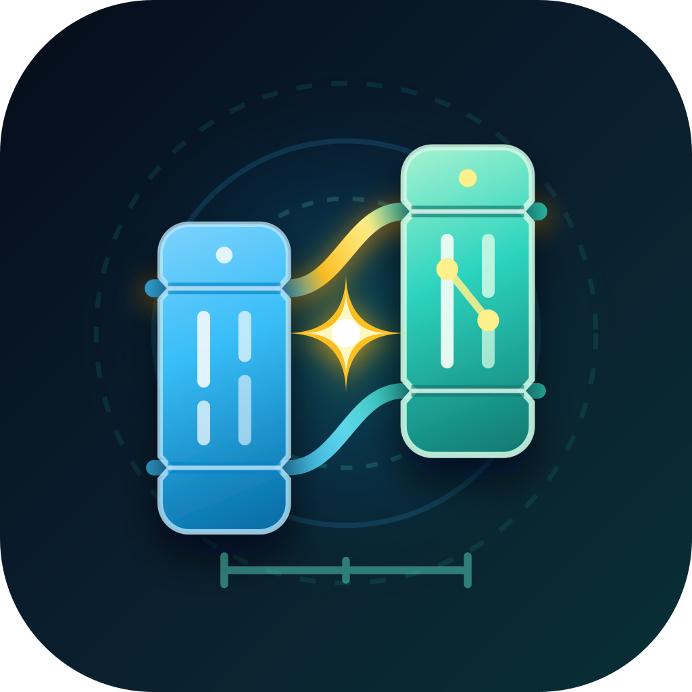

# 青简·咫尺 · OneMoreStep

v1.4.1 新增离线原因提示和本地 [连接诊断](docs/connection-diagnostics.md)，沿用 v2 配对，无需重新绑定。

> 当前开发分支的修复、升级要求与未实现能力见 **[实现边界与升级验收](docs/implementation-status.md)**。v1.4.0 加入 [安全传输 v2](docs/secure-transport-v2.md)，升级需重新配对；以下性能数字和硬件行为不代表已完成真机验证。


<p align="left">
  
</p>

> **青简载思，咫尺通达 (`One More Step`)** —— 打通 macOS 本地 AI Agent（**Codex、Antigravity、OpenCode、Claude Code**）与**小米 Android 手机（HyperOS / MIUI）**的全场景双向互操作与跨端协同底座。

---

## 目录

- [1. 项目背景与核心价值](#1-项目背景与核心价值)
- [2. 核心特性全景](#2-核心特性全景)
- [3. 系统架构与工程结构](#3-系统架构与工程结构)
- [4. 快速上手指南（3 分钟全无线配通）](#4-快速上手指南3-分钟全无线配通)
- [5. AI Agent 接入指南（MCP Server & 全局 Skill）](#5-ai-agent-接入指南mcp-server--全局-skill)
- [6. CLI 命令行工具 (`oms`) 全集](#6-cli-命令行工具-oms-全集)
- [7. 本地运行目录与数据规范 (`~/.one_more_step`)](#7-本地运行目录与数据规范-one_more_step)
- [8. 源码构建与测试](#8-源码构建与测试)
- [9. 设计文档库导航](#9-设计文档库导航)

---

## 1. 项目背景与核心价值

在使用 **Codex、Antigravity、OpenCode、Claude Code** 等本地 AI Agent 进行研发、写作与知识库治理时，电脑与 Android 手机之间长期存在三大断层：

1. **投递链路繁琐且割裂**：手机截屏、拍白板、刷到好文章想喂给电脑 AI，往往需要借道微信/钉钉「文件传输助手」，经历「发送 ➔ 电脑另存为 ➔ 复制路径 ➔ 粘贴给 AI」的 8~9 步操作，极易打断心流。
2. **网络隔离与常驻 VPN 阻断**：办公网 AP 隔离、户外无 Wi-Fi、或手机常驻代理软件（Clash / Sing-box 等占用 `VpnService` 槽位）时，传统局域网工具频频断连。
3. **AI 困在终端，缺乏移动端感知与执行力**：长耗时任务跑在电脑上时人不敢离开工位；电脑 AI 无法直接为你设定手机原生闹钟、检查手机日历冲突、主动拉取手机最新照片，更无法操作仅存在于手机 App 内的封闭功能。

**青简·咫尺 (`OneMoreStep`)** 为此提供了一套**零第三方 IM 依赖、零云端账号绑定、兼容常驻 VPN** 的原生跨端底座：
- **向上（面向 AI Agent）**：提供标准 **MCP Server（13 Tools + 3 Resources）**、统一 **CLI (`oms`)** 与 **全局 Skill**；
- **中间（自适应传输与在场感知）**：融合 **局域网 WebSocket + 蓝牙 BLE GATT + 可选 WSS 中继**，自动感知你是否在电脑旁（`AT_DESK` / `AWAY`）；
- **向下（面向小米 Android）**：基于原生 Kotlin + Jetpack Compose 深度适配小米 HyperOS/MIUI，兼具 **依赖系统权限的原生 API 执行器** 与 **带应用层安全检查的无障碍 GUI 自动化引擎**。

---

## 2. 核心特性全景

### 2.1 📱 ➔ 💻 免 IM 极速投递、离线语音转写与个人知识库联动
- **三指截屏秒传胶囊 (`ScreenshotPillController`)**：监听系统截屏事件，截屏瞬间右上角浮现半透明胶囊（3.5 秒无操作自动消隐）。点击 **`[🚀 发给 Mac AI]`** 1 秒直达 Mac 收件箱；按住 **`[🎙️ 附言]`** 可边发图边附加语音指令。
- **系统分享 3 大置顶入口 (`Direct Share`)**：在任意 App（浏览器、知乎、公众号、相册等）点击系统分享，首行置顶直达：
  - `📚 存入个人知识库`（带 `#pkb_vault` 标签，自动进入个人知识库暂存队列）
  - `🚀 发给 Mac Inbox`（带 `#default_inbox` 标签，自动复制文本到 Mac 剪贴板 / 自动弹出图片预览）
  - `🐛 发给 AI 修 Bug`（带 `#ui_bug` 标签，专供移动端 UI 走查与修复）
- **控制中心快捷磁贴 (`OmsQuickTileService`)**：
  - **单击磁贴**：通过 1×1 透明焦点窗口突破 Android 10+ 后台剪贴板读取限制，1 秒将手机剪贴板同步至 Mac；
  - **长按磁贴**：呼出「💡 我有一个想法」语音闪念框，说完即刻投递至 Mac `#voice_idea` 队列。
- **手机验证码锁屏实时同步 Mac (`OmsNotificationListenerService` + `OmsSmsBroadcastReceiver`)**：
  - 无需拿起并解锁手机，手机收到短信或微信/飞书/邮箱验证码瞬间，自动剔除尾号与金额干扰、提取 4~8 位纯验证码推送至 Mac 桌面通知，并将**纯数字验证码**自动写入 Mac 剪贴板（电脑网页直接 `⌘V` 粘贴）。
- **手机原生语音录制 + Mac SenseVoice 离线自动转写**：
  - 手机底部输入栏支持点击 **`🎙️语音`** 直接录制 `.m4a` 语音消息，Mac `omsd` 收到音频附件后自动调用本地 `local-asr`（SenseVoiceSmall 离线模型）转写为文字并自动写入 Mac 剪贴板（可直接 `⌘V`）。
- **Mac 实时收件箱与协同 Web 看板 (`/inbox`)**：内置深色主题本地 Web 控制台，支持图文流实时预览、手机全维遥测监控与远程快捷控制、一键在 Finder 定位文件、按标签/关键词过滤及反向推送消息。

### 2.2 💻 ➔ 📱 确定性系统能力、全维遥测与远程交互监工
- **原生系统闹钟 (`AlarmExecutor`)**：调用 `AlarmClock.ACTION_SET_ALARM` 配合小米后台弹出界面权限，静默在小米原生时钟创建闹钟，并附带 `AlarmManager.setAlarmClock()` 双重兜底。
- **系统日历防冲突读写 (`CalendarExecutor`)**：直接读写 `CalendarContract`，支持自动展开周期性重复日程（`Instances`）以供 AI 检查排期冲突，并支持写入带提前响铃提醒的新日程。
- **受权目录按需拉取 (`ScopedStorageExecutor`)**：严格遵循目录白名单（`screenshots`、`camera`、`download`），无需拿起手机，直接让电脑 AI 一键检索并拉取手机刚截的图（`oms pull latest-screenshot`）或刚拍的白板照（`oms pull latest-camera`）。
- **手机全维实时遥测与远程控制 (`phone_device_control`)**：
  - 实时读取手机电量/充电状态/电池温度/电压、屏幕亮灭与锁屏状态、当前前台应用中文名与包名、Wi-Fi SSID/信号强度/速率、四声道音量、RAM 与存储余量及权限健康度；
  - 支持从 Mac 一键**响铃找手机**（突破静音）、**远程抓屏回传**、**四声道音量调节**、**手机端直接打开网址或启动常用 App**（微信/飞书/钉钉/相机等）及执行系统级导航与锁屏。
- **L1~L3 分级通知与闹钟声道强制 TTS (`NotificationExecutor`)**：
  - `silent` (L1)：静默写入手机时间流；
  - `normal` (L2)：常规通知栏提醒（人在电脑旁 `AT_DESK` 时自动转为 Mac 桌面通知 + 手机静默入流）；
  - `urgent` (L3)：突破勿扰模式、锁屏全屏卡片亮屏 (`fullScreenIntent`)、强震动，并支持调用系统 `TextToSpeech` 走闹钟音频流（`STREAM_ALARM`）直接开口播报。
- **阻塞式远程交互审批 (`phone_request_approval`)**：当长耗时 Agent 遇到高风险操作（如数据库迁移、大范围重构）时，向手机推送带代码 Diff 摘要的紫色审批卡片，阻塞等待你在手机上点击 `[✅ 批准继续]` 或 `[❌ 拒绝并中止]`。
- **通勤 TTS 随身听**：支持将 Mac 上的研究报告、Markdown 总结一键推送到手机时间流，内置 Markdown 符号清洗与倍速（`1.2x`）中文语音朗读。

### 2.3 🤖 无障碍 GUI 屏幕自动化与四大安全护栏
针对没有开放 API 的第三方 App 场景，内置 `OmsAccessibilityService`：
- **三步语义剪枝树 (`SemanticTreeExtractor`)**：过滤冗余布局容器、聚合复合卡片文本，为可交互节点分配 `#1, #2` 短编号，单屏仅 `5~10 KB`，AI 无需看大图即可秒级定位。
- **零弹窗静默截屏与 Set-of-Mark 合成 (`ScreenCapturer`)**：基于 Android 11+ `takeScreenshot` API，自动在截图上绘制带 `#ID` 的红框视觉角标，赋能多模态视觉精准对齐。
- **四项应用层安全检查**：
  1. **顶部物理急停胶囊 (`SafetyStopOverlay`)**：AI 操控手机期间，屏幕顶部常驻橙色 `🤖 Mac AI 操作中 · 点击立即停止` 胶囊，点击后持久化停止状态并取消后续 GUI 动作，需在手机上显式恢复；已注入手势无法保证撤回；
  2. **用户触碰即让路**：通过 `TYPE_TOUCH_INTERACTION_START` 请求取消当前 GUI 动作；OEM 事件覆盖需真机验证，等待确认时允许触碰确认条；
  3. **金融与密码页黑名单**：按支付包名、活动名和密码字段拒绝操作；截图保留系统 secure-window 错误，不声称能识别所有 `FLAG_SECURE` 窗口；
  4. **敏感动作停顿确认 (`requireUserConfirm`)**：在执行「提交/发送/支付」等最后一步前，可在手机端弹出半透明确认框，由人工点按放行；没有浮层权限或超时则拒绝，放行后再次检查观察是否有效。

### 2.4 📡 三级自适应传输与蓝牙空间感知
- **三级无感热切换**：
  1. `Tier 1 · LAN_WS`：局域网 WebSocket 直连（吞吐量需实测），绑定底层物理网卡并内置 UDP 广播、ARP 邻居单播信标与子网自动发现；
  2. `Tier 2 · BT_RFCOMM`：历史枚举名；Mac 实际使用 `CoreBluetooth` BLE GATT，支持近场 IP 交换；MTU、背压与大文件传输仍需专项验证；
  3. `Tier 3 · WAN`：实际为可选 WebSocket 中继接入，尚未实现 WebRTC DataChannel/ICE/TURN，不占手机 `VpnService` 槽位。
- **空间在场引擎 (`PresenceEngine`)**：通过蓝牙 RSSI 滑动窗口与滞回滤波，自动识别 `AT_DESK`（在电脑前）与 `AWAY`（离开工位），实现「坐到电脑前自动同步晨报、离开工位自动将 AI 通知路由至手机」。
- **小米 HyperOS / MIUI 专属适配 (`XiaomiAdaptationHelper`)**：通过反射自检小米专属 AppOps 权限（`10021` 后台弹出界面、`10008` 锁屏显示），提供一键跳转设置向导。

### 2.5 🔐 一机一码与局域网严格 1 对 1 安全隔离
v1.4.0 将业务帧统一置于认证加密会话内；首次信任依赖安全传递完整配对链接。测试与部署进度、HTTP 安装页和 BLE/WAN 边界见 [安全传输 v2](docs/secure-transport-v2.md)：
- **加密握手与业务帧**：一次性 256 位 token 认证首次握手，临时 P-256 ECDH 与 HKDF 派生配对及会话密钥；长期密钥不在网络响应中下发。每次重连建立新的双向 AES-256-GCM 会话；密钥确认完成前不接受业务操作。旧配对记录必须重新配对，禁止回退明文。
- **手机端唯一 `macId` 强锁定**：一旦完成配对，手机端的 UDP 信标监听、局域网子网扫描与蓝牙近场发现仅接受 `macId == paired.macId` 的宿主设备；即使你自己的 Mac 休眠或离线，手机也绝不会自动连接或改绑到同一局域网内的其他电脑。
- **Mac 本地控制台回环隔离 (`127.0.0.1` Only)**：`/inbox` 实时看板与 `/api/inbox/*` 控制接口严格限制仅允许本机回环地址 (`127.0.0.1` / `::1`) 访问，同一局域网内的其他电脑访问一律返回 `403 Forbidden`，杜绝借道 Mac 操控手机。
- **配对凭据仅本地展示**：`oms pair` 生成 10 分钟有效、成功后单次消费的完整链接；`/pair/resolve` 不再返回凭据。手机保留完整链接输入，旧 6 位码入口关闭。

---

## 3. 系统架构与工程结构

### 3.1 架构拓扑图

```mermaid
flowchart TB
    subgraph MacHost["💻 macOS 宿主端 (TypeScript / Bun + Swift)"]
        Agents["本地 AI Agents<br/>(Codex / Antigravity / OpenCode / Claude Code)"]
        MCP["MCP Server (`oms mcp`)<br/>13 Tools + 3 Resources"]
        CLI["命令行工具 (`oms`)<br/>配对 / 收发 / 遥控 / 闹钟 / 日历 / GUI"]
        WebUI["本地 Web 控制台<br/>`/install` 无线安装台 · `/inbox` 实时看板"]
        Daemon["单例守护进程 (`omsd`)<br/>Unix Socket IPC · 在场路由 · 离线ASR · 审批挂起器"]
        Inbox["本地存储与收件箱 (`~/.one_more_step/`)<br/>`latest.json` · `pkb_pending.jsonl` · 密钥库"]
        BtBridge["原生蓝牙桥接 (`oms-bt-bridge`)<br/>Swift CoreBluetooth GATT + RSSI"]

        Agents <-->|stdio JSON-RPC| MCP
        Agents <-->|Bash / Skill| CLI
        MCP & CLI <-->|Unix Socket (`omsd.sock`)| Daemon
        Daemon <--> WebUI
        Daemon <--> Inbox
        Daemon <-->|Unix Socket (`bt.sock`)| BtBridge
    end

    subgraph Transport["📡 三级自适应传输层 (8-Byte P0/P2 多路复用帧协议 + Ed25519 鉴权)"]
        T1["Tier 1: LAN WebSocket (局域网高速直连 + UDP/ARP 自动发现)"]
        T2["Tier 2: BLE 信令 + Classic BT RFCOMM (零网络/绕过VPN)"]
        T3["Tier 3: WAN WSS 中继接入 (需部署)"]
    end

    subgraph XiaomiPhone["📱 小米 Android 客户端 (Kotlin + Jetpack Compose, MinSDK 30)"]
        FgService["核心前台服务 (`OmsCoreForegroundService`)<br/>连接状态机 · 离线重试队列 · 帧复用收发"]
        ShareSuite["免 IM 极速投递套件<br/>截屏悬浮胶囊 · 3大置顶分享 · 控制中心磁贴 · 原生录音"]
        SysCap["确定性系统能力与全维遥测<br/>原生闹钟 · 日历读写 · 受权文件 · 远程操控 · L1~L3通知/TTS"]
        GuiAgent["无障碍 GUI 自动化引擎 (`OmsAccessibilityService`)<br/>语义控件树 · 静默截屏(SoM) · 拟人手势 · 急停胶囊"]
        ComposeUI["Jetpack Compose 双向时间流<br/>远程审批卡片 · 通勤TTS随身听 · 智能OTA · 小米权限向导"]

        FgService <--> ShareSuite & SysCap & GuiAgent & ComposeUI
    end

    Daemon <--> T1 & T3
    BtBridge <--> T2
    T1 & T2 & T3 <--> FgService
```

### 3.2 Monorepo 目录结构与核心产物

```text
one_more_step/
├── package.json                  # Bun Workspace 根配置与快捷脚本
├── tsconfig.base.json            # TypeScript 基础编译配置
├── scripts/
│   └── setup.ts                  # 一键编译蓝牙桥、链接全局 `oms` 命令与安装全局 Skill
├── skills/
│   └── one-more-step/SKILL.md    # 面向 Codex / Antigravity / OpenCode 的仓库内置 Skill 模板
├── shared-protocol/              # [@oms/shared-protocol] 跨端协议与加密原语
│   ├── src/
│   │   ├── types.ts              # 双向 JSON-RPC 2.0 方法定义、遥测模型、意图标签、错误码
│   │   ├── framing.ts            # 8 字节二进制帧协议 (P0 控制信令 / P2 分块文件流多路复用)
│   │   └── crypto-pairing.ts     # Ed25519 密钥生成、挑战签名鉴权、UUIDv7、配对 URI
│   └── tests/protocol.test.ts    # 协议帧编解码、乱序抢占与加密签名单元测试
├── mac-host/                     # [@oms/mac-host] macOS 守护进程、MCP Server、CLI 与蓝牙桥
│   ├── bluetooth-bridge/         # [Swift] CoreBluetooth BLE Peripheral/Central 源码
│   ├── src/
│   │   ├── daemon/               # omsd 守护进程、Unix Socket IPC 服务端与客户端
│   │   ├── transport/            # 会话管理、UDP/ARP 自动发现、蓝牙桥客户端、RSSI 滞回滤波在场引擎
│   │   ├── inbox/                # 本地收件箱管理 (InboxManager) 与 Web 看板 (/inbox & /install)
│   │   ├── mcp/server.ts         # 标准 stdio MCP Server (13 Tools & 3 Resources)
│   │   ├── cli/index.ts          # oms 命令行工具全集
│   │   └── plugins/dingtalk.ts   # 可选钉钉自定义机器人 HMAC-SHA256 抄送插件
│   └── tests/                    # 传输层、在场状态机与 Daemon+MCP 端到端集成测试
├── android-app/                  # [com.oms.client] 小米 Android 原生客户端 (Kotlin + Compose)
│   └── app/src/main/java/com/oms/client/
│       ├── transport/            # 8 字节帧协议编解码与三级传输客户端 (OmsTransportClient)
│       ├── service/              # 常驻前台协同服务 (OmsCoreForegroundService)
│       ├── share/                # 截屏胶囊、Direct Share 接收器、磁贴服务、语音闪念、透明剪贴板捕获
│       ├── capability/           # 原生闹钟、系统日历、受权存储白名单、语音录制、分级通知与闹钟流 TTS
│       ├── agent/                # 无障碍服务、语义树剪枝提取、静默截屏 SoM 标注、顶部急停悬浮窗
│       ├── xiaomi/               # 小米 HyperOS / MIUI 专属权限反射自检与跳转工具
│       └── ui/                   # Jetpack Compose 主界面、双向时间流、远程审批卡片、智能 OTA 与通勤随身听
└── docs/                         # 完整立项评估、架构设计与模块规范文档库 (01 ~ 11)
```

| 核心构件 | 路径 / 获取方式 | 说明 |
| :--- | :--- | :--- |
| **Android 安装包 (APK)** | [GitHub Releases (`OneMoreStep-v1.3.7.apk`)](https://github.com/dqrcsc/one-more-step/releases/latest) 或 `bun run build:apk` | 原生 Kotlin + Jetpack Compose 客户端 |
| **macOS 蓝牙桥接器** | [`mac-host/bluetooth-bridge/main.swift`](./mac-host/bluetooth-bridge/main.swift) | 基于 Swift `CoreBluetooth` 的蓝牙近场通信助手（首次启动或 `bun run setup` 自动编译） |
| **Mac 守护进程 (`omsd`)** | [`mac-host/src/daemon/main.ts`](./mac-host/src/daemon/main.ts) | 管理多通道会话、本地收件箱、离线语音转写、Web 控制台与多 Agent IPC |
| **MCP Server (`oms mcp`)** | [`mac-host/src/mcp/server.ts`](./mac-host/src/mcp/server.ts) | 面向 AI Agent 暴露 13 个标准工具与 3 个动态资源 |
| **CLI 工具 (`oms`)** | [`mac-host/src/cli/index.ts`](./mac-host/src/cli/index.ts) | 终端一键配对、Web 看板、文件推拉、远程操控、系统能力与 GUI 自动化 |
| **全局 Agent Skill** | [`skills/one-more-step/SKILL.md`](./skills/one-more-step/SKILL.md) | 供本地 Agent 自动发现并调用手机协同能力的全局 Skill 模板 |

---

## 4. 快速上手指南（3 分钟全无线配通）

### 环境要求
- **macOS**：支持 Apple Silicon / Intel，已安装 [`Bun`](https://bun.sh/)（`>= 1.1.0`）。
- **手机端**：运行 Android 11+ (`MinSDK 30`) 的小米 / Redmi 手机（HyperOS 或 MIUI）。

### 第一步：初始化 Mac 宿主并启动无线配对台

无需寻找数据线，亦无需通过微信传安装包（避免 `.apk.1` 拦截），在项目根目录运行：

```bash
bun install
bun run setup
oms pair
```

终端将自动拉起后台守护进程 `omsd`，并输出无线安装台地址与配对凭证：

```text
==============================================================
🔗 OneMoreStep · 小米手机无线安装与绑定凭证 (10分钟内有效)
==============================================================
📲 【无数据线 APK 下载页】(仅提供安装，不提供配对凭据):
   👉 http://192.168.x.x:19527/install

📬 【Mac 实时收件箱看板】(电脑浏览器打开):
   👉 http://127.0.0.1:19527/inbox

🔐 安全 v2：通过自己控制的可信途径将完整 URI 输入手机。
🌐 本机局域网地址:   192.168.x.x : 19527
🔑 完整配对 URI:
   oms://pair?v=2&id=mac_...
==============================================================
```

- **方式 A（推荐 · 手机浏览器无线直装）**：
  1. 确保手机与 Mac 处于同一 Wi-Fi（若手机开着 VPN，请开启「绕过局域网」或暂停 VPN 10 秒）；
  2. 用手机浏览器访问终端显示的 `http://192.168.x.x:19527/install`；
  3. 点击页面上的 **`[📥 点击下载 OneMoreStep.apk]`** 完成安装（若本地未编译 APK，将自动引导下载最新 GitHub Release 安装包）。
- **方式 B（备选 · 通过有线/无线 ADB 安装）**：
  > 通过 ADB 安装的 APK 会被系统直接视为受信任应用，**可自动免除 Android 13/14/15 开启无障碍服务时的「受限制的设置」解锁步骤**：
  ```bash
  adb install -r android-app/app/build/outputs/apk/debug/app-debug.apk
  ```

### 第二步：首次信任绑定与常驻 VPN 分流

1. 打开手机上的 **「青简·咫尺 (`OneMoreStep`)」**，在顶部 **「🔐 1 对 1 安全绑定与重连」** 输入框中粘贴 Mac 本地显示的完整 `oms://pair?v=2&...` 链接（通过可信途径获取，不经旧 OMS 明文推送或 HTTP 页面），点击 **`[🔐 验证并绑定]`**。
2. 状态栏变为 **`🟢 局域网高速直连 (Tier 1)`** 在两端均为 v1.4.0 时代表 v2 加密会话已建立（此后即使在同一局域网有其他电脑运行同款服务，手机也只认你绑定的这台 Mac）。
3. **常驻 VPN 用户必配**：打开手机上的代理软件（Clash Meta / Sing-box / NekoBox 等），进入「分应用代理（Per-App Proxy）」，勾选 **`青简·咫尺 (OneMoreStep)` 绕过代理 / 直连**。

### 第三步：一键开启小米 HyperOS / MIUI 专属权限

点击手机 App 右上角的 **`[小米权限]`** 按钮，按向导依次开启以下权限以解锁全部能力：

| 权限项 | 作用说明 |
| :--- | :--- |
| **1. 后台弹出界面 & 锁屏显示** | 跳转到小米专属权限页设为「始终允许」，确保 AI 能在后台静默设定小米原生闹钟、控制中心秒读剪贴板及弹出锁屏强提醒。 |
| **2. 省电策略设为「无限制」** | 防止手机锁屏后后台协同通道被小米系统冻结。 |
| **3. 悬浮窗权限** | 用于截屏后右上角浮现 3.5 秒「🚀 发给 Mac AI」胶囊，以及 AI 操控屏幕时的顶部橙色急停胶囊。 |
| **4. 无障碍服务** | 开启「OneMoreStep 屏幕协同助手」，赋予 AI 提取屏幕紧凑语义树、静默截屏与自动化手势能力。（注：若浏览器安装提示“受限制的设置”，先到 `设置 ➔ 应用管理 ➔ 青简·咫尺 ➔ 右上角 ⋮ ➔ 允许受限制的设置` 解锁即可）。 |

---

## 5. AI Agent 接入指南（MCP Server & 全局 Skill）

### 5.1 全局 Skill 自动安装

运行 `bun run setup` 会自动将 [`skills/one-more-step/SKILL.md`](./skills/one-more-step/SKILL.md) 渲染并安装至 `~/.codex/skills/one-more-step/SKILL.md`，并将全局 CLI 链接至 `~/.local/bin/oms`。支持全局 Skill 发现的 Agent（Codex、Antigravity、OpenCode 等）开箱即用。

### 5.2 挂载标准 MCP Server

在 **Antigravity、Codex、Claude Code、OpenCode** 等客户端的 MCP 配置文件中添加：

```json
{
  "mcpServers": {
    "one-more-step": {
      "command": "bun",
      "args": [
        "run",
        "/path/to/one_more_step/mac-host/src/mcp/server.ts"
      ]
    }
  }
}
```

### 5.3 13 个标准 MCP Tools 一览

| 类别 | Tool 名称 | 核心功能与典型使用场景 |
| :--- | :--- | :--- |
| **收件箱与文件流转** | `phone_inbox_latest` | 获取刚从手机投递到 Mac 的最新图文、截图、链接或语音闪念，支持按标签（`default_inbox` / `pkb_vault` / `voice_idea` / `ui_bug`）过滤。 |
| | `phone_media_recent` | 主动列出手机相册或截图目录中最近生成的 N 个媒体文件元数据（无需用户在手机上手动发送）。 |
| | `phone_file_pull` | 将手机受权目录（`screenshots` / `camera` / `download`）中的指定图片或文档拉取到 Mac 本地并返回绝对路径。 |
| | `phone_file_push` | 将 Mac 上的 Markdown 总结、代码报告或文件推送到手机时间流，支持开启 `enableCommuteTts` 通勤随身听语音朗读。 |
| | `phone_clipboard_sync` | 读取小米手机当前剪贴板内容（含可选近期白名单验证码提取），或将 Mac 生成的文本直接写入手机剪贴板。 |
| **主动式助理与远程审批** | `phone_alarm_set` | 在小米手机原生系统时钟 App 中静默创建闹钟（支持设置重复周期与备注标签）。 |
| | `phone_calendar_manage` | 查询手机系统日历日程（自动展开重复会议以防排期冲突），或直接向手机日历写入带提前响铃提醒的新日程。 |
| | `phone_notify` | 发送分级通知：`silent`（静默入流）、`normal`（常规通知）、`urgent`（突破勿扰+锁屏全屏高亮+闹钟声道强制 TTS 语音播报）。 |
| | `phone_request_approval` | 长耗时任务遇到高风险操作或关键分叉时，向手机推送含代码 Diff 摘要的交互式审批卡片，阻塞等待用户点击决策后返回。 |
| **在场遥测与远程操控** | `phone_presence_status` | 查询用户当前是否在电脑旁（`AT_DESK` / `AWAY`）、当前激活的传输通道、电池电量/温度、前台应用、Wi-Fi 信号、音量、存储/内存余量及小米权限健康度。 |
| | `phone_device_control` | 远程操控小米手机系统能力：响铃找手机 (`find_phone`)、TTS 语音播报 (`tts_speak`/`stop_tts`)、调节音量 (`set_volume`)、远程抓屏入收件箱 (`take_screenshot`)、打开网址 (`open_url`)、启动常用 App (`launch_app`) 或执行系统按键 (`home`/`back`/`lock_screen`)。 |
| **GUI 屏幕自动化** | `phone_gui_observe` | 获取手机当前前台 App 的精简无障碍语义控件树（每个元素带 `#1, #2` 短编号），可选附带静默截屏或 Set-of-Mark (`#ID`) 标注截图。 |
| | `phone_gui_action` | 执行无障碍 GUI 自动化操作（按 `#ID` 或坐标点击、长按、输入文本、滚动、滑动、启动 App/URL、返回/桌面键），支持 `requireUserConfirm` 敏感操作停顿确认。 |

### 5.4 3 个 MCP Resources 一览

| Resource URI | 名称 | 说明 |
| :--- | :--- | :--- |
| `oms://inbox/latest` | Latest Mobile Submission | 最新一条从小米手机投递到 Mac 的图文/闪念元数据与本地文件路径 |
| `oms://inbox/pkb_pending` | Pending PKB Submissions | 待归入个人知识库 (`pkb_vault` / `voice_idea`) 的手机未处理投递队列 |
| `oms://phone/status` | Xiaomi Phone Presence & Status | 手机在场状态 (`AT_DESK` / `AWAY`)、传输通道层级与小米权限状态快照 |

---

## 6. CLI 命令行工具 (`oms`) 全集

执行 `bun run setup` 后，全局可执行命令 `oms` 将自动链接至 `~/.local/bin/oms`。除了通过 MCP 供 AI 调用外，你或 AI Agent 可以在**任意工作目录**直接运行 `oms <command>`（在项目根目录下亦可使用 `bun run oms <command>`）执行所有跨端操作：

```bash
# ──────────────── 1. 配对、全维状态、远程控制与 Web 看板 ────────────────
# 在 Mac 本地生成安全 v2 配对 URI；/install 仅提供 APK 下载
oms pair

# 在 Mac 浏览器打开实时收件箱与双向时间流 Web 看板 (http://127.0.0.1:19527/inbox)
oms web

# 查看手机在场状态 (AT_DESK / AWAY)、传输通道、电池温度、前台应用、网络与权限状态 (--live 强制实时刷新)
oms status --live

# 远程操控手机：响铃找手机 / TTS 开口说话 / 调节音量 / 远程截屏回传 / 打开网址或 App / 锁屏
oms phone find --text "正在寻找手机，我在这里！"
oms phone say "构建与测试已全部通过" --alarm
oms phone volume 60 --stream music
oms phone screenshot
oms phone open "https://github.com/dqrcsc/one-more-step"
oms phone launch wechat
oms phone lock

# 一键向手机推送局域网 OTA 升级 / 安装 macOS LaunchAgent 开机自启
oms ota
oms daemon install-launchagent

# ──────────────── 2. 收件箱、离线语音转写、媒体拉取与文件推送 ────────────────
# 读取从手机投递到 Mac 的最新记录（可按 --tag 过滤、--q 搜索关键词、ack 标记已处理）
oms inbox --limit 5
oms inbox --tag pkb_vault --unprocessed
oms inbox --q "白板"
oms inbox show <itemId>
oms inbox transcribe <itemId>
oms inbox ack <itemId>

# 一键拉取手机最新一张截屏或相机照片到 Mac 本地
oms pull latest-screenshot
oms pull latest-camera

# 列出手机相册近期截图或相机照片 (--type screenshot|camera|all_images, --since 最近 N 分钟)
oms media --type screenshot --limit 10

# 将手机受权目录中的图片或文件拉取到 Mac 本地
oms pull "content://media/external/images/media/100001234"
oms pull "download/architecture.pdf" -o ~/Downloads

# 将 Mac 本地文件或 Markdown 文本推送到手机时间流（--tts 开启通勤语音朗读）
oms push ./docs/02-scenarios-and-value.md --title "全景场景分析" --tts
oms push --text "这是给手机的一段速记备忘" --title "Mac 速记"

# ──────────────── 3. 双向剪贴板、原生闹钟、系统日历 ────────────────
# 读取手机剪贴板 (含验证码) / 写入手机剪贴板 / 与 Mac 系统剪贴板双向一键同步
oms clip get --otp
oms clip set "https://github.com/dqrcsc/one-more-step"
oms clip pull
oms clip push

# 在小米手机原生时钟中静默设置闹钟
oms alarm 08:30 --label "起床检查 AI 任务结果"

# 查询手机未来日历日程 / 写入新日程（默认提前 15 分钟响铃提醒）
oms calendar list --days 3
oms calendar add --title "OneMoreStep 架构复盘" --desc "验证跨端协同" --remind 15

# ──────────────── 4. 分级强提醒、TTS 播报与远程审批 ────────────────
# 发送常规通知或突破勿扰的 L3 紧急通知（--tts 让手机用闹钟声道直接语音播报）
oms notify "代码重构与单元测试已全部通过" --level urgent --tts

# 发起阻塞式远程交互审批（终端挂起等待手机端点击按钮返回决策）
oms approve --title "是否执行生产数据库迁移？" --summary "将新增 2 张索引表，预计耗时 3 秒"

# ──────────────── 5. 无障碍 GUI 屏幕观察与自动化控制 ────────────────
# 提取当前手机屏幕的紧凑语义控件树，并生成带 #1, #2 红框角标的 SoM 截图
oms gui observe --screenshot --som

# 按控件编号点击、输入文本或执行导航（--confirm 在执行前弹出人工确认框）
oms gui act click "#2" --observation "刚才返回的 observationId"
oms gui act input_text "#5" --text "今日研发日报内容..." --observation "刚才返回的 observationId"
oms gui act click "#8" --confirm --observation "刚才返回的 observationId"
```

---

## 7. 本地运行目录与数据规范 (`~/.one_more_step`)

Mac 守护进程 `omsd` 运行时会将所有配置、密钥与手机投递的文件统一管理在 `~/.one_more_step/`（可通过环境变量 `OMS_HOME` 自定义）：

```text
~/.one_more_step/
├── config.json                   # 端口、蓝牙开关、剪贴板自动复制、图片自动预览、钉钉插件配置
├── keystore/
│   ├── host_identity.json        # Mac 端 Ed25519 长期身份密钥对 (0600)
│   └── trusted_devices.json      # 已绑定的小米手机设备公钥与信任记录
├── run/
│   ├── omsd.pid                  # 守护进程 PID
│   ├── omsd.sock                 # 供 MCP Server 与 CLI 并发调用的本地 Unix Domain Socket
│   └── bt.sock                   # omsd 与原生 Swift 蓝牙助手 (oms-bt-bridge) 的通信 Socket
└── inbox/
    ├── latest.json               # 最新一条手机投递记录的即时快照 (O(1) 读取)
    ├── items_index.jsonl         # 全量投递历史索引 (JSON Lines)
    ├── pkb_pending.jsonl         # 待个人知识库 (personal-knowledge-base) 消化的暂存队列
    ├── ui_bug_pending.jsonl      # 待修复的移动端 UI Bug 队列
    ├── asr_cache/                # SenseVoice (local-asr) 离线语音转写结果缓存
    ├── pulled_cache/             # AI 主动从手机拉取的文件与静默截屏缓存
    └── YYYY-MM-DD/<itemId>/      # 按日期与 UUIDv7 归档的原始附件与 meta.json
```

---

## 8. 源码构建与测试

### 8.1 运行 TypeScript 类型检查与自动化测试
项目包含针对二进制帧协议、Ed25519 签名、传输层优先级抢占、在场状态机及 Daemon ⇄ MCP 全链路集成测试：

```bash
# 运行全仓单元测试与端到端集成测试
bun test

# 运行 TypeScript 类型检查
bun run typecheck
```

### 8.2 编译 macOS 原生蓝牙桥接助手 (`oms-bt-bridge`)
`omsd` 首次启动或运行 `bun run setup` 时会自动编译 [`mac-host/bluetooth-bridge/main.swift`](./mac-host/bluetooth-bridge/main.swift)，亦可通过以下命令手动编译：

```bash
bun run build:bt
```

### 8.3 编译小米 Android 客户端 (`app-debug.apk`)
若修改了 [`android-app/`](./android-app) 下的 Kotlin 源码，可使用 Gradle 编译打包：

```bash
bun run build:apk
# 产物路径：android-app/app/build/outputs/apk/debug/app-debug.apk
```

---

## 9. 设计文档库导航

完整的立项论证、22 个场景 ROI 分析与 7 大核心模块详细设计均存放在 [`docs/`](./docs/README.md) 目录下：

1. **[01. 可行性分析报告](./docs/01-feasibility-analysis.md)**：Android + macOS 技术可行性、三级无感连接、免 IM 原生交互及小米 ROM 避坑指南。
2. **[02. 全景功能与高价值场景分析](./docs/02-scenarios-and-value.md)**：6 大核心价值维度、22 个具体协同场景及优先级矩阵评估。
3. **[03. 系统顶层架构概览](./docs/03-architecture-overview.md)**：Monorepo 结构、技术选型、核心 MCP 工具集与演进路线。
4. **[04. 模块一：设备配对、安全认证与统一通信协议](./docs/04-module-protocol-and-pairing.md)**：零账号扫码/短码绑定、Ed25519 双向挑战鉴权、8 字节优先级多路复用帧协议与断点续传。
5. **[05. 模块二：三级自适应传输层与蓝牙空间感知](./docs/05-module-transport-and-presence.md)**：`LAN_WS` ⇄ `BT_RFCOMM` ⇄ `WAN_WEBRTC` 无缝热切换与 `AT_DESK / AWAY` 蓝牙 RSSI 滞回滤波引擎。
6. **[06. 模块三：Android 免 IM 极速投递、内置时间流与知识库联动](./docs/06-module-android-share-and-stream.md)**：截屏秒传胶囊、Direct Share 置顶目标、1×1 透明焦点窗口剪贴板同步与通勤随身听。
7. **[07. 模块四：Android 确定性系统能力与小米 HyperOS 深度适配](./docs/07-module-android-system-capabilities.md)**：原生闹钟双保险、日历防冲突读写、受权目录白名单、L1~L3 分级通知/TTS 及小米专属权限向导。
8. **[08. 模块五：Android 无障碍 GUI 屏幕自动化引擎与安全护栏](./docs/08-module-android-gui-agent.md)**：语义树剪枝算法、Android 11+ 静默截屏与 Set-of-Mark 合成、拟人手势注入与四项应用层安全检查。
9. **[09. 模块六：Mac 宿主守护进程 (`omsd`)、本地收件箱与知识库触发器](./docs/09-module-mac-daemon-and-inbox.md)**：单例 `omsd` + Unix Socket 多 Agent 并发架构、`~/.one_more_step/` 规范与在场智能路由。
10. **[10. 模块七：Mac AI Agent 接口层（13 个 MCP Tools、CLI `oms` 与全局 Skill）](./docs/10-module-mcp-cli-and-skill.md)**：13 个 MCP 工具的 JSON Schema 契约、`oms` CLI 设计与全局 Skill 协同准则。
11. **[11. 无数据线安装、配对与全功能体验指南](./docs/11-wireless-install-and-experience-guide.md)**：手把手完成无线安装、首次绑定、小米权限开启与 7 大核心场景实操演练。

---

## License

[MIT License](./LICENSE) © 2026 [dqrcsc](https://github.com/dqrcsc)
