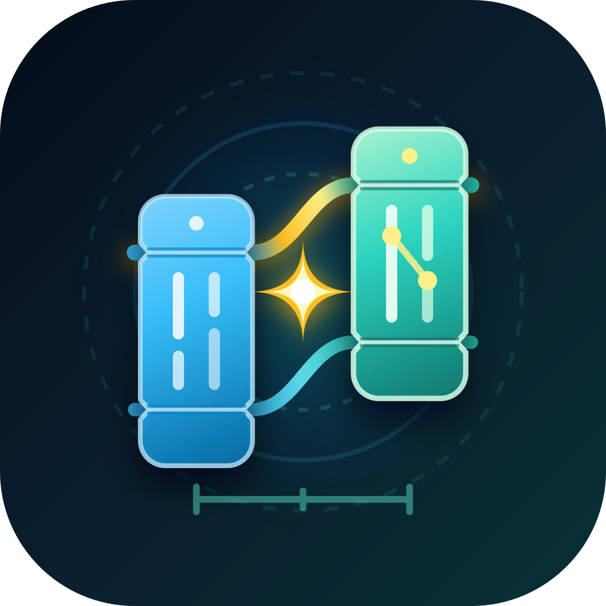

#  青简 · OneMoreStep (`oms` · 咫尺 + 尺素) — macOS 本地 AI ⇄ 小米 Android 认知座舱与双脑协同底座

[](./CHANGELOG.md)
[](https://bun.sh)
[-0284c7?style=flat-square&logo=apple&logoColor=white)](./mac-host)
[-ff6900?style=flat-square&logo=xiaomi&logoColor=white)](./android-app)
[-07c160?style=flat-square&logo=wechat&logoColor=white)](./wechat-context)
[](./docs/secure-transport-v2.md)
[](./mac-host/src/mcp/server.ts)
[](./LICENSE)

> **青简载思，咫尺通达 (`One More Step`) —— 集「随身第一现场认知座舱（咫尺）」、「微信活上下文网关（尺素）」与「跨网双脑重任调度中枢」于一体的个人 AI 操作系统底座。**  
> 在家或工位走 `1ms` 局域网与近场蓝牙直连；走出家门切 5G 自动无缝接入自建零信任加密中继（`Tier 3 WAN`），**不占手机系统 VPN 槽位、云端零明文零密钥留存**——随时随地在手机上远程唤醒并指挥家里的 Mac 运行 `Codex` 与 `Antigravity`、流式监控工具调用、远程拍板高危操作审批、无脑裂接管微信文章深读、秒同步锁屏验证码与剪贴板、无感流转 AirPods。

**最新修复版 v3.6.7**：修复手机端顶部 OTA 更新提示条点击后消失的问题（常驻展示实时下载百分比与重试态），并将 GitHub Release OTA 检查与下载接入内置免 VPN 代理 `OmsProxyManager`；同时包含锁屏至解锁验证码双端四层防重推与近场蓝牙拥塞修复。[更新说明](docs/releases/v3.6.7.md)。跨网解锁请同步升级 Mac 和 Android。

---

## 🚀 核心版本演进提要（v1.7 ➔ v2.2）

- **`v2.2.0` · 零信任跨网中继 (`Tier 3 WAN`)、离家防休眠与远程工作闭环**：新增零依赖 `wan-relay`（常驻内存约 `12 MiB`），采用恒定时间 `Bearer` 鉴权 + 固定根证书（CA Pinning）+ 端到端 v2 `P-256 ECDH + AES-256-GCM` 双层锁死；修复跨网待命握手时序，离席断连 `1.5s` 自动切入 `🟣 跨网远程在线`；中继回传 `hostOnline: false` 时手机在户外 5G 下亦可 100% 确定性接管微信尺素；新增 `oms stay-awake` 离家驻守防休眠、`oms wan` 跨网诊断与完整七大域结构化 `oms` 命令族。
- **`v2.1.0 ~ v2.1.1` · 咫尺认知座舱、内置免 VPN 代理、尺素休眠接管与 `🕹️ 任务舱`**：
  - **内置免 TUN 纯 Kotlin 代理引擎 (`:core:net-proxy`)**：原生支持 Shadowsocks-2022（`SIP022`/`SIP023`）、SS-AEAD、Trojan，内置 **AI 地域限制自动熔断换线 (`AiGeoBlockFailoverInterceptor`)** 与 HTTP/2 连接池即时驱逐，不抢占 Android 系统唯一 `VpnService` 槽位；
  - **三工作区 120fps 认知座舱**：重构为 `✦ 对话 | 📖 尺素 | 🕹️ 任务舱` + L0/L1/L2 三级认知记忆漏斗 + `📷 识物`（Gemini Vision + Google Search Grounding 博物图鉴卡）+ `🎧 Live` 全双工实时语音舱；
  - **`🕹️ 任务舱` 跨端重脑调度 (`AgentSessionHub`)**：自动发现 Mac 项目与历史会话，支持在手机端新建或按原 `session_id / conversation_id` 无缝 `resume` 接续 `Codex` 与 `Antigravity` 任务；
  - **微信尺素早晚休眠零脑裂接管 (`EdgeWeChatStandbyEngine`)**：Mac 休眠且手机亮屏时自动接管微信 ClawBot 轮询完成初筛回执，Mac 唤醒重连瞬间原子移交入库。
- **`v1.7.0` · 青简合一（咫尺 + 尺素单守护进程融合）**：将 `wechat-context` 完整并入 `omsd` 受管体系，在 Mac 原生无打扰浮窗（`oms-mac-hud`）、本地 Web 总控台（`/inbox`）与小米手机端统一提供微信公众号/小红书/抖音/YouTube 深度归档、SenseVoice 语音转写与多格式（MD/HTML/PDF）回推微信能力。
- **工程边界与兼容性说明**：从 `v1.4.x ~ v2.1.x` 升级至 `v2.2.0` **无需重新配对**，直接运行 `oms ota` 或覆盖安装 [`OneMoreStep-v2.2.0.apk`](https://github.com/dqrcsc/one-more-step/releases/download/v2.2.0/OneMoreStep-v2.2.0.apk) 即可保留全部密钥、会话与收件数据。详细安全边界见 [安全传输 v2](./docs/secure-transport-v2.md) 与 [实现状态边界](./docs/implementation-status.md)，完整演进见 [CHANGELOG.md](./CHANGELOG.md)。

---

## 📑 目录导航

- [0. 项目定位与「青简 · 咫尺 / 尺素」命名释义](#0-项目定位与青简--咫尺--尺素命名释义)
- [1. 十大核心协同与远程工作场景](#1-十大核心协同与远程工作场景)
- [2. 总体系统架构与 Monorepo 模块矩阵](#2-总体系统架构与-monorepo-模块矩阵)
- [3. 快速上手指南（本机初始化、小米满血权限与可选跨网中继部署）](#3-快速上手指南本机初始化小米满血权限与可选跨网中继部署)
- [4. `oms` 命令族全景规正参考手册（七大能力域 · 25 个标准命令）](#4-oms-命令族全景规正参考手册七大能力域--25-个标准命令)
- [5. AI Agent 接入指南（13 个 MCP Tools、3 个 Resources 与全局 Skill）](#5-ai-agent-接入指南13-个-mcp-tools3-个-resources-与全局-skill)
- [6. 本地数据目录规范 (`~/.one_more_step`) 与 HTTP 安全边界](#6-本地数据目录规范-one_more_step-与-http-安全边界)
- [7. 源码构建、隔离测试与发布流水线](#7-源码构建隔离测试与发布流水线)
- [8. 架构与专项设计文档索引](#8-架构与专项设计文档索引)
- [9. 开源协议 (License)](#9-开源协议-license)

---

## 0. 项目定位与「青简 · 咫尺 / 尺素」命名释义

- **「青简」**：古人炙竹渗水谓之「杀青」，编联成册谓之「韦编」。「青简」代表我们在 Mac 本地与个人知识库（Vault）中长期积累的深度笔记、代码仓库与认知资产。
- **「咫尺」 (`One More Step`)**：打破 macOS 与小米 Android（HyperOS / MIUI）之间的生态藩篱与物理距离，让手机既是随身独立的 AI 第一现场认知座舱，又是桌面重脑的延伸五官与遥控器。
- **「尺素」 (`WeChat-as-Context`)**：“呼儿烹鲤鱼，中有尺素书。” 将日常在微信中顺手转发的公众号长文、行业视频、碎片灵感自动转化为结构化知识库伴读笔记与桌面 AI 的活上下文。

---

## 1. 十大核心协同与远程工作场景

| 维度 | 场景与核心工程能力 |
| :--- | :--- |
| **1. 🕹️ 跨网远程操控 Mac 开展工作** | 人在户外 5G 或异地出差、与家里 Mac 完全脱离局域网与蓝牙时，手机自动通过 `Tier 3 WAN` 零信任加密中继连回 Mac（顶栏显示 `🟣 跨网远程在线`）。在手机 **`🕹️ 任务舱`** 下拉选择 Mac 上的任意项目目录，直接新建或 `resume` 接续桌面上的 **`Codex` / `Antigravity`** 会话、实时查看工具执行流与文件变更、远程点按高危操作审批；配合 `oms stay-awake on` 让留守 Mac 锁屏黑屏省电但不断网。 |
| **2. ✦ 随身认知座舱与免 VPN 双擎路由** | 开屏 `<150ms` 直达 120fps 块级增量 Markdown 对话画布；内置纯 Kotlin 免 TUN 代理（SS-2022 / Trojan + AI 锁区节点自动熔断换线），无需开启系统 VPN 即可直连 OpenAI 旗舰模型与 Google Gemini；支持 L0（本地与 Mac 镜像 FTS 全文库）➔ L1（自动蒸馏 `ContextCapsule`）➔ L2（一键提炼入个人知识库）三级记忆漏斗。 |
| **3. 📷 博物之眼相机与 🎧 Live 语音舱** | 输入栏左翼 CameraX `📷 识物` 结合 Gemini Vision + Google Search Grounding 秒级生成结构化「🌿 博物图鉴卡」或识别海报防冲突写入原生日历；右翼集成极速中英混排语音听写与 OpenAI Realtime / Gemini Live 散步免提双向音视频对谈（支持 `[🇬🇧 English Only]` 口语实战模式）。 |
| **4. 💬 微信尺素四端合一与休眠无感接管** | 在微信把公众号、小红书、抖音、YouTube 或“我有个想法”转给 ClawBot：Mac 在线时深度归档正文/视频转写并写入 Vault；**Mac 合盖休眠或跨网确认离线时，手机亮屏自动零脑裂接管初筛并秒回微信**，Mac 唤醒重连瞬间单事务原子移交游标与笔记；支持 `oms wx push` 将本地报告自动编译为 MD/HTML/PDF 推送回手机微信。 |
| **5. 📱 ➔ 💻 免 IM 极速投递与原生 HUD** | 三指截屏 3.5s 悬浮胶囊、系统分享三大置顶入口（`📚 存入个人知识库` / `🚀 发给 Mac Inbox` / `🐛 发给 AI 修 Bug`）、控制中心半屏快传面板（多图 + PDF/Word/Excel/ZIP 原中文名保留）；语音附件由本机 **SenseVoiceSmall** 离线转写；Mac 端由无 Dock 原生 Swift 助手 `oms-mac-hud` 提供右上角毛玻璃轻通知与内嵌 `PDFKit`/`QuickLook` 速览浮窗。 |
| **6. 🔑 锁屏验证码毫秒级提取上屏** | 四通道穿透监听手机短信与通知（NotificationListener + SMS PDU + ContentObserver + Accessibility），抗干扰剔除尾号/金额/航班号，0.2s 将 4~8 位纯数字验证码写入 Mac 剪贴板，电脑直接 `⌘V` 登录。 |
| **7. 🎧 AirPods 跨生态无感自动流转** | 实时感知 Mac `CoreAudio` 与小米手机 `AudioPlaybackConfiguration` / 通话焦点——哪端出声或来电，AirPods 自动抢占切过去，并自动发送系统指令暂停对端正在播放的音乐或视频。 |
| **8. 🪞 实时屏幕镜像与鼠标远程触控** | 通过本地 Web 工作台（`/mirror`）或 `oms-mac-hud` 原生「📱 手机镜像」Tab 提供低延迟手机投屏、鼠标点击/拖拽手势映射与中英文文本直输。 |
| **9. 🔓 远程九宫格解锁、速查拨号与智能代聊** | 一行命令唤醒手机并绘制 3×3 图案密码解锁（`oms unlock`）；内置常用联系人速查表（`oms contacts`），支持双卡选卡外呼（`oms call 老婆`），并在检测到对方接通后通过 **Mac 扬声器 Neural TTS 喂麦 (`--mac-say`)** 或 **小米原生 AI 通话注入 (`--ai-call`)** 自动传话。 |
| **10. ⏰ 原生闹钟、防冲突日历与受护栏 GUI** | 静默创建小米原生闹钟、防冲突读写系统日历、9 款 Microsoft Edge Neural TTS 真人语音播报与突破静音寻机（支持侧面按键/解锁等 5 种随手即停）；面对封闭 App 提供带 `observationId` 时效绑定、隐私页黑名单、顶部急停胶囊与 `--confirm` 人工放行的无障碍 GUI 自动化。 |

---

## 2. 总体系统架构与 Monorepo 模块矩阵

### 2.1 全栈拓扑图

```mermaid
flowchart TB
    subgraph Phone["📱 小米 Android · 青简 v2.2 (`com.oms.client`)"]
        Cockpit["Jetpack Compose 认知座舱\n✦ 对话 (博物相机 / Live 语音) | 📖 尺素 | 🕹️ 任务舱"]
        CoreAI["模块 `:core:ai-engine`\nOpenAI Responses/Realtime + Gemini Grounding/Live"]
        CoreProxy["模块 `:core:net-proxy`\n纯 Kotlin 免 VPN 隧道 (SS-2022/Trojan + 防 AI 锁区换线)"]
        EdgeWX["EdgeWeChatStandbyEngine\n四态防脑裂租约 + 休眠接管初筛 + 唤醒原子移交"]
        PhoneSys["原生硬件与 GUI 能力层\n4通道OTP · AirPods流转 · 九宫格解锁 · 双卡代聊 · 受护栏GUI"]

        Cockpit <--> CoreAI --> CoreProxy
        EdgeWX <--> CoreAI
    end

    subgraph Transport["🔐 三级自适应安全传输 v2 (`P-256 ECDH + AES-256-GCM` + P0/P1/P2 多路复用帧)"]
        T1["Tier 1: `LAN_WS`\n同局域网物理网卡直连 (1~5ms)"]
        T2["Tier 2: `BT_RFCOMM`\nBLE 近场感知 + 分片通道 (10m 零网络兜底)"]
        T3["Tier 3: `WAN_WEBRTC` (`wan-relay`)\n云端零信任密文会合中继 (~25ms 户外5G跨网在线)"]
    end

    subgraph MacHost["💻 macOS · 青简宿主 (`omsd` 单守护进程体系)"]
        Daemon["`omsd` 核心守护进程\nUnix Socket IPC · 在场引擎 · 离家防休眠 (`caffeinate`) · 审批挂起器"]
        AgentHub["`AgentSessionHub`\nCodex & Antigravity 实时轨迹监听 / 远程派单 / Resume 接续"]
        WxSup["`WeChatBridgeSupervisor` (`wechat-context`)\nClawBot 主控轮询 · 视频/SenseVoice转写 · MD/HTML/PDF 推微信"]
        NativeHelpers["macOS 原生 Swift 助手\n`oms-mac-hud` (无打扰菜单栏速览/镜像浮窗) · `oms-bt-bridge` (蓝牙/AirPods)"]
        Interfaces["AI 与人类交互入口\n`oms` 七大域 CLI · `oms mcp` (13 Tools) · 本地总控台 (`127.0.0.1:19527`)"]
        Vault[("个人知识库 Vault\n& `~/.one_more_step/` 本地加密存储")]

        Interfaces <--> Daemon
        Daemon <--> AgentHub & WxSup & NativeHelpers & Vault
        AgentHub & WxSup <--> Vault
    end

    PhoneSys & Cockpit & EdgeWX <==>|自动无感升降级| T1 & T2 & T3
    T1 & T2 & T3 <==>|端到端认证加密| Daemon
```

### 2.2 仓库目录结构

```text
one_more_step/
├── package.json                  # Bun Monorepo 根配置与构建/测试脚本 (v2.2.0)
├── bunfig.toml                   # 自动化测试隔离守卫（强制回环监听、隔离临时目录、禁止触碰真实设备）
├── shared-protocol/              # [@oms/shared-protocol] 8 字节优先级多路复用帧、ECDH+AES-GCM v2 加密会话、RPC 契约
├── mac-host/                     # [@oms/mac-host] macOS 核心守护进程、Agent 中枢、MCP、CLI 与原生 Swift 组件
│   ├── bluetooth-bridge/         # [Swift] CoreBluetooth BLE GATT + IOBluetooth/CoreAudio AirPods 控制器
│   ├── mac-hud/                  # [Swift] AppKit 无 Dock 菜单栏入口、右上角毛玻璃轻通知、PDFKit/QuickLook/镜像浮窗
│   └── src/
│       ├── agent/                # AgentSessionHub：监听与调度本机 Codex & Antigravity 会话流
│       ├── daemon/               # omsd 单例守护进程、IPC、Neural TTS、通话延续、跨网中继与防休眠管理
│       ├── transport/            # 三级会话管理器 (LAN + BLE + WAN Rendezvous) 与蓝牙 RSSI 在场感知引擎
│       ├── wechat/               # WeChatBridgeSupervisor 子进程守护与手机端节点/胶囊引导下发
│       ├── memory/               # 移动端 L0/L1/L2 对话记忆镜像库与个人知识库提炼桥接
│       ├── inbox/                # 收件箱持久化管理与本机回环 Web 总控台 (/inbox & /mirror)
│       ├── mcp/server.ts         # 标准 stdio MCP Server (13 Tools + 3 Resources)
│       └── cli/index.ts          # 统一规正的七大能力域 `oms` 命令行工具
├── wechat-context/               # [@oms/wechat-context] 青简·尺素：微信 ClawBot 网关、多平台正文/视频提取、伴读分析与定时调度
├── wan-relay/                    # [零依赖云端组件] 约 300 行纯 Node 22 / Bun WebSocket 密文配对中继服务 + Docker 部署编排
├── android-app/                  # 小米 Android 客户端多模块工程 (MinSDK 30, Jetpack Compose)
│   ├── core/net-proxy/           # [独立可复用模块] 纯 Kotlin 免 VPN 代理栈 (BLAKE3, SS-2022, SS-AEAD, Trojan, 防锁区路由)
│   ├── core/ai-engine/           # [独立可复用模块] OpenAI Responses/Realtime/Transcribe + Gemini Grounding/Live 双擎客户端
│   └── app/                      # 咫尺主应用：认知座舱 UI、三级加密传输、尺素离线接管、OTP、AirPods、无障碍 GUI 与系统能力
├── skills/one-more-step/         # 全局 AI Agent Skill 模板（含 `references/wechat-context-rules.md` 渐进式披露契约）
└── docs/                         # 架构设计、安全传输 v2 规范、认知座舱工程方案与各版本验收记录
```

---

## 3. 快速上手指南（本机初始化、小米满血权限与可选跨网中继部署）

### 3.1 本机 3 分钟初始化与 v2 加密绑定

```bash
# 1. 安装依赖、编译 macOS 原生蓝牙/HUD 助手、挂载全局 `oms` 命令与全局 Skill
bun install
bun run setup

# 2. 生成 10 分钟有效的安全 v2 一次性配对链接与局域网无线安装地址
oms pair
```

1. 手机与 Mac 处于同一 Wi-Fi 时，浏览器访问终端显示的 `http://<Mac局域网IP>:19527/install` 下载安装 APK（或从 [GitHub Releases](https://github.com/dqrcsc/one-more-step/releases/latest) 下载 `OneMoreStep-v2.2.0.apk`）。
2. 打开手机「青简」App 粘贴完整 `oms://pair?v=2&...` 链接完成双向认证绑定，并按 App 内 **`⚡ 小米权限`** 向导开启后台弹出界面、锁屏显示、通知使用权、省电无限制、悬浮窗与无障碍服务。

### 3.2（可选）1 分钟自建跨网远程工作通道 (`wan-relay`)

当你想在**手机与 Mac 完全断开局域网和蓝牙连接（如出门在外用 5G）**时依然远程操控家里的 Mac 开展工作，只需在一台任意低配云服务器（如 1核1G / 2核2G 轻量服务器，常驻内存仅 `~12 MiB`）运行 [`wan-relay/`](./wan-relay)：

```bash
# 1. 在云服务器上启动零依赖中继容器（通过反向代理如 Caddy/Nginx 暴露 443 WSS 路由 `/oms-wan/*`）
cd wan-relay
printf "OMS_RELAY_AUTH_TOKEN=$(openssl rand -hex 32)\n" > .env
docker compose up -d --build

# 2. 在家里 Mac 上绑定中继地址与口令，并开启离家驻守防休眠（手机在线时将自动加密接收中继配置，免重新配对！）
oms wan set --url "wss://<你的云服务器域名或IP>/oms-wan/v1" --token "<刚才生成的Token>" [--ca /path/to/ca.crt]
oms wan test
oms stay-awake on
```

---

## 4. `oms` 命令族全景规正参考手册（七大能力域 · 25 个标准命令）

`oms` 已统一规正为 **七大能力域、25 个顶层标准命令**。在终端运行 `oms help` 可查看全景总览，运行 `oms help <域名称>`（或对任意命令加 `--help` / `-h`）可安全查看该域语法而不会触发实际动作。

### 4.1 七大能力域速查总表

#### 一、连接诊断、跨网中继与守护进程 (`oms help system`)

| 命令 | 核心用途与常用参数 |
| :--- | :--- |
| `oms status [--live]` | 查看全维状态总览：在场状态（`AT_DESK`/`AWAY`）、当前激活通道（`LAN_WS`/`BT_RFCOMM`/`WAN_WEBRTC`）、跨网中继状态、防休眠状态、手机实时硬件遥测、AirPods 与微信尺素健康度（别名 `oms doctor`） |
| `oms wan <subcommand>` | **跨网远程加密通道管理**：<br>• `oms wan status`：查看本机待命连接与手机配对入房状态<br>• `oms wan test`：实测本机到云端中继 HTTPS 健康度与往返延迟（RTT）<br>• `oms wan on \| off`：一键启用或停用跨网远程通道<br>• `oms wan set --url <wss> --token <tok> [--ca <pem>]`：配置云端中继并自动加密同步至手机 |
| `oms stay-awake [status\|on\|off]` | **Mac 离家驻守防休眠**（别名 `oms awake`）：底层托管受监控的 `caffeinate -i -s`，允许 Mac 锁屏息屏省电，但阻止系统进入断网睡眠，保障在外随时连回 Mac 干活 |
| `oms pair [--json]` | 在 Mac 本地生成 10 分钟有效、单次消费的安全 v2 完整配对 URI 与局域网无线安装地址 |
| `oms ota` | 从认证加密通道下发 SHA-256 摘要，校验包名、版本号与签名一致性后触发手机端覆盖升级 |
| `oms prefs [...]` | 查看或更新宿主偏好：`--auto-copy`、`--auto-preview`、`--auto-otp`、`--auto-wx-phone`、`--tts-voice <音色>`、`--unlock-pattern <1~9>`、`--unlock-pin <PIN>` |
| `oms edge-sync` | 立即向已连接手机加密下发最新代理节点快照（`bootstrapNodes`）、模型密钥、跨网中继配置、知识库上下文胶囊与微信游标 |
| `oms daemon <subcommand>` | 管理后台单例守护进程：`status` \| `start` \| `stop` \| `restart` \| `logs [--lines N] [--wx]` \| `install-launchagent`（注册 macOS 登录自启） |
| `oms version` | 打印当前 `one-more-step` 版本号（同 `oms --version` / `oms -v`） |

#### 二、手机 ⇄ Mac 收件箱、媒体流转与剪贴板/验证码 (`oms help transfer`)

| 命令 | 核心用途与常用参数 |
| :--- | :--- |
| `oms inbox [...]` | 查询手机投递记录（支持 `--tag all\|sms_otp\|default_inbox\|pkb_vault\|voice_idea\|ui_bug`、`--unprocessed`、`--q <关键词>`、`--limit N`）；子命令：<br>• `oms inbox show <itemId>`：查看单条记录详情与本地附件绝对路径<br>• `oms inbox peek [itemId]`：在 Mac 原生无打扰 HUD 浮窗中直接预览图片/PDF/Office/音频<br>• `oms inbox transcribe <itemId>`：对语音附件手动触发 SenseVoiceSmall 离线转写<br>• `oms inbox ack <itemId>` / `clear-processed`：标记已处理或清理已处理索引 |
| `oms otp [--copy] [--limit N]` | 查询手机锁屏实时捕获同步的最新验证码记录；加 `--copy` 自动将纯数字验证码写入 Mac 剪贴板 |
| `oms media [--type <t>] [--since <m>]` | 主动列出手机近期媒体元数据（`--type screenshot\|camera\|all_images\|video`，`--since` 最近 N 分钟） |
| `oms pull <target> [-o <dir>]` | 主动从手机拉取文件至 Mac：支持捷径 `latest-screenshot`、`latest-camera` 或受权路径（`screenshots/*`、`camera/*`、`download/*`） |
| `oms push <target> [--title <t>] [--tts]` | 将 Mac 本地文件、单行文本（`--text`）或多行标准输入（`--stdin`）推送至手机时间流（别名 `oms send`；加 `--tts` 开启耳机通勤朗读） |
| `oms clip <get\|set\|pull\|push>` | 双向剪贴板同步：`get [--otp]` 读手机剪贴板、`set <文本>`（支持 `--stdin`）写手机剪贴板、`pull` 拉入 Mac `pbcopy`、`push` 推出 Mac `pbpaste` |

#### 三、手机硬件遥控、真人语音、解锁与通话 (`oms help device`)

| 命令 | 核心用途与常用参数 |
| :--- | :--- |
| `oms phone <subcommand>` | **手机系统级全能遥控**（别名 `oms control`）：<br>• `status`：强制实时拉取手机全维遥测快照<br>• `find [文本] [--voice <v>] [--repeat <N>]`：强制扬声器 + 闹钟声道突破静音真人语音寻机<br>• `say <文本> [--force-speaker \| --no-alarm] [--voice <v>] [--repeat <N>]`：9 款 Edge Neural TTS 真人自然语音开口说话（默认戴耳机走耳机私密播报，无耳机走闹钟声道播完恢复原音量）<br>• `voices` / `stop-tts`：查看 9 款音色列表（`xiaoyi`/`xiaoxiao`/`yunxia`/`yunxi`/`yunjian`/`xiaobei`/`xiaoni`/`hsiaochen`/`hiugaai`）/ 停止播报<br>• `volume <up\|down\|mute\|unmute\|0..100> [--stream music\|ring\|alarm\|notification]` / `vibrate [ms]`<br>• `screenshot [--no-inbox]`：远程抓取手机当前屏幕落盘<br>• `open <url>` / `launch <wechat\|lark\|dingtalk\|camera\|settings\|包名>`<br>• `home` \| `back` \| `recents` \| `notifications` \| `lock`：系统导航与锁屏 |
| `oms unlock [pattern] [--save]` | 远程唤醒手机屏幕、上滑呼出密码盘并自动绘制 3×3 九宫格图案（`1~9`）或 `--pin` 解锁（`--save` 持久化保存后直接敲 `oms unlock` 即可一键解锁） |
| `oms contacts [list\|set\|remove]` | 管理本地常用联系人速查表（如 `oms contacts set 老婆 138xxxx --sim 2`），供 `oms call` 直接按姓名呼叫 |
| `oms call <姓名或号码> [...]` | 自动解锁并按指定双卡槽位（`--sim 1\|2\|电信\|联通\|移动`）发起呼叫；支持接通后自动传话（`--mac-say "<文本>"` 电脑扬声器喂麦，或 `--ai-call "<文本>"` 小米原生 AI 通话注入，加 `--hangup-after` 说完自动挂断；`oms dial` 仅打开拨号盘） |
| `oms hangup` | 远程挂断当前正在振铃或通话中的电话 |

#### 四、主动式日程助理、分级强提醒与远程审批 (`oms help assistant`)

| 命令 | 核心用途与常用参数 |
| :--- | :--- |
| `oms alarm <HH:MM> [--label <t>]` | 在小米原生系统时钟 App 中静默创建闹钟（支持 `--days 1,2,3,4,5` 周期重复） |
| `oms calendar <list\|add\|delete>` | 防冲突查询手机日历（`list --days 3`，自动展开重复会议），确认无冲突后新增带提前响铃的日程（`add --title <t> --start <ISO> --duration 60 --remind 15`）或删除日程 |
| `oms notify <正文> [--level <l>]` | 发送在场感知分级通知：`silent`（静默记录）、`normal`（在电脑旁自动转桌面轻提示免打扰）、`urgent`（突破勿扰亮屏强震动，加 `--tts` 强制真人语音播报） |
| `oms approve --title <t> --summary <s>` | 向手机推送含 `--diff` 上下文的远程阻塞审批卡片，终端挂起等待手机端点击拍板（默认超时 `1800s`） |

#### 五、跨生态外设、实时投屏与无障碍 GUI 自动化 (`oms help gui`)

| 命令 | 核心用途与常用参数 |
| :--- | :--- |
| `oms airpods [status\|mac\|phone\|auto\|pause]` | 查看双端耳机状态、手动将 AirPods 抢回 Mac 或切至手机、开关音频焦点自动切换（`auto on/off`）与对端媒体自动暂停（`pause on/off`） |
| `oms mirror [open\|start\|stop\|status]` | 打开实时低延迟手机屏幕镜像与电脑鼠标触控工作台（`--fps 12 --width 720 --quality 72`） |
| `oms web` | 在 Mac 默认浏览器打开本地实时收件箱、微信尺素与设备协同总控台（`http://127.0.0.1:19527/inbox`） |
| `oms gui <observe\|act>` | 封闭 App 无障碍自动化：先 `oms gui observe [--screenshot --som]` 获取紧凑控件树与 `observationId`，再 `oms gui act <click\|input_text\|scroll_down\|...> [#id] --observation <id> [--confirm]` 安全执行 |

#### 六、微信尺素：公众号/视频深读、知识库沉淀与推送微信 (`oms help wx`)

| 命令 | 核心用途与常用参数 |
| :--- | :--- |
| `oms wx <subcommand>` | 微信 ClawBot 活上下文总入口（兼容别名 `wx-ctx`）：<br>• **只读查阅**：`list [--triage <t>] [--json]` \| `show <id> [--json]` \| `recent [--json]` \| `inbox [--json]` \| `tasks [--json]`<br>• **跨端阅读**：`peek [id]`（Mac 原生 HUD 浮窗打开伴读笔记）\| `to-phone <id>`（同步至小米手机通勤朗读）<br>• **采集重跑**：`sync [--json]` \| `ingest "<url>" [--note "<关注点>"]` \| `reanalyze <id> [--force] [--send]` \| `triage <id> <level>` \| `idea <id> "<想法>"`<br>• **推送回微信**：`push [--text "<文本>" \| --stdin \| --file "<路径>" \| --article <id>] [--formats md,html,pdf] [--with-file] [--json]`<br>• **定时与诊断**：`schedule <list\|add\|run\|done\|cancel>` \| `status` \| `doctor [--json]` \| `login` \| `web` \| `config-web` |

#### 七、桌面重脑会话中枢与 MCP 接入 (`oms help agents`)

| 命令 | 核心用途与常用参数 |
| :--- | :--- |
| `oms agents <subcommand>` | **Mac 桌面 `Codex` 与 `Antigravity` 会话编排中枢**（与手机端 `🕹️ 任务舱` 实时互通）：<br>• `oms agents list [--limit 20]`：列出本机活跃与近期 `Codex` / `Antigravity` 会话及项目目录<br>• `oms agents projects`：列出自动发现的可派单工作区仓库目录<br>• `oms agents show <codex\|agy> <sessionId>`：查看指定会话的步骤轨迹与文件变更摘要<br>• `oms agents start [--backend codex\|agy] [--cwd <目录>] "<任务指令>"`：后台启动新任务并流式推送到手机任务舱<br>• `oms agents resume <codex\|agy> <sessionId> "<追问指令>"`：在原会话上下文无缝续跑<br>• `oms agents cancel <codex\|agy> <sessionId>`：中止正在执行的受管任务 |
| `oms mcp` | 以标准 `stdio` 模式启动 MCP Server（供 Codex / Antigravity / Claude Code / OpenCode 挂载） |

---

### 4.2 高频组合实战示例

```bash
# 1. 出门前开启 Mac 驻守防休眠并确认跨网中继就绪
oms stay-awake on
oms wan test

# 2. 手机验证码提取、拉取手机刚拍的白板照、推送报告到手机路上听
oms otp --copy
oms pull latest-camera
oms push ./report.md --title "今日架构评审结论" --tts

# 3. 按联系人姓名选卡外呼并在接通后自动语音传话
oms contacts set "老婆" "13800138000" --sim 2
oms call 老婆 --ai-call "我已经在地铁上了，大概二十分钟到家" --hangup-after

# 4. 阅读微信转发文章并将本地 Markdown 自动编译为 MD+HTML+PDF 推送到手机微信
oms wx list --json
oms wx peek 42
oms wx push --file ./summary.md --formats md,html,pdf --text "这是整理好的三格式报告" --json
```

---

## 5. AI Agent 接入指南（13 个 MCP Tools、3 个 Resources 与全局 Skill）

运行 `bun run setup` 后，全局统一单入口 Skill 已安装至 `~/.codex/skills/one-more-step/SKILL.md`（按需渐进式加载 `references/wechat-context-rules.md`），全局 CLI `oms` 已链接至 `~/.local/bin/oms`。如需挂载标准 MCP Server：

```json
{
  "mcpServers": {
    "one-more-step": {
      "command": "bun",
      "args": ["run", "/path/to/one_more_step/mac-host/src/mcp/server.ts"]
    }
  }
}
```

- **13 个标准 MCP Tools**：`phone_inbox_latest`、`phone_media_recent`、`phone_file_pull`、`phone_file_push`、`phone_clipboard_sync`、`phone_alarm_set`、`phone_calendar_manage`、`phone_notify`、`phone_request_approval`、`phone_presence_status`、`phone_device_control`、`phone_gui_observe`、`phone_gui_action`。
- **3 个 MCP Resources**：`oms://inbox/latest`、`oms://inbox/pkb_pending`、`oms://phone/status`。

---

## 6. 本地数据目录规范 (`~/.one_more_step`) 与 HTTP 安全边界

```text
~/.one_more_step/                 # 权限严格收紧为 0700，敏感凭据文件 0600 原子写入
├── config.json                   # 端口、蓝牙/AirPods 偏好、跨网中继凭据、防休眠开关、默认音色与联系人速查表
├── keystore/                     # Mac 端身份密钥对 (host_identity.json) 与已绑定 v2 设备信任库 (trusted_devices.json)
├── wan_relay/                    # 自建跨网中继本地离线根证书与鉴权口令备份 (0700)
├── wechat/                       # 青简·尺素独立配置 (.env)、SQLite 状态库 (wechat_context.db) 与离线待推队列
├── chat/                         # 移动端对话镜像 SQLite 库 (mobile_chat.db) 与 L1 蒸馏工作记忆 (working_memory.json)
├── agent_hub/                    # 远程发起的 Codex / Antigravity 任务元数据索引
├── cache/tts/                    # Microsoft Edge Neural TTS 音频 SHA-256 本地缓存
├── run/                          # omsd.pid、omsd.sock、bt.sock、hud.sock
├── logs/                         # omsd.log、wechat.log、connections.jsonl (最近 200 条连接诊断环)
└── inbox/                        # 按日期与 UUIDv7 归档的手机投递附件、SenseVoice 转写缓存与待入库队列
```

- **本机回环强隔离**：`omsd` 监听的 `/inbox`、`/mirror`、`/wechat/*`、`/api/*` 与 `/ws/mirror` 均受回环 IP（`127.0.0.1` / `::1`）、`Host` 头与同源 `Origin` 三重守卫保护，非本机请求一律 `403` 拦截；局域网仅开放只读 `/install` 与 `/OneMoreStep.apk` 供手机安装更新，**绝不通过 HTTP 暴露任何配对密钥或业务数据**。

---

## 7. 源码构建、隔离测试与发布流水线

通过 [`bunfig.toml`](./bunfig.toml) 预置测试守卫，所有自动化测试默认在独立临时目录与 `127.0.0.1` 回环下运行，**绝不触碰本机正在运行的 `omsd`、真实手机或个人知识库**：

```bash
# 1. 全仓 TypeScript 严格类型检查（shared-protocol + mac-host + wechat-context）
bun run typecheck

# 2. 运行跨端协议、安全会话、跨网中继与宿主守护进程测试套件
bun run test

# 3. 运行微信尺素（提取质量、防覆盖治理、调度器、休眠原子移交）测试套件
bun run test:wx

# 4. 编译 macOS 原生 Swift 蓝牙桥与无打扰菜单栏 HUD 助手
bun run build:native

# 5. 运行 Android 三模块单元测试并构建签名版 Release APK
bun run test:android
bun run build:apk
```

---

## 8. 架构与专项设计文档索引

- 🛡️ **[当前实现边界与升级验收 (`docs/implementation-status.md`)](./docs/implementation-status.md)**
- 🔐 **[安全传输 v2 协议规范 (`docs/secure-transport-v2.md`)](./docs/secure-transport-v2.md)**
- 🧠 **[青简·咫尺 v2.0 认知座舱与双脑协同工程设计 (`docs/plans/2026-11-20-oms-v2-cockpit-engineering-design.md`)](./docs/plans/2026-11-20-oms-v2-cockpit-engineering-design.md)**
- 🩺 **[离线连接诊断规范 (`docs/connection-diagnostics.md`)](./docs/connection-diagnostics.md)**
- 📚 **[立项与七大基础模块设计系列 (`docs/01` ~ `docs/11`)](./docs/README.md)**
- 📝 **[完整版本更新日志 (`CHANGELOG.md`)](./CHANGELOG.md)**

---

## 9. 开源协议 (License)

本项目基于 [MIT License](./LICENSE) 开源 © 2026 [dqrcsc](https://github.com/dqrcsc)。
