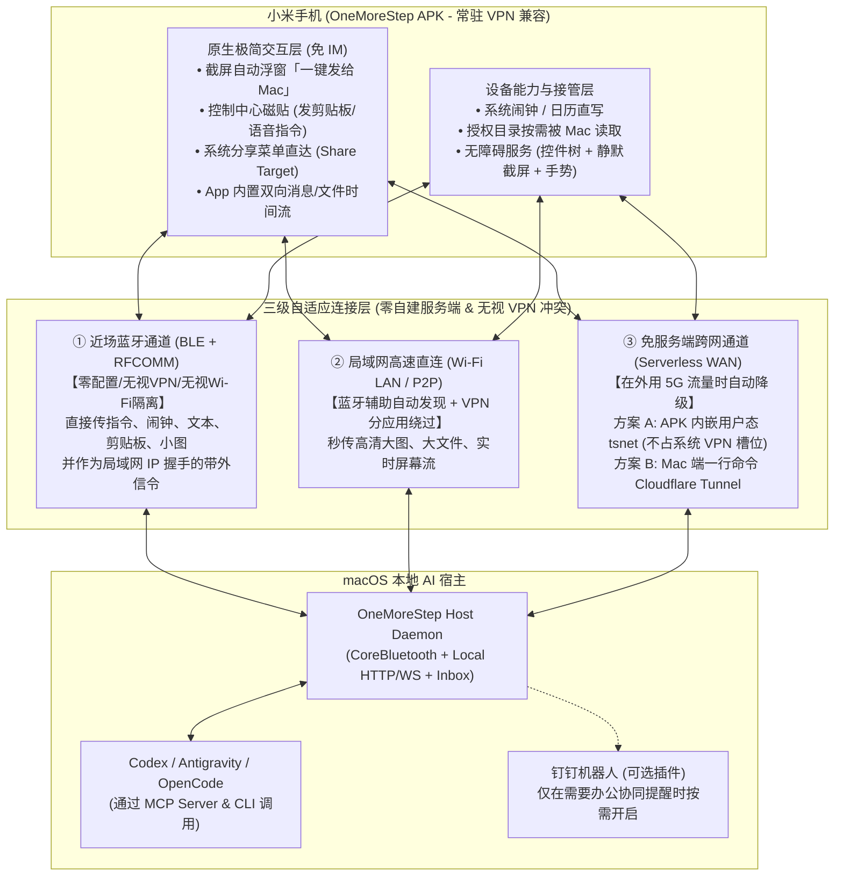

# OneMoreStep 项目可行性分析报告（v2：小米 Android + macOS 零服务端/蓝牙融合版）

## 1. 核心结论与方案演进

结合你的最新反馈（**小米手机、有常驻 VPN、希望尽量免自建服务端降低部署复杂度、引入蓝牙能力、不依赖 IM 也能极简互传、钉钉作为可选补充**），项目的可行性不仅依然是 **100% 可行**，而且架构可以收敛得**更轻量、更优雅、零运维负担**。

核心思路转变为：**以自研轻量 APK + Mac 守护进程为核心本体，通过「蓝牙 + 局域网 + 免运维穿透」三级自适应网络自动切换，彻底摆脱对第三方 IM 和自建云服务器的强依赖。**



---

## 2. 重点突破一：引入「蓝牙」与「免服务端 + 常驻 VPN 兼容」的网络架构

你提到**“如果是蓝牙也用上呢，会不会有更好的思路”**——这是一个非常关键的破局点。苹果的 AirDrop / Handoff 和小米澎湃智联底层正是采用 **「蓝牙控制信令 + 按需高速数据通道」** 的混合模式。

### 2.1 为什么加入蓝牙（BLE + 经典蓝牙 RFCOMM）会让体验质变？
当你带着手机坐在 Mac 附近（家里、办公室、咖啡厅、高铁）时，纯网络方案经常遇到三个恶心问题：**① 手机挂着 VPN 导致局域网不通；② 公司/公共 Wi-Fi 开启了 AP 隔离导致设备间无法 ping 通；③ IP 地址变化导致重连失败**。

引入蓝牙后，这些问题瞬间清零：
1. **100% 无视常驻 VPN 与网络隔离**：蓝牙走物理射频协议栈（macOS `CoreBluetooth` / `IOBluetooth` ⇄ Android Bluetooth API），完全不经过系统的网络路由表和 VPN 网卡，**就算手机断网或挂着全局 VPN，只要在 Mac 旁 10 米内就能秒连**。
2. **轻量操作直接走蓝牙完成（零网络依赖）**：
   - **BLE (低功耗蓝牙)**：负责在后台以近乎 0 耗电的方式感知手机靠近 Mac，自动唤醒连接。
   - **经典蓝牙 RFCOMM / BLE L2CAP 通道**：实际吞吐量可达 **100 KB/s ~ 250 KB/s**。这意味着：
     - AI 给手机**设闹钟、写日程、发通知提醒、同步剪贴板、收发文字消息**：耗时 **< 50ms**。
     - AI 获取手机**无障碍控件树（JSON 仅 5~15KB）并下发点击指令**：耗时 **< 100ms**。
     - 甚至传一张压缩后的手机截图（WebP 格式约 150~300KB）：纯靠蓝牙也只需 **1~2 秒**！
3. **大文件传输的「蓝牙带外握手（Out-of-Band Handshake）」**：
   - 当需要传输几十 MB 的大文件或原图时，手机直接通过蓝牙把自己的当前 Wi-Fi IP 和一次性密钥告诉 Mac，瞬间建立局域网高速 TCP 传输（跑满 30~80 MB/s），无需麻烦的 mDNS 广播（mDNS 经常被 VPN 或路由器丢包）。

### 2.2 如何同时满足「手机有常驻 VPN」+「不想维护云服务器」实现远程跨网？
当你人不在 Mac 旁边（比如在外面用 5G 流量，Mac 在家里开着），要在**不部署云服务器、且不关手机常驻 VPN**的前提下互通，有两个极佳的 **Zero-Server（免自建服务端）** 方案：

| 零服务端跨网方案 | 核心原理（为什么不与常驻 VPN 冲突？） | 部署复杂度 | 体验评价 |
| :--- | :--- | :---: | :--- |
| **方案 A（强烈推荐）：<br>APK 内置用户态 `tsnet` + VPN 分应用绕过** | 官方 Tailscale App 之所以和 VPN 冲突，是因为它注册了系统级 `VpnService` 接管全机流量。<br>但我们是**自研 APK**，可以直接将 `tsnet`（Tailscale 官方 Go 用户态网络库，通过 `gomobile` 编译嵌入 APK）内置在 App 内部！它**只用普通 UDP Socket，完全不申请系统 `VpnService`**，因此与你的常驻 VPN 100% 和平共处（并在你的 VPN 软件里把 `OneMoreStep` 加入「分应用绕过/直连白名单」）。 | **极低（零服务器）**<br>直接白嫖 Tailscale 官方免费协调服务，Mac 与手机自动打洞直连。 | ⭐⭐⭐⭐⭐<br>无需买服务器、无需配域名，在家在外同一个虚拟地址，端到端加密。 |
| **方案 B（极简备选）：<br>Mac 端 Cloudflare Tunnel (`cloudflared`)** | Mac 端后台运行一条 `cloudflared tunnel` 命令，将本机守护进程映射为加密的 HTTPS/WSS 地址（带 Token 鉴权）。手机 APK 只是发起普通 HTTPS 请求，无论开不开 VPN 都能连。 | **极低（零服务器）**<br>无需公网 IP，无需买云主机，手机端就是普通 WebSocket 客户端。 | ⭐⭐⭐⭐<br>开发最简单（纯标准 WebSocket），跨国流量延迟约 100~200ms，足够发图与远程控制。 |

> [!TIP]
> **最终网络体验效果**：
> 你平时根本不需要关心网络配置——**在电脑旁自动走蓝牙/局域网（毫秒级响应、无视 VPN）；出门在外自动无缝切到免服务端加密通道**。如果后续觉得某天需要用自己的轻量云服务器做加速，也只需改一行配置地址即可。

---

## 3. 重点突破二：不通过 IM，如何实现「比微信/钉钉快 5 倍」的原生互传？

以前用微信/文件传输助手/钉钉给电脑发图，流程是：`截屏 -> 切出当前应用 -> 打开 IM -> 找到文件传输助手 -> 点加号选相册 -> 勾选原图 -> 点发送 -> 电脑端另存为 -> 把路径发给 AI`（足足 8~9 步）。

通过自研 `OneMoreStep.apk`，我们可以用 Android 原生系统级入口把它缩短为 **1 步**：

```carousel
### 入口 1：截屏感知悬浮气泡（最常用痛点杀手）
- **工作原理**：APK 通过 `ContentObserver` 监听 `MediaStore.Images` 变化。
- **交互体验**：当你在小米手机任意界面按音量键/三指下拉截屏的瞬间，屏幕边缘自动浮现一个极简小胶囊（3 秒不点自动消失，绝不烦人）：
  - 点击 **`[🚀 发给 Mac AI]`**：1 秒内图片已落盘到 Mac 的 `~/.one_more_step/inbox/latest.png`，剪贴板自动复制该路径（或直接触发当前活跃的 Codex/Antigravity 会话）。
  - 按住 **`[🎙️ 附言发送]`**：边发图边说一句“帮我看看这个报错怎么修”，语音转文字后连同图片一起喂给 Mac 上的 AI。
<!-- slide -->
### 入口 2：系统分享面板置顶（任意文件/网页/文本一键投递）
- **工作原理**：注册 Android `Intent.ACTION_SEND` / `ACTION_SEND_MULTIPLE` 与 `SharingShortcuts`（Direct Share 置顶联系人/目标）。
- **交互体验**：在相册选多张图、在文件管理器选 PDF、在浏览器看文章、甚至在微信/钉钉里收到别人的文件，点「用其他应用打开 / 分享」-> 直接点置顶的 **`OneMoreStep (Mac)`**，即刻静默传到电脑并回执通知。
<!-- slide -->
### 入口 3：小米控制中心快捷磁贴（Quick Settings Tile）
- **工作原理**：实现 Android `TileService`，挂载在小米澎湃 OS 右上角下拉控制中心。
- **交互体验**：
  - **单击磁贴**：立即将手机当前剪贴板内容 + 最新一张截图打包发给电脑 AI。
  - **长按磁贴**：呼出轻量级半屏指令框，随时给电脑上的 AI 下达任务或查看当前 Agent 运行状态。
<!-- slide -->
### 入口 4：APK 内置极简「双向流（Stream）」界面 + 钉钉可选插件
- **内置双向流**：点开 App 本身，就是一个极简的时间轴（没有多余社交功能），展示你发给 Mac 的文件/指令，以及 Mac AI 发回给你的分析结果、生成的文件、创建的日程/闹钟记录，支持一键复制或预览。
- **钉钉作为可选旁路**：在 Mac 端支持配置一个钉钉自定义群机器人 Webhook（或 Stream 模式应用），仅当你在电脑上希望把长篇报告同步归档到钉钉时才按需启用，日常互传完全不依赖钉钉。
```

---

## 4. 重点突破三：小米手机（HyperOS / MIUI）专属适配清单

你使用的是**小米手机**，这在国产 Android 中对开发者自用工具实际上非常友好，只要针对小米的权限机制做好以下 3 点适配，就能解决 99% 的兼容性问题：

1. **突破小米后台建闹钟/弹窗限制（关键细节）**
   - 小米系统除了标准的 Android 权限外，有一个专属的独立权限叫 **「后台弹出界面」（`OP_BACKGROUND_START_ACTIVITY` / Code `10021`）**。
   - **适配方案**：APK 首次启动引导页直接提供一键跳转小米该权限设置页的按钮。一旦开启此开关，Mac 上的 AI 在后台静默调用 `AlarmClock.ACTION_SET_ALARM` 创建手机原生系统闹钟时，100% 丝滑成功，绝不会被小米系统拦截。
2. **小米澎湃 OS / MIUI 满血保活与省电豁免**
   - 自用 APK 只需做一次“三件套”设置：
     1. 应用详情 -> 省电策略 -> 设为 **「无限制」**；
     2. 开启 **「自启动」** 开关；
     3. 开启 APK 的轻量常驻通知（显示当前与 Mac 的蓝牙/跨网连接状态）。
   - 这样即使锁屏一整晚，AI 也能随时读取你授权的文件夹或给你设早起闹钟。
3. **无障碍 GUI 操控在小米上的顺畅运行**
   - 在小米上开启 `OneMoreStep` 的无障碍服务后，即可通过语义控件树 + Android 11+ `takeScreenshot()` 实现远程屏幕观察与自动化操作。
   - 同时我们可以在小米侧边栏或悬浮球上放一个物理级的 **「紧急停止 AI 操作」** 按钮，确保任何时候你一碰屏幕就能夺回控制权。

---

## 5. 可行性总结与建议的 MVP 分步走策略

综合来看，这个项目不仅完全可行，而且非常适合采用 **「先打通高频刚需，再渐进叠加高阶能力」** 的节奏：

| 阶段 | 核心交付能力 | 解决的核心痛点 | 预计研发复杂度 |
| :--- | :--- | :--- | :---: |
| **Phase 1 (MVP 核心基座)** | • **Mac 守护进程 (MCP + CLI + Inbox)**<br>• **小米 APK 基础版（截屏气泡 + 系统分享 + 内置双向流）**<br>• **蓝牙近场 + 局域网/免服务端跨网连接**<br>• **手机授权目录被动读取 + 原生闹钟/日历创建 + 强提醒通知** | 彻底解决“手机发图/文件给电脑 AI 繁琐”、“电脑 AI 直接读手机最新截图/文件”、“AI 帮我设手机闹钟/日程/发提醒”三大最高频痛点 | **低~中**<br>（全部基于标准公开 API，无黑魔法，极度稳定） |
| **Phase 2 (GUI 屏幕接管)** | • **APK 无障碍服务 (`AccessibilityService`) 接入**<br>• **UI 语义控件树提取 + 静默截屏 + 手势注入**<br>• **Mac 端 GUI Agent 工具链与安全护栏** | 让电脑上的 AI 能够跨 App 帮你操作手机界面（处理没有 API 的长尾场景） | **中**<br>（需打磨控件树精简与防误触安全策略） |
| **Phase 3 (生态扩展)** | • **钉钉机器人可选插件**<br>• **语音快捷指令 / 桌面小组件 / 蓝牙近场自动触发规则** | 靠近电脑自动同步、与办公流打通 | **低** |
