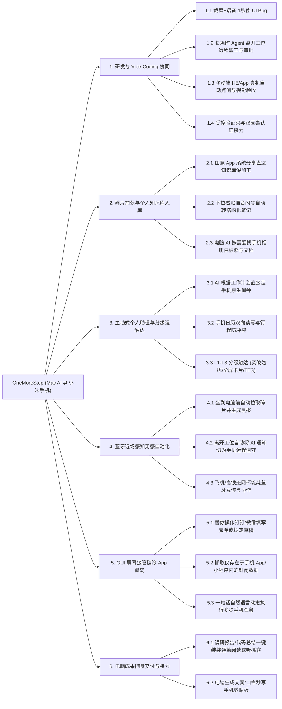
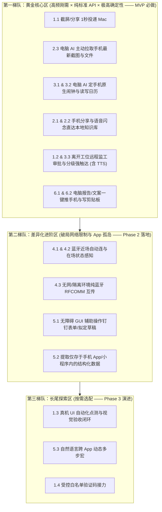

# OneMoreStep 全景功能与高价值场景穷举分析

为了帮你全面评估这个项目的投入产出比（ROI），我将 **Mac 本地 AI Agent（Codex / Antigravity / OpenCode） ⇄ 小米 Android 手机** 在这套技术方案（蓝牙近场 + LAN 直连 + 免服务端跨网 + 系统原生 API + 无障碍 GUI 接管）下能实现的能力，按 **6 大核心价值维度、22 个具体场景** 进行了穷举与深挖。

---

## 全景能力拓扑图

---

## 维度一：研发与 Vibe Coding 协同（解放离开电脑桌的自由）

当你日常重度使用 Codex、Antigravity、OpenCode 进行开发或跑复杂任务时，手机不再是旁观者，而是你的**移动控制台与真机传感器**：

| 编号 | 场景名称 | 痛点现状（Before） | 赋能后体验（After） | 底层技术组合 | 价值评级 |
| :---: | :--- | :--- | :--- | :--- | :---: |
| **1.1** | **移动端截屏 1 秒喂给 AI 修 Bug / 仿写 UI** | 手机截屏 ➔ 打开微信/钉钉 ➔ 发文件传输助手 ➔ 电脑另存为 ➔ 复制路径发给 AI（耗时 1 分钟，8~9 步，极易打断心流） | 手机任意界面三指截屏 ➔ 点右上角自动浮出的胶囊 **`[🎙️ 附言发给 Mac]`** 说一句“按这个截图把卡片圆角和间距改了” ➔ 1 秒内落盘 Mac Inbox，AI 直接读取最新图片并改代码。 | `MediaStore` 截屏监听 + 悬浮胶囊 + LAN/蓝牙秒传 + `phone_inbox_latest` | ⭐⭐⭐⭐⭐ （每日高频刚需） |
| **1.2** | **长耗时任务的「离开工位远程监工与审批」** | 让 AI 跑大规模重构、测试集或深水区调研时，不敢离开电脑去吃饭、拿快递或躺沙发，怕它卡在确认步骤或报错空转。 | 你揣着手机去吃饭，当 AI 遇到高风险操作需审批或任务跑完时，手机立即收到包含**代码 Diff 摘要 / 报错信息**的交互卡片；你在路上点一下 `[批准继续]` 或语音回一句“换方案 B”，Mac 端 AI 立即继续干活。 | 跨网 P2P 通道 + `phone_notify(urgent)` + 双向时间流交互回调 | ⭐⭐⭐⭐⭐ （重度 Agent 玩家核心痛点） |
| **1.3** | **移动端 H5 / App 真机自动化走查闭环** | 电脑上改完前端/移动端代码，要自己拿手机点十几个页面检查有没有样式崩坏或报错。 | Mac 上的 AI 改完代码后，自动调用手机打开测试链接/App，自己模拟滑动点击、自己截屏用多模态视觉检查布局是否正常，发现歪了继续自动改代码。 | `phone_gui_action` + `phone_gui_observe` (Android 11+ 静默截屏) | ⭐⭐⭐⭐ （前端/客户端开发利器） |
| **1.4** | **白名单验证码 / 登录确认接力** | 电脑端自动化脚本或本地操作登录时，需要低头找手机看短信验证码再手动敲进电脑。 | 手机收到特定白名单验证码时，控制中心点一下（或授权自动）秒传至 Mac 剪贴板或当前 AI 会话。 | 剪贴板同步 / 通知过滤转发 | ⭐⭐⭐ （日常便利型） |

---

## 维度二：碎片化信息捕获与个人知识库（PKB）无缝入库

结合你日常进行 **AI 写作、本体论（Ontology）/知识工程研究、以及维护本地个人知识库（Personal Knowledge Base）** 的习惯，手机是你在通勤、睡前、阅读时最大的信息输入端，但以前手机与本地电脑知识库之间有一道巨大的鸿沟：

| 编号 | 场景名称 | 痛点现状（Before） | 赋能后体验（After） | 底层技术组合 | 价值评级 |
| :---: | :--- | :--- | :--- | :--- | :---: |
| **2.1** | **任意 App「一键分享 ➔ 本地知识库深加工」** | 手机刷公众号、小红书、arXiv、X、知乎看到好内容，点微信收藏从此吃灰；发到电脑上还要手动复制整理进本地知识库。 | 在任意 App 点「系统分享 ➔ **OneMoreStep (存入知识库)**」，顺口说一句“结合我知识库里关于 Agent 记忆的笔记做个对比”。Mac 端 AI 自动抓取解析图文、检索你本地 Vault 已有观点、按你的目录规范生成草稿等待审阅。 | Android `ACTION_SEND` Direct Share + Mac Inbox 触发器 + `personal-knowledge-base` Skill 联动 | ⭐⭐⭐⭐⭐ （知识工程质变场景） |
| **2.2** | **“我有一个想法”——随身语音闪念结构化** | 走在路上、洗澡前突然冒出一个写作灵感或项目思路，打字太慢，录音以后又懒得回听整理。 | 下拉小米控制中心点一下磁贴，直接说一段大白话语音发给 Mac。等你回到电脑前，AI 已经把碎片语音提炼成了结构化 Markdown 笔记，甚至帮你查好了相关参考资料。 | `TileService` 快捷磁贴 + 语音识别/音频直传 + Mac AI 后台预处理 | ⭐⭐⭐⭐⭐ （极低摩擦捕获灵感） |
| **2.3** | **电脑 AI 主动“伸手”进手机翻找照片与文档** | 在电脑前写方案，需要用到刚在会议室拍的白板照片、手机相册里的某张架构图、或手机刚下载的 PDF，还得拿起手机解锁去找再传过来。 | 手不离键盘，直接对电脑上的 AI 说：“**把我手机相册里刚刚拍的那张白板照片拉过来，转成 Mermaid 架构图**”，或者“把我手机 Download 目录下最新的那个 PDF 拉过来总结一下”。AI 直接秒级拉取到本机并处理。 | `phone_media_recent` + `phone_file_pull`（受权目录白名单） | ⭐⭐⭐⭐⭐ （省去拿起手机的动作） |

---

## 维度三：主动式个人助理与分级强触达（让 AI 真正融入生活节律）

电脑上的 AI 以前只能困在终端窗口里被动等你提问；接入手机原生系统 API 后，它才能真正管理你的时间与注意力：

| 编号 | 场景名称 | 痛点现状（Before） | 赋能后体验（After） | 底层技术组合 | 价值评级 |
| :---: | :--- | :--- | :--- | :--- | :---: |
| **3.1** | **AI 根据电脑上的工作规划直接定手机系统闹钟** | 在电脑上和 AI 讨论完明天的安排，或者设定了 40 分钟后要检查线上部署，还得自己拿起手机打开时钟 App 手动设闹钟。 | 直接对电脑 AI 说：“明早 7:45 叫我起床，另外 45 分钟后定个闹钟提醒我看构建结果”。AI 直接静默写入小米原生系统时钟，到点系统级响铃。 | `AlarmClock.ACTION_SET_ALARM` + 小米「后台弹出界面」权限适配 | ⭐⭐⭐⭐⭐ （直击你的核心诉求） |
| **3.2** | **手机原生日程双向同步与智能防冲突** | 电脑上的工作排期与手机里的个人日程割裂，AI 帮你排计划时不知道你下午 3 点要去医院或见客户。 | AI 排计划前先调用 `phone_calendar_manage(list)` 读取你手机未来 3 天日程自动避开冲突；排定后直接把新的工作日程和提前 15 分钟提醒写进小米系统日历。 | Android `CalendarContract.Events` & `Reminders` 读写 API | ⭐⭐⭐⭐⭐ （直击你的核心诉求） |
| **3.3** | **L1~L3 注意力分级触达（含 TTS 语音播报）** | 所有通知都长得一样：要么被淹没在几百条群消息里漏看，要么频繁弹窗骚扰你专注写代码。 | AI 按重要程度分级触达你： • **L1（低优）**：静默写进时间流，不响不震； • **L2（常规）**：普通通知栏推送； • **L3（紧急强触达）**：突破手机勿扰模式、锁屏全屏高亮卡片、持续震动，甚至直接让手机开口说话（TTS）：“注意，服务器构建失败，需要处理”。 | Android 高优 NotificationChannel + `fullScreenIntent` + 系统 `TextToSpeech` | ⭐⭐⭐⭐ （关键时刻不漏事） |

---

## 维度四：蓝牙近场感知（Proximity）带来的「空间无感自动化」

引入**蓝牙（BLE + RFCOMM）**后，除了解决 VPN 和局域网隔离下的传输问题，还额外白送了一个极其惊艳的能力——**物理空间在场感知（知道你此刻是否坐在电脑前）**：

| 编号 | 场景名称 | 赋能后体验（After） | 底层技术组合 | 价值评级 |
| :---: | :--- | :--- | :--- | :---: |
| **4.1** | **「坐到电脑前」自动同步与晨间唤醒** | 当你早上带着小米手机走近 Mac 坐下（蓝牙自动握手连接）： 1. 路上在手机上攒下的截图、语音闪念通过蓝牙引导的局域网瞬间同步到 Mac； 2. Mac AI 自动拉取你手机今日日历日程，结合昨日未完成任务，为你准备好今日工作上下文。 | BLE RSSI 近场感知 + 带外 LAN 握手 + 自动触发 Hook | ⭐⭐⭐⭐ （极具未来感的丝滑体验） |
| **4.2** | **「离开工位」自动切换移动值守模式** | 当你揣着手机离开书房/工位（蓝牙断开）：Mac 守护进程自动感知你已不在屏幕前，将所有 AI Agent 的提问、审批和任务完成通知自动路由到你的手机跨网通道上。 | 蓝牙连接状态机切换 + 跨网路由策略 | ⭐⭐⭐⭐ （无需手动切模式） |
| **4.3** | **飞机/高铁/隔离内网下的「纯蓝牙离线协作」** | 在没有互联网的飞机上、高铁弱网区、或开启了严格 AP 隔离的客户会议室里，完全不靠 Wi-Fi 和流量，直接通过经典蓝牙把手机拍的会议白板、录音或文档传给 Mac 上的本地工具处理，再把结果传回手机。 | Classic Bluetooth RFCOMM Socket (100~250 KB/s) | ⭐⭐⭐⭐ （极端环境兜底神器） |

---

## 维度五：GUI 屏幕接管（打破 App 孤岛，替你操作手机专属应用）

国内移动互联网大量功能被锁死在手机 App 或小程序内（无网页版、无开放 API）。通过 Android 无障碍语义树（`AccessibilityService`）+ 静默截屏，Mac 上的 AI 可以像真人的手指一样操作你的手机：

| 编号 | 场景名称 | 痛点现状（Before） | 赋能后体验（After） | 底层技术组合 | 价值评级 |
| :---: | :--- | :--- | :--- | :--- | :---: |
| **5.1** | **钉钉/微信办公协同半自动代办（草稿与表单填充）** | 电脑上让 AI 写好了周报、请假说明或回复话术，却因为公司钉钉没有对个人开放写入 API，只能自己复制到手机钉钉工作台里一个个框去填。 | 你对电脑 AI 说：“把刚写好的日报填进我手机钉钉的日报表单里”。AI 远程唤醒手机打开钉钉 ➔ 识别表单输入框自动填好全部内容 ➔ **停在最后一步「提交」按钮前**，发通知让你在手机上扫一眼点确认！既省事又绝对安全。 | `phone_gui_observe` (语义树) + `phone_gui_action(inputText/click)` + 敏感操作停顿护栏 | ⭐⭐⭐⭐ （办公高频痛点） |
| **5.2** | **抓取仅存在于手机 App / 小程序内的封闭数据** | 某些专业资讯、竞品小程序数据、快递状态、水电账单、内部 App 数据只能在手机上看，无法导出给电脑 AI 分析。 | 让 Mac AI 自动在手机上打开对应 App/小程序，自动翻页并提取屏幕语义树中的全部结构化文字（或截屏 OCR），直接汇总成电脑上的 Excel/Markdown 报告。 | 无障碍节点树提取（比纯 OCR 快 10 倍且零错别字）+ 自动滚动 | ⭐⭐⭐⭐ （打破数据孤岛） |
| **5.3** | **自然语言驱动的「动态跨 App 宏」** | 传统自动化（Tasker/快捷指令）配置极其繁琐，且 App 界面一更新就失效。 | 直接用自然语言下指令：“把我微信收藏里最新那篇带图的笔记转发到钉钉的个人备忘里”，由 Mac 端大模型看着手机实时控件树动态规划步骤完成。 | Mac LLM 推理 + 手机端实时语义树/SoM 截图反馈循环 | ⭐⭐⭐ （进阶探索型） |

---

## 维度六：电脑成果随身交付与跨端接力（Mac AI ➔ Phone）

| 编号 | 场景名称 | 赋能后体验（After） | 底层技术组合 | 价值评级 |
| :---: | :--- | :--- | :--- | :---: |
| **6.1** | **AI 研究报告 / 代码总结「一键装袋」通勤阅读或听播客** | 准备出门前，对电脑上的 Antigravity/Codex 说：“把刚刚生成的这份可行性报告发到我手机上”。手机端 `OneMoreStep` 时间流立即收到排版清晰的文档（支持离线查看，甚至直接调用手机 TTS 在路上戴耳机听 AI 念给你听）。 | `phone_file_push` + APK 内置 Markdown/文件预览与 TTS 朗读器 | ⭐⭐⭐⭐⭐ （无缝延续电脑工作） |
| **6.2** | **电脑生成内容秒写手机剪贴板** | 电脑 AI 帮你写好了一段回复别人的高情商话术、一段小红书文案、或者一个复杂命令，直接一键塞进你小米手机的系统剪贴板，你在手机任意 App 里直接粘贴。 | `phone_clipboard_sync` | ⭐⭐⭐⭐ （高频顺手小功能） |

---

## 综合评估：哪些最值得做？建议的「价值优先级矩阵」

如果从 **「每日使用频次 × 节省的心智负担 ÷ 开发维护成本」** 来评估，这 6 大维度的真实价值排序非常清晰：

### 核心评估结论（供你决策参考）

1. **最赚、最立竿见影的「80% 核心价值」其实集中在最稳定的前四项（第一梯队）**：
   - **手机 ➔ 电脑**：截屏秒传胶囊、系统分享一键进 Mac Inbox / 知识库、控制中心语音闪念；
   - **电脑 ➔ 手机（读取）**：你在电脑上说一句话，AI 直接把手机刚截的图、刚拍的白板照、刚下的文件拉过来分析；
   - **电脑 ➔ 手机（触达与日程）**：AI 直接帮你设小米原生闹钟、读写手机日历、长任务跑完或报错时远程强提醒/语音播报你、把电脑上的报告一键推到手机路上看。
   - 💡 *特点*：这部分**全部基于 Android 100% 确定性的公开系统 API**，响应速度在毫秒~秒级，永远不会因为第三方 App 改版而失效，开发快、极其稳健。
2. **「蓝牙近场感知」与「GUI 屏幕自动化（无障碍服务）」属于拉开上限的差异化王牌（第二梯队）**：
   - **蓝牙**完美兜底了常驻 VPN 与公司网络隔离问题，还顺带解锁了“走近电脑自动同步、离开电脑自动转移动值守”的空间感知体验；
   - **GUI 无障碍控制**则作为没有 API 时的“万能机械手”（比如操作钉钉表单、抓封闭 App 数据、真机点测），建议以**「语义控件树提取 + 辅助填表/查询 + 关键步骤人工点确认」**的务实模式落地，既安全又好用。
