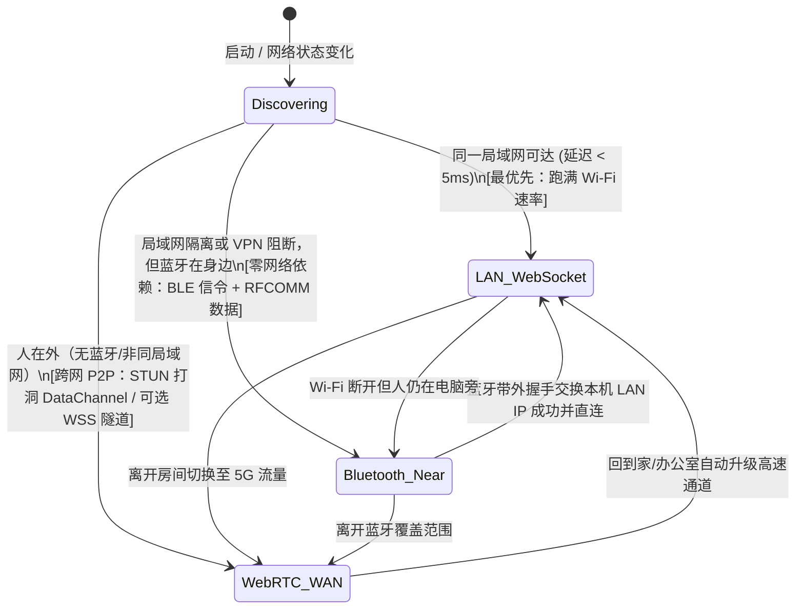

# OneMoreStep 系统架构与详细设计方案（TypeScript + 原生 Kotlin 版）

## 1. 技术选型与本机环境零新增适配

我刚刚检查了你 Mac 上的本地环境，以下工具链**均已就绪，无需安装任何新语言或编译环境**：
- **Node.js `v25.2.1` + `pnpm` + `bun`**：可直接作为 Mac 端守护进程（`omsd`）、CLI（`oms`）与标准 MCP Server 的运行底座。
- **Android Studio + Bundled JDK + Android SDK (`~/Library/Android/sdk`)**：本机已完整包含 Android 编译工具链与 `adb`，可直接用 Gradle 编译打包原生 Kotlin APK。
- **Swift / Xcode Command Line Tools (`/usr/bin/swift`)**：本机已有，可直接用于 macOS 原生蓝牙（`CoreBluetooth` / `IOBluetooth`）桥接。

### 1.1 为什么 Mac 端选 TypeScript (Node.js / Bun) 最合适？
1. **对 Codex / Antigravity / OpenCode 最友好**：TypeScript 版 `@modelcontextprotocol/sdk` 是 MCP 官方最成熟的一等公民；用 `bun` 或 `node` 启动 MCP Server 无需像 Python 那样处理虚拟环境（venv）路径隔离问题，AI Agent 跨目录调用永不报错。
2. **纯 TS 免编译实现跨网 P2P 与双工通信**：通过纯 TypeScript 实现的 WebRTC DataChannel（`werift`，零 C++ 编译依赖）+ WebSocket (`ws`)，配合 Android 端现成的 Maven 库，无需 Go/`gomobile` 即可实现**免自建服务器、不占手机 VPN 槽位**的跨网 P2P 穿透。

### 1.2 项目目录结构 (`one_more_step/`)

```text
one_more_step/
├── package.json                # pnpm / bun workspace 根配置
├── shared-protocol/            # [TypeScript] 跨端 JSON-RPC 2.0 协议与数据模型定义
├── mac-host/                   # [TypeScript + Swift] macOS 宿主端
│   ├── src/
│   │   ├── daemon/             # omsd 后台守护进程 (管理三级连接、Inbox 落盘、事件分发)
│   │   ├── transport/          # LAN WebSocket Server + WebRTC P2P (werift) + 蓝牙桥接客户端
│   │   ├── inbox/              # 本地收件箱管理 (~/.one_more_step/inbox/)
│   │   ├── mcp/                # 标准 MCP Server (供 Codex / Antigravity / OpenCode 调用)
│   │   ├── cli/                # oms 命令行工具
│   │   └── plugins/dingtalk.ts # 可选钉钉 Webhook 机器人插件
│   └── bluetooth-bridge/       # [Swift] 单文件 macOS CoreBluetooth / RFCOMM 原生近场通信助手
└── android-app/                # [Kotlin + Jetpack Compose] 小米 Android 原生客户端 (MinSDK 30)
    └── app/src/main/java/com/oms/client/
        ├── transport/          # 三级自适应传输：Bluetooth (BLE/RFCOMM) + LAN WS + WebRTC P2P
        ├── share/              # 免 IM 极速投递：截屏监听胶囊、系统分享 Target、控制中心磁贴
        ├── capability/         # 确定性系统能力：原生闹钟、日历读写、授权目录访问、强提醒/TTS
        ├── agent/              # GUI 自动化：AccessibilityService 语义树、静默截屏 (SoM)、手势注入
        ├── xiaomi/             # 小米 HyperOS/MIUI 专属权限自检与一键跳转向导
        └── ui/                 # Jetpack Compose 双向时间流 (Timeline Stream) 与安全控制面板
```

---

## 2. 三级自适应传输层设计（零新环境 & 兼容手机常驻 VPN）

在不引入 Go 的前提下，采用 **「蓝牙近场 + 局域网 WebSocket + WebRTC P2P（可选 WSS 中继兜底）」** 实现全场景自动选路：



### 2.1 三级通道如何在纯 TS + Kotlin 下工作？
1. **通道 1：近场蓝牙通道（BLE GATT + Classic Bluetooth RFCOMM）**
   - **完全无视 VPN 与 Wi-Fi 隔离**：只要手机在 Mac 旁 10 米内，通过蓝牙直接收发 JSON-RPC 指令（设闹钟、写日程、读控件树、发提醒 < 100ms）及中小体积截图；同时通过蓝牙自动把手机和 Mac 的当前局域网 IP 互相告知（带外握手），省去手动配 IP 的麻烦。
2. **通道 2：局域网高速直连（LAN WebSocket / HTTP）**
   - Mac 端 `omsd` 监听局域网加密端口，在小米常驻 VPN 软件中将 `OneMoreStep` 加入**「分应用绕过（不走代理）」**，在同一 Wi-Fi 下以 30~80 MB/s 秒传高清原图与大文件。
3. **通道 3：免服务端跨网穿透（WebRTC DataChannel + 可选轻量云/Tunnel WSS）**
   - **免服务端 P2P 模式**：Mac 端使用纯 TS 库 `werift`，Android 端使用标准 Maven 依赖 `io.github.webrtc-sdk:android`。两端通过加密信令与公共 STUN 节点（如小米/Google/腾讯 STUN）完成 UDP 打洞，建立点对点加密 `RTCDataChannel`。**完全运行在普通应用层 Socket，绝不占用 Android `VpnService` 槽位**。
   - **无缝兼容轻量云/Cloudflare Tunnel**：因为底层协议统一为帧消息流，如果未来在极端移动网络下 UDP 打洞受阻，只需在配置中填入一个 WSS 地址（支持免服务器的 Cloudflare Tunnel 或你的轻量云服务器），即可自动作为 100% 保底通道。

---

## 3. Android 端（小米原生 Kotlin APK）四大核心模块设计

### 3.1 模块一：免 IM 极速投递交互套件（Phone ➔ Mac AI）

| 触发入口 | Android 原生实现机制 | 用户操作路径与反馈 |
| :--- | :--- | :--- |
| **① 截屏秒传胶囊** | `ContentObserver` 监听 `MediaStore.Images.Media.EXTERNAL_CONTENT_URI`，过滤 `Screenshots` 路径新文件 | 任意界面截屏后，屏幕右上角浮现小胶囊（3 秒无操作自动消失）：<br>• 点 **`[🚀 发给 Mac]`**：1 秒内图片落盘至 Mac `~/.one_more_step/inbox/`，震动微反馈。<br>• 按住 **`[🎙️ 语音指令]`**：边发图边说话，语音/文字连同截图一起发给 Mac AI。 |
| **② 系统分享置顶** | `Activity` 注册 `ACTION_SEND` / `ACTION_SEND_MULTIPLE` + `ShortcutManagerCompat` 动态发布 Direct Share 目标 | 在相册、浏览器、微信/钉钉文档预览点「分享」，首行直接点 **`OneMoreStep ➔ Mac`**，即刻静默送达 Mac。 |
| **③ 控制中心磁贴** | 继承 `TileService` 注册快捷开关 | 下拉小米控制中心点一下磁贴：自动将当前剪贴板或最新一张截图发往 Mac。 |
| **④ 内置双向时间流** | Jetpack Compose 单 Activity 聊天式时间轴 | 查看历史互传记录、接收 Mac AI 发来的文本/代码片段/文件、查看 AI 执行的操作日志。 |

---

### 3.2 模块二：确定性系统能力执行器（Mac AI ➔ Phone）
系统原生支持的操作 **100% 走 Android 官方 API**，速度快、零幻觉：

1. **原生系统闹钟 (`AlarmExecutor`)**
   - 接口：`phone.alarm.set(hour, minute, message, days[], vibrate)`
   - 实现：调用 `Intent(AlarmClock.ACTION_SET_ALARM)` + `EXTRA_SKIP_UI = true`，配合小米专属「后台弹出界面」权限，后台静默写入小米系统时钟；附带 `AlarmManager.setAlarmClock()` 双保险。
2. **原生系统日历与提醒 (`CalendarExecutor`)**
   - 接口：`phone.calendar.list(startTime, endTime)` / `phone.calendar.insert(title, description, startMs, endMs, advanceReminderMinutes)`
   - 实现：通过 `ContentResolver` 直接读写系统 `CalendarContract.Events` 与 `CalendarContract.Reminders`。
3. **授权目录与近期媒体按需读取 (`ScopedStorageExecutor`)**
   - 接口：`phone.storage.listRecentMedia(type, limit)` / `phone.storage.listDir(alias)` / `phone.storage.pullFile(pathOrUri)`
   - 安全边界：仅允许访问你在 APK「受权目录白名单」中勾选开启的目录（如 `Screenshots`、`Camera`、`Download` 或 SAF 授权目录）。
4. **多级触达与提醒 (`NotificationExecutor`)**
   - `level = "normal"`：常规通知栏消息 + App 时间流记录（附带一键复制/打开按钮）。
   - `level = "urgent"`：高优先级独立通知渠道（突破勿扰、持续震动、锁屏亮屏卡片 `fullScreenIntent`）+ 可选 **系统 TTS 语音播报**。

---

### 3.3 模块三：无障碍 GUI 自动化引擎 (`OmsAccessibilityService`)
用于处理没有系统 API 的第三方 App 场景：
- **紧凑语义控件树提取 (`SemanticTreeExtractor`)**：遍历 `rootInActiveWindow` 剪枝无用容器，仅保留可交互或含文本节点并赋予短编号（`#1`, `#2`），体积仅 5~10KB，AI 无需看大图即可秒级决策。
- **按需静默截屏与编号标注 (`ScreenCapturer`)**：调用 Android 11+ `AccessibilityService.takeScreenshot()`，支持直接生成带 `#ID` 视觉标签（Set-of-Mark）的截图辅助多模态定位。
- **手势注入与四大安全护栏**：支持 `click(#id)`、`tap(x,y)`、`swipe`、`inputText`；屏幕边缘显示 `🤖 AI 正在操作 · 点击立即停止` 悬浮胶囊，遇到用户触摸屏幕或进入 `FLAG_SECURE` 支付/密码页立即自动中止。

---

### 3.4 模块四：小米 HyperOS / MIUI 专属一键配置向导
内置针对小米 ROM 的权限自检与一键跳转页：
1. **小米「后台弹出界面」权限**（`AppOpsManager` Code `10021`，直接跳转 `miui.intent.action.APP_PERM_EDITOR`）。
2. **电池省电策略设为「无限制」** + **「自启动」引导**。
3. **悬浮窗与无障碍服务一键开启**。

---

## 4. Mac 端 AI 赋能接口（MCP Server + CLI + 全局 Skill）

为了 100% 支撑 [02-scenarios-and-value.md](./02-scenarios-and-value.md) 中的全部 **6 大维度 22 个场景**，Mac 端 `omsd` 除了基础连接外，内置以下 **3 个核心协同机制**：
1. **投递意图标签与离线队列（Intent Tags & Offline Queue）**：手机端投递支持带标签（`default_inbox` / `pkb_vault` 存入知识库 / `voice_idea` 语音闪念 / `ui_bug`）；若在飞机/地铁断网，手机端自动暂存本地队列，一旦网络恢复或走近电脑蓝牙自动秒同步。
2. **蓝牙空间在场状态机（Presence Engine）**：根据蓝牙连接与 RSSI 信号强度自动维护 `AT_DESK`（在电脑旁）与 `AWAY`（离开工位）状态，离开工位时自动将 Agent 通知与审批请求路由至手机。
3. **阻塞式远程交互审批（Human-in-the-Loop Approval）**：允许 Mac AI 发起带选项按钮的远程提问，等待你在手机上点击按钮或语音回复后继续执行。

Mac 端通过 TypeScript 提供 `omsd`（后台守护进程）与 `oms`（CLI 及 MCP Server），并在 `~/.codex/skills/one-more-step/SKILL.md`（源码位于 [`skills/one-more-step/SKILL.md`](../skills/one-more-step/SKILL.md)）注册全局 Skill，向 **Codex、Antigravity、OpenCode、Claude Code** 暴露完整的 **13 个标准工具**：

| 覆盖维度 | 工具名称 (MCP Tool) | 功能描述与对应场景 |
| :--- | :--- | :--- |
| **收件箱、知识库捕获与文件流转** | `phone_inbox_latest` | 获取从手机投递到 Mac 的最新图文、语音闪念或知识库素材（支持按 `tag: "pkb_vault" \| "voice_idea" \| "ui_bug"` 过滤，对应场景 1.1, 2.1, 2.2）。 |
| | `phone_media_recent` | 主动列出手机相册/截图/白板照片中最近生成的 N 个媒体文件元数据（对应场景 2.3）。 |
| | `phone_file_pull` | 将手机受权目录中的指定照片/截图/PDF/文档拉取到 Mac 本地并返回路径（对应场景 2.3）。 |
| | `phone_file_push` | 将 Mac 上的调研报告、代码总结或文件推到手机时间流，支持标记为「通勤朗读包」（对应场景 6.1）。 |
| | `phone_clipboard_sync` | 双向读写手机剪贴板，或提取最近一条白名单验证码通知（对应场景 1.4, 6.2）。 |
| **主动式助理、日程与远程审批** | `phone_alarm_set` | 在小米系统时钟中静默创建原生闹钟（对应场景 3.1）。 |
| | `phone_calendar_manage` | 查询手机未来日程（防冲突）或直接向系统日历写入新日程与提醒（对应场景 3.2）。 |
| | `phone_notify` | 发送 L1（静默入流）、L2（常规通知）、L3（突破勿扰全屏强提醒 + 手机 TTS 语音播报）通知（对应场景 3.3）。 |
| | `phone_request_approval` | **远程监工审批**：向手机发送包含代码改动摘要/问题的交互卡片（如 `[批准继续]` `[拒绝]` `[语音回复]`），阻塞等待你在手机上拍板后将决策返回给 Mac AI（对应场景 1.2）。 |
| **空间在场感知** | `phone_presence_status` | 查询你当前是否在电脑旁（`AT_DESK` / `AWAY`）、当前激活的传输通道（`LAN` / `Bluetooth` / `WAN_P2P`）及手机电量/网络状态（对应场景 4.1, 4.2, 4.3）。 |
| **GUI 屏幕自动化** | `phone_gui_observe` | 获取手机当前前台 App 的精简无障碍语义控件树（可选附带原始截图或带 `#ID` 编号的 SoM 截图，对应场景 1.3, 5.1, 5.2, 5.3）。 |
| | `phone_gui_action` | 执行 GUI 动作（按 `#ID`/坐标点击、滑动、输入文本、启动 App/URL），支持 `require_user_confirm=true` 在点击“提交/发送”前停顿由你确认（对应场景 1.3, 5.1, 5.2, 5.3）。 |

---

## 5. 分阶段实施路线图（Roadmap）

所有 22 个场景均纳入整体工程规划，按以下 **3 个紧密衔接的阶段** 落地：

1. **Phase 1：核心底座 + 第一梯队全场景闭环（解决 80% 日常高频刚需）**
   - 搭建 `one_more_step` Monorepo（`shared-protocol` + `mac-host` TypeScript + `android-app` 原生 Kotlin）。
   - 实现 **局域网 WebSocket + 免服务端跨网 P2P (`werift` / WebRTC + 可选 WSS)** 连接与离线暂存队列。
   - 实现手机端 **截屏秒传胶囊（含语音附言）**、**系统分享置顶（含「存入知识库」标签）**、**控制中心磁贴** 与 **内置双向时间流（含通勤 TTS 朗读器）**。
   - 实现电脑端主动能力：**拉取手机相册/授权目录文件**、**设置小米原生闹钟**、**双向读写日历**、**L1~L3 分级强提醒/TTS**、**远程交互式审批 (`phone_request_approval`)**、**剪贴板接力**，以及 **小米 HyperOS/MIUI 专属权限一键向导**。
   - 注册 Mac 端 MCP Server、CLI (`oms`) 与 `~/.codex/skills/one-more-step/SKILL.md` 全局 Skill。
2. **Phase 2：蓝牙近场双模融合与空间在场感知（维度四全场景）**
   - 实现 macOS Swift `CoreBluetooth`/`IOBluetooth` 桥接与 Android 蓝牙通道（BLE 信令 + 带外 LAN IP 握手 + RFCOMM 离线传输）。
   - 实现 **走近电脑自动同步唤醒** 与 **离开工位自动切换移动值守路由**。
3. **Phase 3：无障碍 GUI 屏幕接管引擎与办公协同（维度五 & 真机点测全场景）**
   - 实现 Android `OmsAccessibilityService`（紧凑语义树提取 + Android 11+ 静默截屏与 SoM 标注 + 手势注入 + 边缘悬浮急停胶囊 + 敏感操作停顿确认）。
   - 打通钉钉/封闭 App 辅助填表、数据抓取及移动端 H5/App 真机自动化点测闭环。
