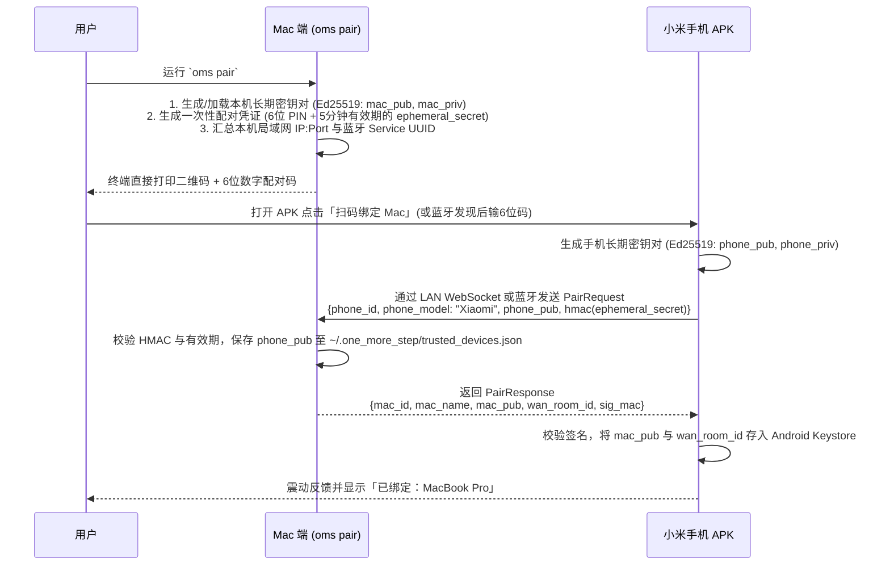
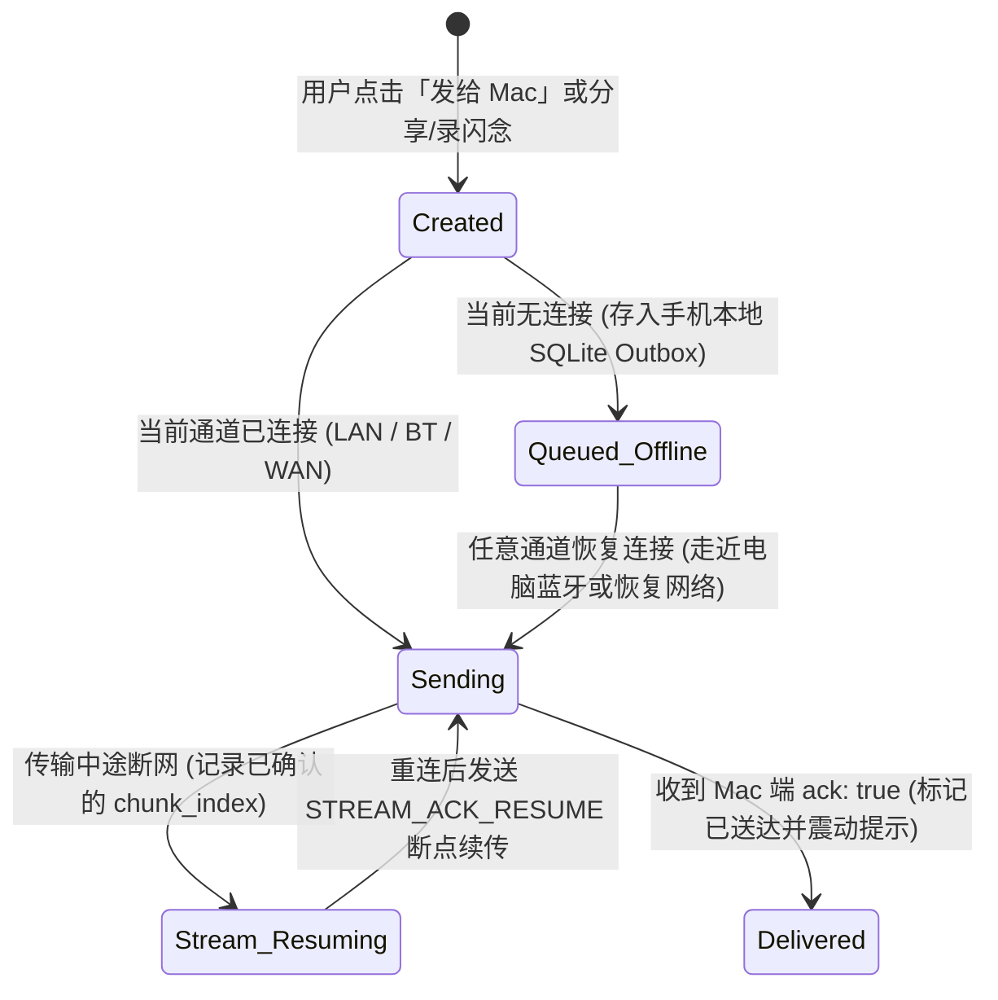

# 04. 模块一细化设计：设备配对、安全认证与统一通信协议

> **模块定位**：位于整个架构的最底层（`shared-protocol`），定义了 Mac 宿主端（`omsd`）与小米 Android 客户端（`OneMoreStep.apk`）之间如何建立首次信任、如何跨不同物理通道（蓝牙 RFCOMM / 局域网 WebSocket / 跨网 WebRTC DataChannel）封装消息帧、如何无阻塞地并发传输大文件与控制信令，以及断网离线时的幂等重传机制。

---

## 1. 零账号设备配对与双向鉴权设计（Pairing & Mutual Auth）

为了保证极简部署（无需注册任何第三方账号）且具备银行级端到端防窃听/防伪造能力，采用 **基于 Ed25519 / X25519 的首次扫码（或 6 位短码）绑定机制**。

### 1.1 首次配对流程（一次性操作，永久信任）



### 1.2 配对二维码载荷格式（URI Schema）
终端二维码编码为紧凑 URI，手机端扫码即可同时获知局域网地址、蓝牙标识与公钥指纹：
```text
oms://pair?v=1&id=<mac_device_id>&name=<url_encoded_hostname>&ip=<lan_ip1>,<lan_ip2>&port=19527&bt=<ble_service_short_uuid>&pk=<base64url_mac_ed25519_pub>&token=<one_time_secret>&exp=<unix_ts>
```

### 1.3 日常重连的双向 Challenge-Response 握手
配对完成后，之后无论是走 **蓝牙 RFCOMM**、**LAN WebSocket** 还是 **WebRTC DataChannel**，通道建立后的前两条消息固定为双向挑战握手：
1. **Mac ➔ Phone (`HelloChallenge`)**：`{ mac_id, nonce_m (32B), timestamp }`
2. **Phone ➔ Mac (`AuthResponse`)**：`{ phone_id, nonce_p (32B), sig_phone: Sign(phone_priv, nonce_m || mac_id), device_snapshot }`
3. **Mac ➔ Phone (`AuthAck`)**：`{ ok: true, sig_mac: Sign(mac_priv, nonce_p || phone_id) }`
- **安全效果**：哪怕你在星巴克连公共 Wi-Fi，同局域网的其他电脑也绝无可能伪装成你的手机读取信息，或伪装成你的 Mac 控制你的手机。

---

## 2. 跨通道统一消息帧协议（Unified Framing Layer）

由于底层有三种物理通道：
- **字节流通道**：Classic Bluetooth RFCOMM Socket（无天然消息边界，会产生粘包/半包）；
- **消息帧通道**：LAN WebSocket、WebRTC `RTCDataChannel`（有消息边界，但若直接塞几十 MB 文件会造成控制指令排队阻塞 Head-of-Line Blocking）。

因此，我们在所有传输通道之上定义统一的 **多路复用二进制包头格式（8 字节固定帧头 + 载荷）**：

```text
 0                   1                   2                   3
 0 1 2 3 4 5 6 7 8 9 0 1 2 3 4 5 6 7 8 9 0 1 2 3 4 5 6 7 8 9 0 1
+-+-+-+-+-+-+-+-+-+-+-+-+-+-+-+-+-+-+-+-+-+-+-+-+-+-+-+-+-+-+-+-+
|  Magic (0x4F) |Version (0x01) |  FrameType    |    Flags      |
+-+-+-+-+-+-+-+-+-+-+-+-+-+-+-+-+-+-+-+-+-+-+-+-+-+-+-+-+-+-+-+-+
|                        PayloadLength (uint32)                 |
+-+-+-+-+-+-+-+-+-+-+-+-+-+-+-+-+-+-+-+-+-+-+-+-+-+-+-+-+-+-+-+-+
|                        Payload Bytes ...                      |
+-+-+-+-+-+-+-+-+-+-+-+-+-+-+-+-+-+-+-+-+-+-+-+-+-+-+-+-+-+-+-+-+
```

### 2.1 六种核心帧类型（`FrameType`）

| FrameType 值 | 名称 | 用途说明 | 优先级队列 |
| :---: | :--- | :--- | :---: |
| `0x01` | `CONTROL_JSON_RPC` | UTF-8 编码的标准 JSON-RPC 2.0 消息（请求、响应、事件通知）。 | **P0（最高优先）**<br>随时插队发送，绝不被大文件阻塞 |
| `0x02` | `STREAM_START` | 启动文件/图片/音频传输流的元数据 JSON 头（包含 `stream_id`、文件名、大小、SHA-256、意图标签等）。 | **P1（高优先）** |
| `0x03` | `STREAM_CHUNK` | 二进制文件数据分块：`[16B stream_id UUID][4B chunk_index uint32][raw_data]`。<br>分块大小自适应：LAN `64KB` / WebRTC `32KB` / 蓝牙 RFCOMM `8KB`。 | **P2（数据流队列）**<br>支持多文件交织与流控 |
| `0x04` | `STREAM_ACK_RESUME` | 接收端确认完成，或断线重连后上报 `{ stream_id, next_expected_chunk }` 实现**毫秒级断点续传**。 | **P1（高优先）** |
| `0x05` | `PING` | 链路保活与 RTT 延迟探测（携带 8 字节发送端毫秒时间戳）。 | **P0（最高优先）** |
| `0x06` | `PONG` | 回复 Ping，并附带轻量级状态位（如当前电量百分比、是否正在充电）。 | **P0（最高优先）** |

> [!TIP]
> **为什么设计 `STREAM_CHUNK` 分块与 `P0/P2` 双优先级队列？**
> 假设你正在从手机往电脑传一个 50MB 的视频（需要几秒钟），在同一秒钟内，Mac 上的 AI 需要立刻下发一条 `gui.abort`（急停指令）或 `alarm.set`。由于控制帧（`0x01`）走 P0 队列，它会在两个 `64KB` 数据块之间的微秒级间隙立刻插队发出，**确保控制指令在任何文件传输负载下都是零延迟响应**。

---

## 3. 双向 JSON-RPC 2.0 接口规范（Method Registry）

所有 `FrameType = 0x01` 的载荷遵循标准 JSON-RPC 2.0 格式：
```json
{
  "jsonrpc": "2.0",
  "id": "req_01J9X...",
  "method": "alarm.set",
  "params": {
    "hour": 8,
    "minute": 15,
    "label": "早起看构建结果",
    "vibrate": true
  }
}
```

### 3.1 方向一：Mac 调用小米手机（Host ➔ Phone Methods）

| 领域 | Method 名称 | 参数 (`params`) | 返回值 (`result`) |
| :--- | :--- | :--- | :--- |
| **系统与状态** | `sys.getStatus` | `{}` | `{ batteryPct, isCharging, wifiSsid, foregroundPkg, screenLocked, permissions: {...} }` |
| **受权存储与媒体** | `storage.listRecentMedia` | `{ mediaType: "image"\|"video"\|"screenshot", limit: 10, sinceMs?: number }` | `{ items: [{ mediaId, fileName, path, mimeType, size, width, height, createdAtMs }] }` |
| | `storage.listDir` | `{ dirAlias: "screenshots"\|"download"\|"camera"\|string, subPath?: string, limit?: 50 }` | `{ entries: [{ name, isDir, size, updatedAtMs, uriOrPath }] }` |
| | `storage.pullFile` | `{ sourceUriOrPath: string, compressImage?: boolean }` | `{ streamId: string, fileName: string, totalBytes: number, sha256: string }`（随后手机立即推送 `0x02/0x03` 二进制流） |
| **剪贴板与验证码** | `clipboard.get` | `{ includeRecentOtp?: boolean }` | `{ text: string, updatedAtMs: number, recentOtp?: { code: string, source: string, receivedAtMs: number } }` |
| | `clipboard.set` | `{ text: string, showToast?: boolean }` | `{ ok: true }` |
| **原生闹钟** | `alarm.set` | `{ hour: number, minute: number, label?: string, days?: number[], vibrate?: boolean }` | `{ ok: true, mode: "system_alarm_intent" \| "alarm_manager_fallback" }` |
| **原生日历日程** | `calendar.list` | `{ startMs: number, endMs: number }` | `{ events: [{ eventId, title, description, location, startMs, endMs, allDay }] }` |
| | `calendar.insert` | `{ title: string, description?: string, startMs: number, endMs: number, reminderMinutes?: number }` | `{ ok: true, eventId: number }` |
| | `calendar.delete` | `{ eventId: number }` | `{ ok: true }` |
| **分级通知与语音** | `notify.send` | `{ title: string, body: string, level: "silent"\|"normal"\|"urgent", ttsSpeak?: boolean, actions?: string[] }` | `{ notificationId: string, deliveredAtMs: number }` |
| | `notify.requestApproval` | `{ approvalId: string, title: string, summary: string, contextText?: string, options: string[], timeoutSec?: number }` | `{ received: true }`（用户点击后由手机发起 `approval.respond` 异步回调） |
| **GUI 屏幕自动化** | `gui.observe` | `{ includeScreenshot?: boolean, somAnnotation?: boolean, maxDepth?: number }` | `{ packageName, activityName, isSecureWindow, nodes: SemanticNode[], screenshotStreamId?: string }` |
| | `gui.act` | `{ action: "click"\|"long_click"\|"input_text"\|"scroll"\|"swipe"\|"back"\|"home"\|"launch_app"\|"open_url", targetNodeId?: string, x?: number, y?: number, text?: string, requireUserConfirm?: boolean }` | `{ ok: true, postActionTree?: SemanticNode[] }` |
| | `gui.abort` | `{ reason?: string }` | `{ ok: true }` |

---

### 3.2 方向二：小米手机主动上报/投递给 Mac（Phone ➔ Host Methods）

| 领域 | Method 名称 | 参数 (`params`) | Mac 端处理逻辑与返回值 |
| :--- | :--- | :--- | :--- |
| **极速投递与闪念** | `inbox.submitItem` | `{ clientItemId: string, intentTag: "default_inbox"\|"pkb_vault"\|"voice_idea"\|"ui_bug", textContent?: string, voiceTranscript?: string, sourceApp?: string, attachments?: [{ streamId, fileName, mimeType, totalBytes, sha256 }] }` | Mac 端落盘至 `~/.one_more_step/inbox/YYYY-MM-DD/`，更新 `latest.json` 索引，返回 `{ ack: true, savedId, macPath }`。 |
| **远程监工拍板** | `approval.respond` | `{ approvalId: string, selectedOption: string, userComment?: string, decidedAtMs: number }` | 唤醒正在阻塞等待该 `approvalId` 的 MCP 工具调用，将你的决策直接返回给 Codex / Antigravity。 |
| **紧急安全中断** | `gui.emergencyStop` | `{ trigger: "floating_pill_clicked" \| "user_touch_detected" \| "flag_secure_entered", timestamp: number }` | Mac 端立即中止当前正在执行的 GUI 自动化循环，并向 AI 返回 `ERR_USER_INTERRUPTED`。 |
| **近场与网络通告** | `presence.announce` | `{ lanIps: string[], lanPort: number, batteryPct: number, wifiSsid?: string }` | 蓝牙连接瞬间交换局域网 IP，触发 Mac 端尝试升级为高速局域网直连。 |

---

## 4. 手机端离线暂存队列与幂等同步设计（Offline Outbox Queue）

为了支持你在**地铁、电梯、飞机无网环境**或**电脑休眠**时依然能随时在手机上截屏投递、分享文章到知识库、录语音闪念：



1. **客户端幂等 ID (`clientItemId`)**：每条投递在手机端点击瞬间生成唯一 `UUIDv7`（自带毫秒级时间序）。即使网络抖动导致重传，Mac 端根据 `clientItemId` 哈希表去重，绝不会在电脑收件箱或知识库里产生重复文件。
2. **零感知队列消费**：APK 内置 `OutboxSyncWorker`，一旦监听到蓝牙连上 Mac 或跨网通道就绪，在后台 1~2 秒内自动将路上积压的所有截图、闪念、分享链接按时间顺序推送到 Mac。

---

## 5. 标准错误码规范（Error Codes）

当手机端无法完成 Mac AI 请求的操作时，返回语义明确的错误码，方便 AI 自动向你解释原因或采取备选方案：

| 错误码 | 常量名 | 含义说明 | AI Agent 收到后的推荐行为 |
| :---: | :--- | :--- | :--- |
| `-32001` | `ERR_PERMISSION_MISSING` | 手机端缺少对应系统权限（如日历权限或小米后台弹窗权限未开）。 | 提示用户在手机端打开 OneMoreStep 点击「小米权限自检向导」一键开启。 |
| `-32002` | `ERR_SCOPED_PATH_DENIED` | AI 请求读取的路径不在用户授权的目录白名单内。 | 拒绝越界访问，告知用户该路径未授权。 |
| `-32003` | `ERR_ACCESSIBILITY_DISABLED` | 无障碍服务未开启或被系统回收，无法执行 `gui.*` 操作。 | 降级为发送通知提醒用户，或引导开启无障碍开关。 |
| `-32004` | `ERR_SECURE_WINDOW_BLOCKED` | 当前手机屏幕处于密码输入、银行或微信支付页（`FLAG_SECURE`）。 | 立即停止自动化操作，调用 `notify.send` 请用户本人拿手机完成操作。 |
| `-32005` | `ERR_USER_INTERRUPTED` | 用户点击了手机屏幕上的「急停胶囊」或主动触摸接管了手机。 | 立即中止当前任务序列，等待用户新指令。 |
| `-32006` | `ERR_APPROVAL_TIMEOUT` | 远程审批请求超时未收到用户点击回复。 | 保持安全挂起状态，不执行高风险变更。 |
