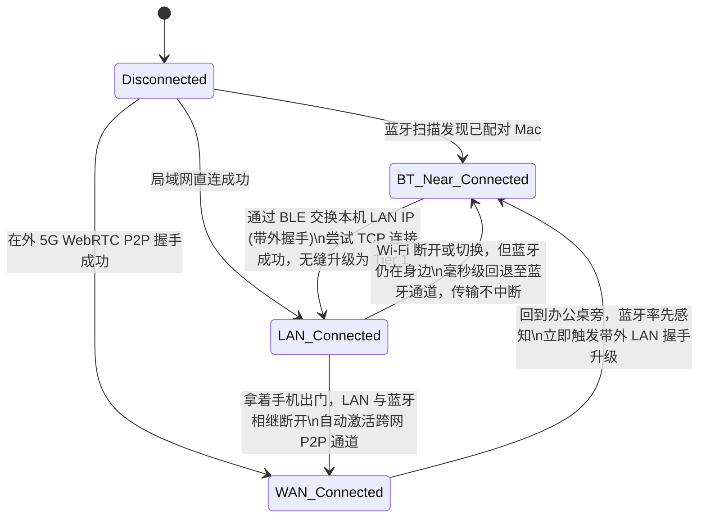
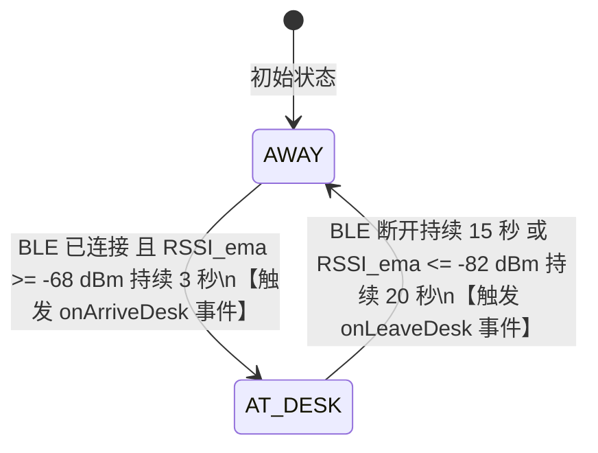

# 05. 模块二细化设计：三级自适应传输层与蓝牙空间感知

> **模块定位**：负责在 Mac 宿主端（`omsd`）与小米手机端（`OneMoreStep.apk`）之间维护一条**全天候、无感切换、兼容手机常驻 VPN 且零自建服务器**的逻辑长连接通道（`OmsSession`），同时利用蓝牙信号提供物理空间的「在场感知（Presence Engine）」。

---

## 1. 三级通道架构与选路状态机

系统同时管理三条物理通道，向上层统一暴露单一的 `OmsChannel` 接口（发送/接收模块一定义的 8 字节帧数据包）：

| 优先级 | 通道名称 | 物理介质与协议 | 典型延迟 | 吞吐量 | 适用场景与核心优势 |
| :---: | :--- | :--- | :---: | :---: | :--- |
| **Tier 1 (最高)** | `LAN_WS` | 局域网 WebSocket over TLS (`wss://<lan_ip>:19527`) | `1 ~ 5 ms` | `30 ~ 80 MB/s` | 手机与 Mac 在同一 Wi-Fi（或蓝牙握手直连成功），跑满局域网带宽，秒传原图与大文件。 |
| **Tier 2 (近场兜底)** | `BT_RFCOMM` | BLE GATT（信令/感知）+ Classic Bluetooth RFCOMM（数据流） | `15 ~ 40 ms` | `120 ~ 250 KB/s` | 在公司隔离 Wi-Fi、咖啡厅、高铁/飞机无网、或手机全局 VPN 阻断局域网时，**只要手机在电脑旁 10 米内即可 100% 连通**。 |
| **Tier 3 (远程跨网)** | `WAN_WEBRTC` | WebRTC `RTCDataChannel` (UDP STUN 打洞) + 可选 WSS 中继 | `30 ~ 120 ms` | `2 ~ 15 MB/s` | 人离开电脑旁（在外使用 5G 蜂窝流量），**免自建服务器、不占用 Android 系统 VPN 槽位**。 |

### 1.1 多通道并发保活与「先建后断（Make-Before-Break）」热切换



- **无缝切换机制（Session Migration）**：
  - `OmsSession` 的会话状态（包括正在传输的文件 `stream_id` 和未决的 JSON-RPC `req_id`）绑定在逻辑层，而非单条物理 Socket。
  - 当新通道（如 `LAN_WS`）建立并通过 Challenge-Response 认证后，直接将 `activeTransport` 指针原子切换到新通道，随后优雅关闭旧通道（或保留 BLE 作为低功耗心跳与距离监测），正在传输的文件通过 `0x04 STREAM_ACK_RESUME` 帧自动在高速通道上接着传剩余分块。

---

## 2. 蓝牙双模通道详细设计（BLE + Classic RFCOMM）

蓝牙模块采用 **「BLE 负责低功耗发现、在场测距与带外 IP 交换 + Classic RFCOMM 负责实际帧数据传输」** 的混合架构。

### 2.1 交互流程

```mermaid
sequenceDiagram
    participant MacTS as Mac omsd (TypeScript)
    participant MacSwift as Mac bluetooth-bridge (Swift)
    participant PhoneBT as 小米 APK BluetoothManager

    MacTS->>MacSwift: 启动本地 IPC (~/.one_more_step/run/bt.sock)
    MacSwift->>MacSwift: 1. 开启 CoreBluetooth BLE 外设广播 (Service UUID: 0xFD9A)\n2. 开启 IOBluetooth RFCOMM Server 监听 Channel
    PhoneBT->>MacSwift: BLE 后台扫描匹配已配对 Service UUID，建立 GATT 连接
    PhoneBT->>MacSwift: 读取 Characteristic [Mac Info]: 获取 Mac 当前 LAN IP 列表 + RFCOMM MAC/Channel
    PhoneBT->>MacSwift: 写入 Characteristic [Phone Info]: 上报手机 LAN IP + 当前 RSSI
    Note over PhoneBT,MacTS: 【路径 A：优先尝试蓝牙引导的局域网高速直连】
    PhoneBT->>MacTS: 直接向 Mac 汇报的 LAN IP:19527 发起 WebSocket 连接
    alt 局域网无隔离，直连成功 (耗时 < 100ms)
        MacTS-->>PhoneBT: 建立 Tier 1 (LAN_WS) 高速通道，BLE 仅保留 RSSI 测距
    else 公司 Wi-Fi 开启了 AP 隔离 / 无 Wi-Fi 环境
        Note over PhoneBT,MacSwift: 【路径 B：自动启用经典蓝牙 RFCOMM 数据通道】
        PhoneBT->>MacSwift: connectRfcommSocket(UUID) 建立字节流连接
        MacSwift <--> MacTS: 通过本地 Unix Socket 透明转发 8 字节协议帧
    end
```

### 2.2 macOS 端 `bluetooth-bridge` (Swift) 设计
由于 Node.js 社区的蓝牙 C++ 原生插件（如 `noble`）在 macOS 新系统与 Node v25 下经常出现编译兼容问题，我们在 `mac-host/bluetooth-bridge/` 下编写一个 **约 250 行的纯原生 Swift 命令行守护助手**（使用 macOS 系统自带的 `swiftc` 编译为单一可执行文件，零第三方依赖）：
- 调用 macOS 原生 `CoreBluetooth` (`CBPeripheralManager`) 与 `IOBluetooth` (`IOBluetoothRFCOMMChannel`)。
- 通过本地 Unix Domain Socket (`~/.one_more_step/run/bt.sock`) 与 TypeScript 主进程 `omsd` 通信，向上层屏蔽所有底层蓝牙细节。

### 2.3 小米 Android 端蓝牙权限与后台扫描适配
- Android 12+ (API 31+) 仅需声明：
  - `android.permission.BLUETOOTH_SCAN`（加上 `android:usesPermissionFlags="neverForLocation"`，无需为此申请敏感的地理位置权限！）
  - `android.permission.BLUETOOTH_CONNECT`
  - `android.permission.BLUETOOTH_ADVERTISE`
- 使用 `BluetoothLeScanner` 配合硬件级 `ScanFilter`（指定我们配对生成的 128-bit Service UUID），由小米蓝牙芯片协处理器在底层硬件过滤，息屏待机一整天耗电低于 1%。

---

## 3. 局域网通道与小米常驻 VPN 共存方案

你平时在小米手机上会开启常驻 VPN 软件（如 Clash Meta / Sing-box / NekoBox 等）。如果 VPN 处于全局 TUN 劫持模式，有时会导致手机无法直接访问局域网内 Mac 的 IP，或者让跨网 P2P 绕行海外代理节点减速。

### 3.1 零冲突解决方案（双重保障）
1. **Android `ConnectivityManager.bindProcessToNetwork` 物理网卡直绑（代码级自动实现，无需手动配置）**：
   - 在 Android 原生 Kotlin 中，即使系统开启了其他 VPN App，我们的 APK 可以通过 `ConnectivityManager` 查找当前具备 `TRANSPORT_WIFI`（局域网）或 `TRANSPORT_CELLULAR`（蜂窝移动网）且 `NET_CAPABILITY_NOT_VPN` 的底层物理 `Network` 对象！
   - 当向 Mac 的局域网 IP 发起连接时，直接调用 `wifiNetwork.socketFactory.createSocket()` 绑定到物理 Wi-Fi 网卡发包，**从代码底层直接绕过手机上的常驻 VPN TUN 虚拟网卡**！
2. **VPN 软件「分应用代理（Per-App Proxy）」绕过引导（辅助推荐）**：
   - 在小米权限向导中提供一行提示：建议在常驻 VPN 软件的「分应用代理」中将 `OneMoreStep` 勾选为「绕过/不走代理」，这样无论是局域网还是国内 STUN 打洞都能获得最低延迟。

---

## 4. 免服务端跨网通道设计（WebRTC P2P + 可选 WSS 中继）

当人离开蓝牙与局域网范围（在外使用 5G 流量）时，启用 `Tier 3` 跨网通道。

### 4.1 为什么采用 WebRTC `RTCDataChannel` + 加密 Serverless 信令？
- **零自建服务器**：
  - 信令阶段（仅交换几百字节的 SDP 与 ICE Candidate）默认可通过免费的公共 MQTT over WSS Broker（如 EMQX 公共 Serverless 节点）进行。
  - **端到端加密信令**：信令 Topic 由配对时派生的 `SHA256(wan_room_id + date)` 动态生成，且信令载荷全部使用配对协商的共享密钥进行 `ChaCha20-Poly1305` 加密——公共 Broker 只看到乱码，且无法伪造任何握手包。
- **点对点打洞直连**：
  - Mac 端使用纯 TypeScript 库 `werift`（无需编译 C++ 插件），Android 端使用 `io.github.webrtc-sdk:android`。
  - 利用国内高可用公共 STUN 节点（如腾讯 `stun.qq.com:3478`、小米 `stun.miwifi.com:3478`）完成 NAT 穿透，建立 DTLS 加密的 `RTCDataChannel`，直接承载模块一的统一 8 字节帧协议。
- **100% 兼容你的轻量云服务器或 Cloudflare Tunnel（可选保底配置）**：
  - 如果你在某些极端对称型 NAT 移动网络下想要 100% 确定性的直连，只需在 `config.json` 中填入一行 `relayWssUrl`（可以是免服务器的 `cloudflared tunnel` 域名，也可以是你轻量云服务器上的 30 行 WebSocket 转发脚本），客户端在 WebRTC 打洞超过 3 秒未通时自动回退到该 WSS 通道。

---

## 5. 蓝牙空间在场感知引擎（Presence Engine）

利用 BLE 连接状态与信号强度（RSSI），Mac 端 `omsd` 实时计算你当前所处的物理状态（`AT_DESK` 在电脑旁 vs `AWAY` 离开工位），驱动场景 4.1 与 4.2 的无感自动化。

### 5.1 防抖动滞回滤波算法（Hysteresis & EMA Filter）
由于无线电信号会有瞬时波动，为防止你坐在座位上时状态频繁在“在场/离开”之间横跳，采用 **指数移动平均（EMA）+ 双阈值时间窗滞回算法**：

$$
\text{RSSI}_{\text{ema}}(t) = \alpha \cdot \text{RSSI}_{\text{raw}}(t) + (1 - \alpha) \cdot \text{RSSI}_{\text{ema}}(t-1), \quad (\alpha = 0.3)
$$



### 5.2 在场状态转换触发的自动化动作

| 状态转换事件 | 系统自动执行的协同动作 |
| :--- | :--- |
| **`AWAY ➔ AT_DESK`<br>（你拿着手机坐到电脑前）** | 1. 立即通过蓝牙带外握手唤醒局域网 `LAN_WS` 高速通道；<br>2. 触发手机端 `OutboxSyncWorker`，将你在路上/地铁积压的截图、知识库分享、语音闪念静默同步至 Mac Inbox；<br>3. 若为当日首次到岗（如 07:00~11:00），记录到岗事件并可配置自动拉取今日手机日历日程生成晨间简报。 |
| **`AT_DESK ➔ AWAY`<br>（你拿着手机离开工位）** | 1. 将 `omsd` 的通知路由策略自动切换为 **`REMOTE_MOBILE_FIRST`**：此后 Codex / Antigravity 调用的通知或审批请求不再只停留在电脑屏幕，而是立即通过跨网通道推送到手机；<br>2. 自动锁紧手机 GUI 远程控制的默认安全等级。 |
