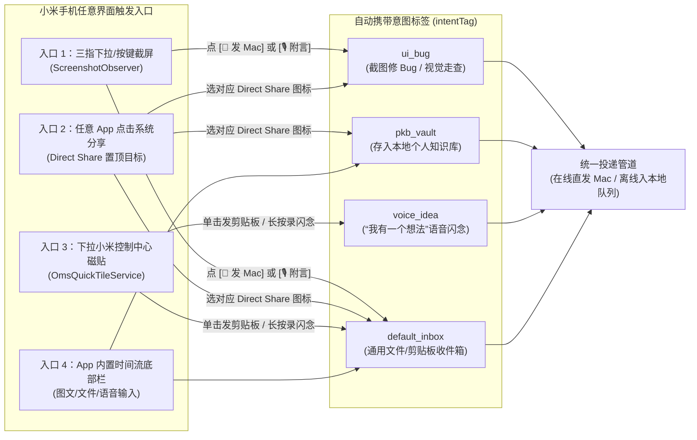

# 06. 模块三细化设计：Android 免 IM 极速投递、内置时间流与知识库联动

> **模块定位**：彻底取代“打开微信/钉钉文件传输助手”的繁琐路径，利用 Android 原生系统级入口打造 **1 秒极速投递体验**，并在 App 内提供清爽的双向时间流、远程监工审批卡片与通勤 TTS 随身听功能。

---

## 1. 四大免 IM 极速投递入口详细设计



### 1.1 入口一：截屏秒传悬浮胶囊 (`ScreenshotPillService`)
- **监听原理**：
  - 在前台服务中注册 `ContentObserver` 监听 `MediaStore.Images.Media.EXTERNAL_CONTENT_URI`。
  - 当触发 `onChange(uri)` 时，查询该图片的 `RELATIVE_PATH`（包含 `Screenshots`）与 `DATE_ADDED`（距当前时间 `< 3 秒`），且 `IS_PENDING == 0`（确认小米系统已写盘完成），并使用 `lastHandledMediaId` 去重防止多次触发。
- **胶囊 UI 与交互（绝不打扰正常使用）**：
  - 通过 `WindowManager` 添加一个 `TYPE_APPLICATION_OVERLAY` 悬浮视图，带 `FLAG_NOT_FOCUSABLE`（**不抢占当前 App 的键盘焦点，不影响你继续打字或滑动**），贴在屏幕右侧边缘偏上位置。
  - **胶囊内容**：`[缩略图] [🚀 发 Mac] [🎙️]`。
  - **3.5 秒无操作自动丝滑淡出消失**；向左轻扫也可立即滑走关闭。
  - **点击 `[🚀 发 Mac]`**：立即将原图（或快速压缩副本）打包为 `inbox.submitItem` 发往 Mac，胶囊变为 `✅ 已送达 Mac` 并在 0.8 秒后消失，伴随清脆的 `HapticFeedbackConstants.CONFIRM` 线性马达震动。
  - **按住 `[🎙️]` 说话**：松手后自动通过 Android 原生 `SpeechRecognizer`（或直接打包 `.m4a` 音频流）将你的语音指令（如“把这个页面底部留白改小一点”）作为 `voiceTranscript` 附带在截图上一并发给 Mac AI。

---

### 1.2 入口二：系统分享面板 Direct Share 三大直达目标 (`ShareReceiverActivity`)
- **痛点解决**：普通系统分享需要先点 App 图标，再跳进 App 选发给谁。我们利用 Android `ShortcutManagerCompat.pushDynamicShortcut` 注册 **3 个置顶 Direct Share 目标**，点开系统分享菜单第一排直接出现三个具体动作，点一下即刻在原界面静默完成发送：
  1. **`🚀 发给 Mac Inbox`** (`intentTag = "default_inbox"`)：适合随手传照片、PDF、安装包、文字段落。
  2. **`📚 存入个人知识库`** (`intentTag = "pkb_vault"`)：在公众号、小红书、浏览器、arXiv 看到好文章或长图时点击，弹窗提供可选的一句话语音/文字批注框（3 秒不输入则直接静默投递），Mac 端收到后直接归入个人知识库待处理区。
  3. **`🐛 发给 AI 修 Bug`** (`intentTag = "ui_bug"`)：强制弹出半屏语音/文字附言框，让你补充一句问题描述后连同截图/日志发给电脑上的 Codex/Antigravity。
- **多类型载荷兼容**：
  - 完整支持 `Intent.ACTION_SEND`（单图、单文件、`text/plain` 链接/文本）与 `Intent.ACTION_SEND_MULTIPLE`（一次在相册勾选 9 张白板照片批量打包发送）。

---

### 1.3 入口三：小米控制中心快捷磁贴 (`OmsQuickTileService`)
- **挂载位置**：小米澎湃 OS 右上角下拉控制中心，添加「OneMoreStep」磁贴（副标题实时显示：`Mac 已连接 (LAN)` / `Mac 已连接 (蓝牙)` / `远程在线`）。
- **突破 Android 10+ 后台读剪贴板限制的优雅方案（`ClipboardCatcherActivity`）**：
  - Android 10+ 规定只有拥有当前窗口焦点（Window Focus）的 Activity 才能调用 `ClipboardManager.getPrimaryClip()`。
  - 当你下拉控制中心单击磁贴时，`TileService` 立即拉起一个 **全透明、无动画、1×1 像素的主题 Activity (`Theme.Translucent.NoTitleBar`)**：
    - 在 `onWindowFocusChanged(hasFocus = true)` 触发的瞬间（耗时 `< 30ms`），读取剪贴板文本/图片并投递给 Mac，随后立即调用 `finish()` 销毁自身并收起控制中心，肉眼几乎无感知，100% 稳定读取剪贴板！
- **长按磁贴（「我有一个想法」语音闪念速记）**：
  - 配置 `<meta-data android:name="android.service.quicksettings.ACTIVE_TILE" />` 并拦截 `ACTION_QS_TILE_PREFERENCES`，长按磁贴直接呼出半屏卡片 `VoiceIdeaSheetActivity`：
  - 打开即自动开始录音与实时语音转文字，说完点发送，直接带着 `intentTag = "voice_idea"` 飞向 Mac。

---

## 2. Jetpack Compose 内置双向时间流与核心交互卡片

当你主动点开桌面的 `OneMoreStep` 图标时，无需任何繁杂菜单，直接进入极简的 **「Mac AI ⇄ 小米手机 双向时间流 (`StreamTimelineScreen`)」**。

### 2.1 界面布局结构与防拥堵设计（v1.2+）

针对长期使用后消息记录增多的问题，采用 **「四维分类 Tab + 关键词搜索 + 日期分组 + 默认紧凑折叠卡片 + 一键清理历史」** 架构：

1. **顶部多维筛选 Tab 与搜索/清理栏**：
   - 支持按 `全部`、`🤖 Mac推来`、`📱 我发出的`、`⚠️ 待审批` 实时筛选；
   - 点击 `🔍搜索` 可按标题、正文、语音转写或标签过滤；
   - 点击 `🧹清理` 一键清除所有已同步/已处理历史记录（自动保留未同步与待审批项）。
2. **按日期自动分组 (`📅 今天` / `📅 昨天` / `📅 MM月dd日`)**：
   - 时间流按自然日聚合展示，清晰区分当日动态与历史记录。
3. **默认紧凑折叠卡片 (`StreamTimelineCard`) + 点击展开详情**：
   - 默认仅展示 **1 行标题 + 2 行正文摘要 + 44dp 图片缩略图 + 短时间戳**，一屏可浏览更多记录；
   - 点击卡片任意位置即可展开查看完整长文、大图预览、Mac 落盘路径，以及 `[🎧 TTS朗读]`、`[📋复制]`、`[🗑️删除]` 等操作按钮（`PENDING_APPROVAL` 待审批卡片默认自动展开）。
4. **智能 APK 更新校验 (`checkOtaUpdate`)**：
   - 点击右上角 `🔄更新` 时，先请求 Mac 端 `GET /apk/version`，比对本地已安装 APK 的 `versionCode` 与二进制 `SHA-256`；
   - 若已是最新版，直接弹出 Toast `✅ 当前已是最新版本`，**绝不盲目拉起浏览器重复下载**；
   - 仅当检测到新版本或新编译产物时，才弹出版本对比确认框，确认后再触发下载安装。

```text
+-------------------------------------------------------------------+
| ● 已连接 MacBook Pro (局域网 2ms · 在电脑旁)        [权限自检] [设置] |
+-------------------------------------------------------------------+
|                                                                   |
|  [你 · 10:15 · 截屏胶囊投递 #ui_bug]                              |
|  +---------------------------------------------+                  |
|  | 🖼️ screenshot_20261021.png (1.2 MB)         |                  |
|  | 🎙️ "底部按钮边距歪了，按这个设计稿改一下"      |                  |
|  |                                  ✓ 已存 Inbox|                  |
|  +---------------------------------------------+                  |
|                                                                   |
|  [🤖 Antigravity / Codex · 10:18 · 远程审批请求]                   |
|  +-------------------------------------------------------------+  |
|  | ⚠️ 需要确认：是否执行数据库迁移并重启测试服务？                  |  |
|  | 修改文件：3 个 (+42 / -12 lines)                             |  |
|  | > ALTER TABLE users ADD COLUMN last_sync_at TIMESTAMP...    |  |
|  |                                                             |  |
|  | [ ✅ 批准继续 ]    [ ❌ 拒绝 ]    [ 🎙️ 语音补充意见 ]           |  |
|  +-------------------------------------------------------------+  |
|                                                                   |
|  [🤖 Mac AI 推送 · 11:30 · 通勤随身包]                             |
|  +-------------------------------------------------------------+  |
|  | 📄 OneMoreStep_可行性报告_v2.md                              |  |
|  | [ 📖 全屏阅读 ]  [ 🎧 TTS 朗读 (1.25x) ]  [ 📋 复制全文 ]      |  |
|  +-------------------------------------------------------------+  |
|                                                                   |
+-------------------------------------------------------------------+
| [ ➕ 发图/文件 ]  [ 输入消息或按住 🎙️ 说话直达 Mac... ]     [ 发送 ] |
+-------------------------------------------------------------------+
```

### 2.2 远程监工审批卡片 (`ApprovalCard`) 交互闭环
- 当你在外吃饭或离开座位，Mac 上的 Agent 调用了 `phone_request_approval`：
  1. 手机弹出高优通知（通知栏自带 Direct Action 按钮：无需打开 App 即可直接在通知栏点 `批准` 或 `拒绝`）；
  2. 点进 App 时间流可查看完整的上下文代码 Diff 预览；
  3. 若点击 `[🎙️ 语音补充意见]`，你可以直接说：“先不要删旧字段，只加新字段”，手机将 `{ selectedOption: "custom_feedback", userComment: "先不要删旧字段，只加新字段" }` 通过 `approval.respond` 发回 Mac，Agent 立即按照你的新指示修改方案。

### 2.3 通勤随身听模式 (`CommuteTtsPlayer`)
- 针对 Mac AI 通过 `phone_file_push` 推送过来的研究报告、论文总结或长文档：
  - 内置轻量 Markdown 渲染视图；
  - 点击 `[🎧 TTS 朗读]` 后，自动清洗 Markdown 符号（去除代码块与表格边框），按自然段切分，调用小米系统内置的高音质中文语音引擎（`android.speech.tts.TextToSpeech`），并在系统锁屏媒体控制中心（`MediaSession`）挂载上一首/下一段/暂停/1.25x~2.0x 倍速按钮，走路或坐地铁戴耳机即可听完。

---

## 3. 手机端本地数据库设计（Room SQLite Schema）

使用 Android Jetpack Room 持久化所有双向流记录与离线待发队列：

```kotlin
// 1. 双向时间流消息表
@Entity(tableName = "stream_items")
data class StreamItemEntity(
    @PrimaryKey val itemId: String,          // UUIDv7
    val direction: String,                   // "PHONE_TO_MAC" | "MAC_TO_PHONE" | "SYSTEM_LOG"
    val itemType: String,                    // "MEDIA" | "FILE" | "TEXT" | "VOICE_IDEA" | "APPROVAL" | "CAPABILITY_LOG"
    val intentTag: String,                   // "default_inbox" | "pkb_vault" | "voice_idea" | "ui_bug"
    val title: String?,
    val textContent: String?,
    val voiceTranscript: String?,
    val localFileUri: String?,               // 手机本地文件 URI 或缓存路径
    val macSavedPath: String?,               // Mac 端落盘后的绝对路径回执
    val syncStatus: String,                  // "QUEUED" | "SENDING" | "DELIVERED" | "FAILED"
    val metadataJson: String?,               // 审批选项、已选结果或文件哈希等扩展字段
    val createdAtMs: Long
)

// 2. 离线分块断点续传状态表
@Entity(tableName = "transfer_streams")
data class TransferStreamEntity(
    @PrimaryKey val streamId: String,
    val itemId: String,
    val fileUri: String,
    val totalBytes: Long,
    val chunkSize: Int,
    val lastAckedChunkIndex: Int,            // 用于断线重连后发送 STREAM_ACK_RESUME 续传
    val sha256: String
)
```
