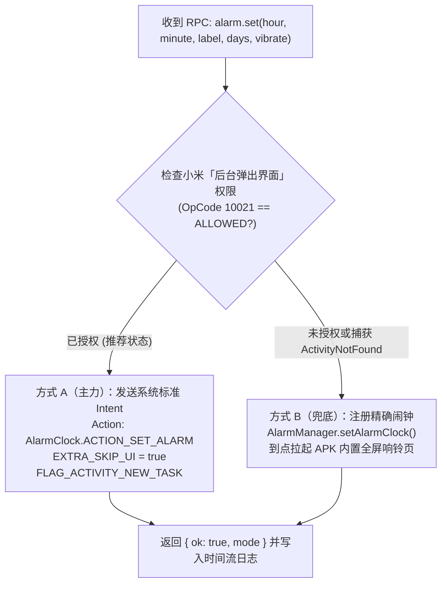

# 07. 模块四细化设计：Android 确定性系统能力与小米 HyperOS 深度适配

> **模块定位**：负责将 Mac 端 AI 下发的确定性指令（设闹钟、查改日历、拉取手机最新截图与授权目录文档、发送 L1~L3 分级通知与 TTS 播报）直接映射为 Android 原生系统 API 调用，并针对 **小米 HyperOS / MIUI** 的权限与后台机制提供专项适配。

---

## 1. 原生系统闹钟执行器 (`AlarmExecutor`)

### 1.1 双轨保障设计（系统时钟优先 + AlarmManager 兜底）



### 1.2 核心实现细节
1. **AndroidManifest.xml 权限声明**：
   ```xml
   <!-- 注意：必须使用全限定名 com.android.alarm.permission.SET_ALARM -->
   <uses-permission android:name="com.android.alarm.permission.SET_ALARM" />
   <uses-permission android:name="android.permission.USE_EXACT_ALARM" />
   ```
2. **周期性闹钟转换**：
   - `AlarmClock.EXTRA_DAYS` 接收 `ArrayList<Int>`，遵循 `java.util.Calendar` 常量（周日=`1`，周一=`2` ... 周六=`7`）。`AlarmExecutor` 自动将标准 ISO 星期（`1=周一...7=周日`）转换为 Android `Calendar` 枚举后传入小米系统时钟（`com.android.deskclock`）。
3. **为什么小米上必须配合 `OpCode 10021`？**
   - 即使传入了 `EXTRA_SKIP_UI = true`，Android 系统的 `ACTION_SET_ALARM` 本质上仍然是一个隐式 `Activity` 调用。当手机处于锁屏或 `OneMoreStep` 在后台运行时，小米 HyperOS 默认会拦截后台 Service 发起的任何 `startActivity`。一旦在我们的「小米权限自检向导」中开启了 **「后台弹出界面」**，小米系统时钟就能在后台 100% 静默建好闹钟并立即出现在你的系统状态栏闹钟图标中。

---

## 2. 原生系统日历与提醒执行器 (`CalendarExecutor`)

通过 `READ_CALENDAR` 与 `WRITE_CALENDAR` 权限，直接读写系统 `CalendarContract` 数据库。

### 2.1 自动识别小米主日历账户 (`resolvePrimaryCalendarId`)
不同手机内部存在多个日历表（小米云日历、本地日历、节假日订阅日历）。写入日程前按以下优先级自动定位目标 `calendar_id`：
1. 查询 `CalendarContract.Calendars.CONTENT_URI`，筛选 `VISIBLE == 1` 且 `CALENDAR_ACCESS_LEVEL >= CAL_ACCESS_CONTRIBUTOR`；
2. 优先匹配 `IS_PRIMARY == 1` 或 `ACCOUNT_TYPE == "com.xiaomi"`；
3. 次选匹配小米本地账户（`ACCOUNT_TYPE == "LOCAL"` 或 `CALENDAR_DISPLAY_NAME` 包含 `"本地"` / `"Phone"`）。

### 2.2 日程防冲突查询 (`calendar.list`) 与写入 (`calendar.insert`)
- **展开周期性事件查询**：
  - 查询未来 N 天日程时，**不直接查 `Events` 表**（因为每周例会等重复日程在 `Events` 表只有一条初始记录），而是使用 **`CalendarContract.Instances.query(contentResolver, projection, startMs, endMs)`**，由系统自动展开所有重复会议实例，确保 Mac AI 帮你排计划时绝不会漏掉每周固定例会。
- **静默写入事件与提醒**：
  1. 向 `CalendarContract.Events.CONTENT_URI` 插入标题、描述、起止毫秒时间戳及本地时区（`TimeZone.getDefault().id`）；
  2. 获取返回的 `eventId` 后，立即向 `CalendarContract.Reminders.CONTENT_URI` 插入一条 `METHOD = METHOD_ALERT`、`MINUTES = reminderMinutes`（默认提前 15 分钟）的记录。小米系统日历会立即同步并在到点时触发原生系统级提醒。

---

## 3. 受权目录与媒体按需读取器 (`ScopedStorageExecutor`)

为了让你在电脑前说一句“看看我手机刚截的图 / 刚拍的白板照 / 刚下的 PDF”就能直接拉取，同时**绝对保障你手机其他隐私目录的安全**，采用 **「受权目录别名白名单（Alias Allowlist）」** 机制。

### 3.1 默认白名单目录与权限映射

| 目录别名 (`dirAlias`) | 指向的手机物理/媒体路径 | 所需权限 | 默认状态 |
| :--- | :--- | :--- | :---: |
| `screenshots` | `MediaStore.Images` 中 `RELATIVE_PATH LIKE '%Screenshots%'` | `READ_MEDIA_IMAGES` (Android 13+) | 默认开启 |
| `camera` | `MediaStore.Images` 中 `RELATIVE_PATH LIKE '%DCIM/Camera%'` | `READ_MEDIA_IMAGES` | 默认开启 |
| `download` | 公共下载目录 `/storage/emulated/0/Download/` | 通过 SAF 目录授权或文件访问权限 | 需在 App 内勾选开启 |
| `custom_<name>` | 用户在 App 内通过系统文件夹选择器（`ACTION_OPEN_DOCUMENT_TREE`）手动添加的任意工作目录（如微信/钉钉接收文件目录） | SAF 持久化 URI 权限 (`takePersistableUriPermission`) | 按需手动添加 |

### 3.2 严格防越界安全校验
- 当收到 `storage.listDir` 或 `storage.pullFile` 请求时：
  1. 首先检查 `dirAlias` 是否在当前已开启的白名单字典中，若不在则直接拒绝并返回 `-32002 ERR_SCOPED_PATH_DENIED`；
  2. 对子路径参数执行 `File.canonicalPath` 规范化校验，严禁任何包含 `..` 或软链接跳出白名单根目录的访问；
  3. 每次 Mac AI 拉取文件时，自动在 APK 的「双向时间流」中留下一条透明审计记录：`🤖 Mac AI 读取了文件：screenshot_2026.png`，让你对 AI 读取过什么一目了然。

---

## 4. L1~L3 分级触达与突破勿扰语音播报 (`NotificationExecutor`)

为了解决“普通通知淹没在群消息里看不到，或者半夜/开会勿扰模式下紧急故障叫不醒你”的痛点，APK 预设 **3 个独立的系统通知渠道（`NotificationChannel`）**：

| 级别 | Channel ID | 系统重要性 | 行为特征与适用场景 |
| :---: | :--- | :---: | :--- |
| **L1 (静默)** | `oms_silent_stream` | `IMPORTANCE_LOW` | 无声、无震动、不弹横幅，仅写入 APK 内置时间流（适合日常日志归档、非紧急知识库入库回执）。 |
| **L2 (常规)** | `oms_standard_notify` | `IMPORTANCE_DEFAULT` | 标准通知栏提示音与短震动，支持通知栏快捷按钮（适合任务完成汇报、文件推送到位提醒）。 |
| **L3 (强触达)** | `oms_urgent_alert` | `IMPORTANCE_HIGH` | **1. 突破勿扰 (`setBypassDnd(true)`)**<br>**2. 锁屏全屏唤醒卡片 (`setFullScreenIntent`)**<br>**3. 高强度持续震动波形**<br>**4. 闹钟声道强制 TTS 语音播报** |

### 4.1 L3 级「静音模式下依然能开口说话提醒你」的实现原理
平时很多人的手机常年把「媒体音量（`STREAM_MUSIC`）」关成静音。如果普通 TTS 走媒体声道，关键时刻根本听不见。
因此，当 `notify.send(level = "urgent", ttsSpeak = true)` 触发时，`NotificationExecutor` 在调用 `TextToSpeech.speak()` 时显式绑定 **闹钟音频属性（`USAGE_ALARM`）**：
```kotlin
val alarmAudioAttrs = AudioAttributes.Builder()
    .setUsage(AudioAttributes.USAGE_ALARM)
    .setContentType(AudioAttributes.CONTENT_TYPE_SPEECH)
    .build()
tts.setAudioAttributes(alarmAudioAttrs)
```
这样只要你的手机闹钟能响，L3 紧急语音播报就能清晰读出提醒内容！

---

## 5. 小米 HyperOS / MIUI 专属适配与一键权限自检向导

为了让这个自用 APK 在小米手机上达到 **99.9% 的后台保活率与零拦截执行力**，App 顶部内置 **「小米专属权限自检面板 (`XiaomiSetupWizardScreen`)」**，自动通过反射与系统 API 检测以下 5 项关键状态，并提供一键直达按钮：

### 5.1 小米专属隐藏权限 OpCode 反射检测表

在小米 HyperOS / MIUI 中，`AppOpsManager` 维护了几个标准 Android SDK 没有公开的专属权限码：

| 检查项 | 检测方式（Kotlin 实现） | 未开启时的后果 | 一键跳转小米设置页 Intent |
| :--- | :--- | :--- | :--- |
| **① 后台弹出界面**<br>*(小米最关键开关)* | 反射调用 `AppOpsManager.checkOpNoThrow(op = 10021, uid, pkg)`，判断返回值是否为 `MODE_ALLOWED (0)` | 锁屏/后台时无法静默调用系统时钟建闹钟，无法弹出控制中心剪贴板透明读取窗 | `Intent("miui.intent.action.APP_PERM_EDITOR").putExtra("extra_pkgname", packageName)` |
| **② 锁屏显示权限** | 反射调用 `AppOpsManager.checkOpNoThrow(op = 10008, uid, pkg)` | L3 紧急通知或远程审批无法在小米锁屏界面直接亮屏全屏展示 | 同上（跳转小米应用权限详情页直接勾选「锁屏显示」） |
| **③ 省电策略：无限制** | `PowerManager.isIgnoringBatteryOptimizations(pkg)` | 息屏半小时后后台长连接可能被小米冻结断连 | `Intent(Settings.ACTION_REQUEST_IGNORE_BATTERY_OPTIMIZATIONS, Uri.parse("package:$packageName"))` |
| **④ 悬浮窗权限** | `Settings.canDrawOverlays(context)` | 无法在截屏后显示右上角 3 秒「发给 Mac」快捷胶囊与 GUI 急停按钮 | `Intent(Settings.ACTION_MANAGE_OVERLAY_PERMISSION, Uri.parse("package:$packageName"))` |
| **⑤ 小米自启动开关** | 引导用户在列表中开启一次 | 手机重启后需手动点开一次 App 才能恢复连接 | `Intent().setComponent(ComponentName("com.miui.securitycenter", "com.miui.permcenter.autostart.AutoStartManagementActivity"))` |

### 5.2 常驻轻量前台服务保活架构 (`OmsCoreForegroundService`)
- 声明 Android 14+ 标准前台服务类型：`android:foregroundServiceType="connectedDevice|dataSync"`。
- 在通知栏常驻一条折叠后极简的状态栏通知（如：`🟢 MacBook Pro 已连接 · 局域网 2ms`，并在通知右侧直接放置 `[📋 发剪贴板]` 与 `[🎙️ 语音闪念]` 两个快捷按钮），既保证了小米系统永不杀进程，又把通知栏变成了一个随时可用的快捷入口。
