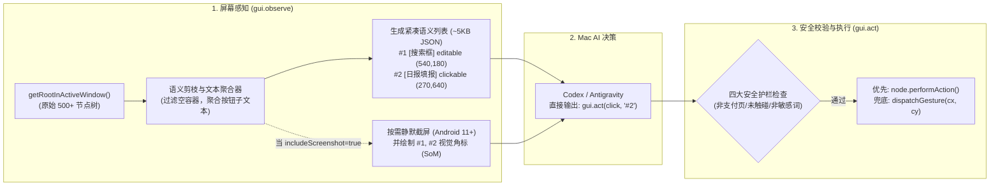
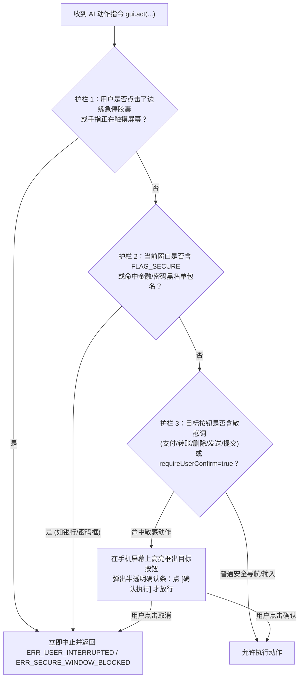

# 08. 模块五细化设计：Android 无障碍 GUI 屏幕自动化引擎与安全护栏

> **模块定位**：当目标操作没有公开系统 API（例如：操作钉钉填写工作台表单、抓取仅存在于手机封闭 App/小程序内的数据、进行移动端 H5/App 真机自动化点测）时，通过 Android 原生 `AccessibilityService` 为 Mac 端 AI 提供 **「看得清语义、点得准控件、随时可急停」** 的 GUI 自动化能力。

---

## 1. 整体工作流：语义树优先 + Set-of-Mark (SoM) 视觉增强

传统 GUI Agent 纯靠截图让视觉大模型猜 `(x, y)` 像素坐标，不仅慢（单步耗时 5~10 秒），而且在不同分辨率手机上极易点偏。本模块采用 **「紧凑语义控件树 + 按需 SoM 编号截图」** 双擎驱动：



---

## 2. 无障碍服务配置 (`accessibility_service_config.xml`)

为了同时具备**跨窗口节点读取**、**Android 11+ 静默截屏**与**手势注入**能力，无障碍服务声明如下：

```xml
<accessibility-service xmlns:android="http://schemas.android.com/apk/res/android"
    android:accessibilityEventTypes="typeWindowStateChanged|typeWindowContentChanged|typeViewClicked"
    android:accessibilityFeedbackType="feedbackGeneric"
    android:accessibilityFlags="flagReportViewIds|flagRetrieveInteractiveWindows|flagIncludeNotImportantViews"
    android:canPerformGestures="true"
    android:canRetrieveWindowContent="true"
    android:canTakeScreenshot="true"
    android:notificationTimeout="100" />
```

> [!NOTE]
> **关于 Android 13~15 侧载 APK「受限设置」的说明**：
> - 如果你是通过 Android Studio 或 `adb install` 安装本 APK，系统**自动豁免**受限设置，可直接在系统设置中开启无障碍服务；
> - 如果是通过手机本地点击 APK 安装，在首次进入无障碍设置时，我们的「小米权限向导」会引导你在应用详情页右上角点击一次「允许受限制的设置」即可开启。

---

## 3. 紧凑语义控件树提取与剪枝算法 (`SemanticTreeExtractor`)

### 3.1 为什么必须剪枝与聚合？
在微信、钉钉或小红书等复杂 App 中，一个列表项往往是：外层一个 `RelativeLayout (clickable=true, text=null)`，里面套了 4 层子 `TextView (clickable=false, text="周报审批")`。如果简单过滤掉无文本节点，就会丢掉真正能点击的外层容器；如果不剪枝，则会把几百个无意义的布局框全发给 AI。

### 3.2 三步剪枝与子节点文本聚合算法
1. **可见性过滤**：剔除 `!node.isVisibleToUser`、屏幕外坐标（`bounds.intersect(screenRect) == false`）或面积过小（宽或高 `< 5px`）的装饰性节点。
2. **可交互容器文本聚合（Child Text Aggregation）**：
   - 当遍历到一个 `isClickable || isEditable || isCheckable || isScrollable` 的容器节点 $N$，若 $N$ 自身的 `text` 与 `contentDescription` 为空，算法自动递归收集其子树中所有不可独立点击的纯文本节点的文字，拼接为 $N$ 的 `label`（例如自动合成为：`#8 [Button] "钉钉工作台 - 日报提交"`）。
3. **短编号映射与缓存**：
   - 为每个最终保留的有效节点分配从 `#1` 开始的短编号，并在内存中保留 `WeakReference<AccessibilityNodeInfo>` 映射表。
   - 输出给 Mac AI 的紧凑 JSON 结构（整个屏幕通常仅 20~45 个节点，体积 `< 6KB`）：
   ```json
   {
     "packageName": "com.alibaba.android.rimet",
     "activityName": ".biz.LaunchHomeActivity",
     "isSecureWindow": false,
     "screenWidth": 1080,
     "screenHeight": 2400,
     "nodes": [
       { "id": "#1", "role": "EditText", "label": "搜索", "editable": true, "bounds": [48, 132, 1032, 228], "center": [540, 180] },
       { "id": "#2", "role": "Button", "label": "工作台", "clickable": true, "selected": true, "bounds": [432, 2210, 648, 2360], "center": [540, 2285] },
       { "id": "#3", "role": "ViewGroup", "label": "日报 · 今日未提交", "clickable": true, "bounds": [48, 420, 510, 680], "center": [279, 550] }
     ]
   }
   ```

---

## 4. 静默截屏与 Set-of-Mark (`SoM`) 视觉标注合成 (`ScreenCapturer`)

当遇到小程序 Canvas、纯图标按钮（无 `contentDescription`）或需要做 UI 视觉验收（场景 1.3）时，AI 调用 `gui.observe(includeScreenshot = true, somAnnotation = true)`：

1. **零弹窗静默截屏**：直接调用 Android 11+ `AccessibilityService.takeScreenshot(Display.DEFAULT_DISPLAY, mainExecutor, callback)`（注意：Android 系统限制调用频率最快为每 1 秒 1 次，内部自带令牌桶限流）。
2. **Set-of-Mark (`SoM`) 编号绘制**：
   - 在截屏得到的 `Bitmap` 副本上，遍历刚刚提取出的 `#1 ~ #N` 节点：
   - 用 `2dp` 半透明亮色描边画出控件 `bounds` 矩形框，并在矩形左上角绘制高对比度胶囊角标 `#1`, `#2`...
   - 将合成后的图片压缩为 `80%` 质量的 WebP（单张仅约 `120 ~ 250 KB`）流式传回 Mac。这样多模态大模型一眼就能把视觉画面与 `#ID` 对应起来，彻底消除坐标估算误差！

---

## 5. 混合动作注入器 (`ActionInjector`)

当收到 `gui.act` 请求时，支持以下动作原语：

| 动作 (`action`) | 执行策略（双模式自动降级） |
| :--- | :--- |
| `click` / `long_click` | **1. 语义优先**：若指定了 `targetNodeId`（如 `#3`），优先调用 `node.performAction(ACTION_CLICK)`。<br>**2. 手势兜底**：若返回 `false`（部分自定义 View 或 WebView 屏蔽了无障碍点击），自动取该节点的中心坐标 `(cx, cy)`（叠加 `±2px` 随机偏移），通过 `dispatchGesture()` 注入 `80ms` 的真实物理点击手势。 |
| `input_text` | 先聚焦目标节点，随后通过 `Bundle().putCharSequence(ACTION_ARGUMENT_SET_TEXT_CHARSEQUENCE, text)` 调用 `ACTION_SET_TEXT` **瞬间填入长段中文/代码/链接**，无需弹出软键盘逐字敲击。 |
| `scroll` / `swipe` | 支持按方向语义滚动（`scroll_down` / `scroll_up`），或使用二次贝塞尔曲线生成平滑加减速的拟人滑动手势轨迹（`GestureDescription.StrokeDescription`）。 |
| `launch_app` / `open_url` | 直接通过 `PackageManager.getLaunchIntentForPackage(pkg)` 或 `Intent(ACTION_VIEW, Uri.parse(url))` 一步直达目标应用或测试页面，无需在桌面翻找图标。 |
| `back` / `home` / `recents` | 直接调用 `performGlobalAction(GLOBAL_ACTION_BACK / HOME / RECENTS)`。 |

---

## 6. 四大硬件级安全护栏（Safety Guardrails）

为了让 AI 操作手机既强大又绝对可控，在 `OmsAccessibilityService` 底层硬编码以下 **4 道不可绕过的安全闸门**：



1. **护栏一：顶部边缘「AI 操控中 · 点击急停」胶囊 (`SafetyStopOverlay`)**
   - 只要进入 `gui.*` 会话，手机屏幕状态栏下方立即浮现醒目的橙色呼吸胶囊：`🤖 Mac AI 正在操作 · 点击立即停止`。
   - 你任何时候点一下该胶囊，或者直接用手划动屏幕，无障碍服务立即切断当前自动化会话并向 Mac 返回 `-32005 ERR_USER_INTERRUPTED`。
2. **护栏二：`FLAG_SECURE` 与金融/系统核心页黑名单隔离**
   - 自动检测 `AccessibilityWindowInfo` 是否标记为安全窗口，并内置硬编码黑名单包名/界面（如支付宝付款码与收银台、微信支付密码框、各大手机银行、小米系统权限授权弹窗与卸载确认页）。一旦进入这些页面，既不截屏也不执行任何点击。
3. **护栏三：最后一步「提交/发送/删除」停顿确认机制**
   - 完美契合场景 5.1（如帮你填钉钉日报或拟定回复）：AI 可以一路自动打开 App、自动点击进入表单、自动把所有文字框填好；但当最后一步准备点击文本包含 `["提交", "发送", "发布", "删除", "付款", "确认转账"]` 的按钮时，系统自动拦截并挂起，在手机上发出轻震动提示你扫一眼点确认。
