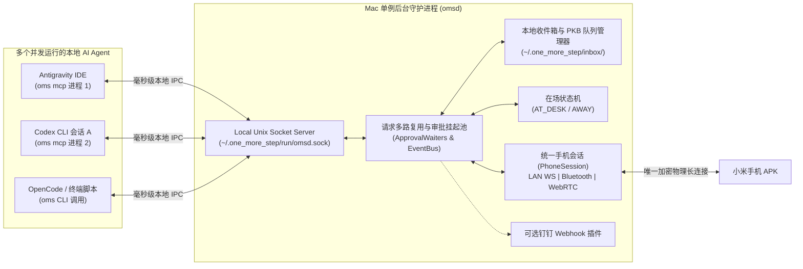

# 09. 模块六细化设计：Mac 宿主守护进程 (`omsd`)、本地收件箱与知识库触发器

> **模块定位**：运行在 macOS 后台的单例中枢服务（`omsd`）。它向下维持与小米手机的唯一长连接会话，向上通过本地 Unix Domain Socket 同时服务多个并发的 AI Agent（Codex、Antigravity、OpenCode 等），并管理本地收件箱（Inbox）、个人知识库待处理队列与在场感知路由。

---

## 1. 为什么采用「单例守护进程 `omsd` + 多 Agent 本地 IPC」架构？

你在日常开发中，往往会**同时打开多个 AI 工具或多个终端会话**（例如：一边开着 Antigravity IDE，一边在两个终端跑 Codex 和 OpenCode）。
如果让每个 AI 的 MCP 进程各自独立去连手机或监听端口，会导致端口抢占与蓝牙重复连接。因此，Mac 端采用经典的 **Daemon + Thin Client** 架构：



---

## 2. `~/.one_more_step/` 本地目录结构与数据规范

所有配置、密钥、日志与手机投递的文件统一收敛在 `~/.one_more_step/` 下，干净整洁、易于备份与清理：

```text
~/.one_more_step/
├── config.json                         # 全局配置文件（端口、白名单、钉钉 Webhook 等）
├── keystore/
│   ├── host_ed25519.key                # Mac 本机长期私钥 (权限 0600)
│   └── trusted_devices.json            # 已配对的小米手机公钥与设备信息
├── run/
│   ├── omsd.pid                        # 守护进程 PID
│   ├── omsd.sock                       # 供 MCP / CLI 调用的本地 Unix Domain Socket
│   └── bt.sock                         # 与 Swift bluetooth-bridge 通信的内部 Socket
├── logs/
│   └── omsd.log                        # 自动轮转的运行与审计日志
└── inbox/                              # 手机主动投递 & 按需拉取的本地文件库
    ├── latest.json                     # 永远指向最新一次手机投递的快捷元数据索引
    ├── pkb_pending.jsonl               # 待归入个人知识库 (pkb_vault / voice_idea) 的未处理队列
    ├── ui_bug_pending.jsonl            # 待修复的移动端 UI 报错截图队列
    ├── 2026-10-21/                     # 按日期分目录存储，避免单目录文件过多
    │   ├── 01J9X7A_screenshot/
    │   │   ├── meta.json               # 投递时间、意图标签、语音附言转写、来源 App
    │   │   └── screenshot_1201.png     # 实际图片/文档/音频文件
    │   └── 01J9X8B_idea/
    │       ├── meta.json
    │       └── voice_note.m4a
    └── pulled_cache/                   # 电脑 AI 调用 phone_file_pull 主动拉取的文件缓存
```

### 2.1 `inbox/latest.json` 快照格式
当你刚在手机上截屏点了「发给 Mac」，转头对电脑上的 AI 说：“看我刚从手机发过来的图”，AI 调用 `phone_inbox_latest` 直接读取 `latest.json`（耗时 `< 1ms`）：
```json
{
  "itemId": "01J9X7A8B9C0...",
  "receivedAt": "2026-10-21T13:40:12+08:00",
  "intentTag": "ui_bug",
  "textContent": null,
  "voiceTranscript": "底部按钮边距歪了，按这个截图改一下",
  "files": [
    {
      "fileName": "screenshot_1201.png",
      "absPath": "~/.one_more_step/inbox/2026-10-21/01J9X7A_screenshot/screenshot_1201.png",
      "mimeType": "image/png",
      "sizeBytes": 412890
    }
  ]
}
```

---

## 2.5 Mac 端直观查看与即时消费三层设计（v1.2+）

当手机向 Mac 发送文字、闪念或图片时，除了供 AI Agent 通过 MCP 读取外，Mac 端提供三层直观的人机消费体验：

1. **第一层：内置 Mac 实时收件箱与协同看板 (`http://127.0.0.1:19527/inbox` 或 `bun run oms web`)**
   - 实时流式展示手机发来的所有图文卡片（2 秒无感增量同步）；
   - **图片直出大图预览**：支持点击 Lightbox 放大查看原图、一键调用 macOS 原生 `Preview.app` 打开 (`👁️ Mac 预览打开`)、一键在 Finder 高亮定位 (`📂 Finder 定位`)；
   - **文本与 AI 提示词一键复制**：支持一键复制正文或带文件绝对路径的 AI 提示词；
   - **反向极速推送**：支持在网页看板直接输入文字/Markdown 推送至小米手机时间流或写入手机剪贴板。
2. **第二层：收到文字自动同步 Mac 剪贴板 (`autoCopyTextToClipboard`)**
   - 手机投递文字或语音转写到达 Mac 瞬间，`omsd` 自动通过 `pbcopy` 写入 Mac 系统剪贴板，并在通知横幅提示 `· 已复制可 ⌘V`，在任意编辑器直接按 `Cmd + V` 即可粘贴。
3. **第三层：收到图片/截图自动打开预览 (`autoPreviewImageOnMac`)**
   - 手机投递截图或照片到达 Mac 瞬间，`omsd` 自动调用 `open <absPath>` 唤起 macOS 原生预览窗口展示大图（可在 `/inbox` 看板顶部随时开关这两项自动联动）。

---

## 3. 与个人知识库（Personal Knowledge Base Vault）的安全联动机制

针对你在手机上产生的两类高频知识输入：
- **外部素材分享**（`intentTag == "pkb_vault"`：在公众号、小红书、浏览器、arXiv 点的系统分享）；
- **个人原创闪念**（`intentTag == "voice_idea"`：下拉控制中心磁贴录制的“我有一个想法…”）。

### 3.1 联动处理流水线（Staging Queue + Skill 协同）
为了严格遵守你个人知识库的治理规范（不在未经语义归类的情况下直接污染核心笔记目录）：
1. **第一阶段（`omsd` 实时收件与结构化暂存）**：
   - `omsd` 收到手机投递后，将附件与语音转写文本落盘至 `~/.one_more_step/inbox/YYYY-MM-DD/<itemId>/`，并在 `~/.one_more_step/inbox/pkb_pending.jsonl` 追加一条状态为 `"pending"` 的记录。
   - 若你当前处于 `AT_DESK`（在电脑旁），macOS 右上角弹出轻量原生通知：`📚 收到手机知识库投递：「关于本体论的思考」`。
2. **第二阶段（AI Agent 结合 `personal-knowledge-base` Skill 深度入库）**：
   - 当你在与 Antigravity / Codex 对话时说：“把手机上发过来的新想法/素材整理进我的知识库”，或者由晨间唤醒任务触发时：
   - AI 调用 `phone_inbox_latest(tag="pkb_vault" | "voice_idea")` 读取暂存队列，随后自动加载你的 `~/.codex/skills/personal-knowledge-base/SKILL.md` 规范，完成查重、关联既有观点并写入正确的 Vault 目标位置，最后将该条投递标记为 `"archived"`。

---

## 4. 在场感知智能通知路由（Presence-Aware Notification Router）

当电脑上的 AI Agent 调用 `phone_notify` 或 `phone_request_approval` 时，`omsd` 根据模块二的蓝牙在场状态机（`AT_DESK` vs `AWAY`）执行智能路由：

| 调用类型 | 当你在电脑前 (`AT_DESK`) | 当你离开工位 (`AWAY`) |
| :--- | :--- | :--- |
| **普通通知 (`normal`)** | 同时显示 macOS 桌面原生横幅通知 + 静默写入手机时间流（避免手机在桌上重复响铃吵你）。 | 立即通过跨网/局域网通道推送至小米手机弹出标准通知栏提醒。 |
| **紧急强触达 (`urgent`)** | macOS 弹窗提示 + 手机震动提醒。 | **触发手机端 L3 强触达**：突破勿扰模式、锁屏亮屏卡片、持续震动，并按需开启闹钟声道 TTS 语音播报。 |
| **远程监工审批 (`phone_request_approval`)** | 手机与电脑同时呈现审批选项，你在哪边顺手点哪边。 | 立即推送高优交互卡片到小米手机，挂起当前 MCP 请求（最长可等待 `timeoutSec`，默认 1800 秒），等你吃完饭/路上点选后瞬间唤醒 Mac AI 继续执行。 |

---

## 5. 可选钉钉机器人插件 (`DingTalkPlugin`)

针对你日常使用钉钉的习惯，`omsd` 内置零依赖的钉钉自定义机器人 Webhook 转发器（默认关闭，在 `~/.one_more_step/config.json` 中填入 `dingtalk.webhookUrl` 与加签密钥 `dingtalk.secret` 即可启用）：
- **签名算法**：标准 `HMAC-SHA256(timestamp + "\n" + secret)` Base64 URL 编码。
- **触发条件**：可配置当 AI 调用 `phone_notify` 携带 `syncDingtalk: true`，或当手机离线无法直达时，自动将 Markdown 格式的任务汇报、审批提醒同步发送到你的个人钉钉通知群。

---

## 6. macOS 开机自启与进程保活 (`LaunchAgent`)

通过 `oms daemon install` 命令，一键在 `~/Library/LaunchAgents/com.oms.daemon.plist` 生成标准 macOS 用户级守护配置：
- `RunAtLoad = true`（登录 Mac 即自动在后台静默启动 `omsd` 与 `bluetooth-bridge`）；
- `KeepAlive = true`（若进程意外退出，macOS `launchd` 在 1 秒内自动拉起恢复连接）。
