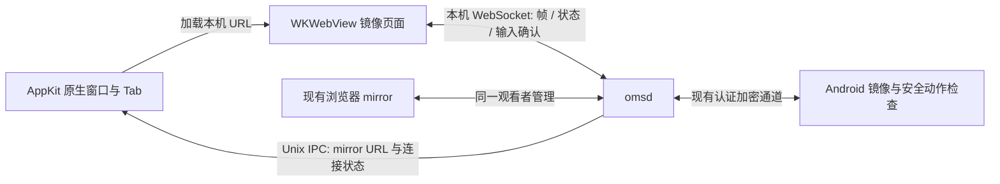

# Mac 浮窗「手机镜像」Tab 设计

日期：2026-11-15。源码基线：`5dc3720`（v1.6.5 后续 HUD 修复）。

状态：用户已确认「画面 + 现有远程操作，手动启动」方案，进入开发。本文描述目标行为，不代表已经真机验证通过。

## 1. 目标和成功标准

在现有 Mac 菜单栏浮窗内增加与「最近投递」并列的「手机镜像」Tab。用户无需打开浏览器，即可主动开始观看手机画面，使用现有触控、键盘与导航功能。

- 打开菜单、投递窗口或切到镜像 Tab 本身，不采集手机画面、不唤醒或解锁手机。
- 用户点击「开始镜像」才连接观看通道。锁屏时显示对应状态；解锁仍需用户明确点击。
- 离开镜像 Tab、关闭或隐藏窗口后，释放这个窗口的观看连接，不误停其他浏览器观看端。
- 输入、断线和异常都有真实结果反馈；重连不补发旧触控或文字。
- 投递列表、附件预览、标记已处理、菜单未读行为不退化。
- 第一轮以隔离的模拟手机、测试端口和临时目录验证；用户当前手机、真实收件箱和配对数据不参与测试。

## 2. 当前事实与可行性

| 模块 | 已有实现 | 对新功能的意义 |
| --- | --- | --- |
| `mac-host/mac-hud/main.swift` | AppKit `NSPanel`、投递列表与附件预览；当前失焦且未钉住就隐藏 | 可以加入原生 Tab，但镜像页需要独立的失焦规则 |
| `mac-host/src/inbox/inbox-web-dashboard.ts` | `/mirror` HTML、Canvas 解码、输入和导航按钮 | 复用展示与操作，不重新实现视频链路 |
| `mac-host/src/transport/session-manager.ts` | 本机 `/ws/mirror`、二进制帧转发、观看者集合 | 内嵌页可与浏览器共同观看同一采集流 |
| `mac-host/src/daemon/oms-daemon.ts` | 串行启停、代际失效、最后观看者离开 25 秒后停止 | 继续使用已有竞态保护和无人观看回收机制 |
| Android `OmsTransportClient.kt` | `mirror.start/stop/input`；蓝牙镜像拒绝；已有安全动作检查 | 预计不需要修改 APK 或重新配对 |

需要处理的现有行为：

1. 网页加载就建立 WebSocket，服务端看到观看者会自动启动，网页 `onopen` 也发送 start。直接嵌入会让选择 Tab 等同于开播。
2. 网页 stop 调用全局 `stopMirror()`，不能作为「离开当前 Tab」的实现。
3. 网页 WebSocket 关闭后无限重连，没有区分用户关闭与连接故障。
4. 输入框发送后立即清空并提示成功，页面没有消费 `input_ack`；不能表示手机实际执行成功。
5. HUD 状态目前不传 HTTP 端口，不能把默认 19527 写死在新视图中。

可行性结论：现有协议和页面支持这种嵌入。macOS WebKit 的 `WKWebView` 支持把 HTML/CSS/JavaScript 放进原生视图层级，并可通过导航代理限制页面跳转。具体 WebKit 图像解码、输入法和原生窗口行为仍需在实施时验证。

## 3. 方案比较

| 方案 | 优点 | 代价与限制 |
| --- | --- | --- |
| **A. 原生 Tab + WKWebView 复用 `/mirror`，推荐** | 共用现有帧协议、操作与安全检查；浏览器入口保留 | 增加 WebKit 进程；必须处理页面生命周期和原生焦点 |
| B. 全原生镜像视图 | 布局和键盘行为可完全原生化 | 需重写解码、帧调度、缩放、手势、输入与错误显示，维护两套客户端 |
| C. Tab 内仅提供浏览器打开按钮 | 改动最少 | 无法在当前窗口直接查看，不满足主要目标 |

选择 A。第一版不增加音频传输、录屏、多手机、多镜像窗口，也不迁移整个投递页为网页。

## 4. 界面与交互

```text
青简·咫尺    [ 最近投递 | 手机镜像 ]               [钉住] [关闭]
─────────────────────────────────────────────────────────
投递 Tab：最近记录列表 | 现有文本/附件速览

镜像 Tab：连接状态 / 画面状态        [画质] [开始/结束观看]
          ┌───────────────────┐    返回 / 桌面 / 多任务
          │ 按手机比例展示画面 │    唤醒解锁 / 锁屏
          │ 等待、锁屏或错误提示│    通知 / 音量 / 截屏
          └───────────────────┘
          [输入文字…] [填入] [填入并回车]   操作结果
```

- 右键菜单增加「手机镜像…」，只打开指定 Tab，不自动开播。
- 原「查看最近投递」与通知详情、`oms inbox peek` 明确进入投递 Tab；普通状态同步与新投递通知不抢走正在看的镜像 Tab。
- 保持一个浮窗、一个 WebView；保留现有窗口尺寸与可缩放能力。画面等比适配，不裁掉手机边缘。小窗口下按钮换行/滚动可达。
- 首次进入镜像页显示「开始镜像」和连接说明。蓝牙连接显示「实时镜像需要局域网连接」，不误报配对失效。
- 镜像 Tab 失焦时继续显示，方便在其他 Mac 应用旁观看；投递 Tab 保留未钉住时失焦收起的现有行为。钉住状态不被 Tab 自动改写。
- 镜像页 Esc、关闭按钮、切换投递页均结束当前观看；Esc 在中文输入法候选阶段先交给输入法，不转换为手机返回键。
- 窗口重新打开或重新回到镜像页后回到「开始镜像」，不自动恢复采集。
- 画质继续使用现有档位，默认 640 宽、质量 72、8 FPS。画质属于共享采集设置：已有浏览器在观看时沿用当前档位；主动修改时注明会影响其他观看端。

## 5. 组件和数据流



### 原生层

- 使用 `NSSegmentedControl` 切换两个内容容器；现有列表和详情作为投递容器保留。
- 在 `HudStatusPayload` / `HudStatusSnapshot` 增加可选 `mirrorUrl`，由 daemon 使用实际配置端口生成 `http://127.0.0.1:<port>/mirror?hud=1`。
- 缺失或非法 URL 时显示「主机版本不支持，请更新 Mac 服务」，不猜测端口、不加载任意 URL。
- WebView 懒创建，使用非持久化数据存储；不缓存到磁盘、不读取浏览器 Cookie。仅允许这个本机 origin 的镜像页；禁止外部跳转、弹窗、下载和文件 URL。
- 原生 Tab 隐藏/窗口关闭时，先调用固定的页面释放函数，再导航空白并销毁 WebView。`stopLoading()` 不能单独作为关闭 WebSocket 的保证。
- IPC 断开或 mirror URL 改变时撤销旧页面；提示服务离线/重试。服务恢复后只恢复入口，不自动开始镜像。
- WebKit 子进程终止时显示「页面已退出，重新加载」，不自动恢复远程动作。

### 页面层

- 同一个 renderer 支持 `hud=1` 模式；共享帧解码与输入逻辑，差异只在启动/退出和适配布局。
- HUD 模式初始不创建 WebSocket，不调用手机 RPC；点击开始才连接。
- HUD WebSocket 增加明确的手动启动模式标记。服务端不在这个观看者加入时自动 start，由客户端在连接就绪后决定：已有流则加入；没有流才以 `autoWake:false` 发起 start。普通浏览器当前行为保持兼容。
- `hostDeactivate()`：先置活动状态为 false、作废会话代际，清理重连、长按、动画/解码任务和指针状态，关闭本页 WebSocket，清空画布及待确认动作。
- 固定生命周期函数只供原生调用，不提供通用 shell、任意 IPC 或本地文件访问桥接。

### 服务层

- 延续现有加密传输、原生帧格式、代际控制和串行启停；不另建手机连接。
- HUD 页面「结束观看」只退出自己的观看连接。已有浏览器继续播放。
- 最后一个观看者离开后沿用 **25 秒宽限期**，再尝试停止手机采集。当前窗口立即停止显示，但不宣称手机已立刻停播。
- 若手机断开而 stop 未获确认，日志注明「停止未确认」。不能把本地状态停止作为手机回执。
- 明确保留现有浏览器全局 stop 语义；如果浏览器停播，HUD 显示「镜像已停止」，不自动抢着重启。

## 6. 状态、输入和异常处理

| 状态/事件 | 画面与操作 | 后续行为 |
| --- | --- | --- |
| 未开始 | 占位页；禁用远程操作 | 仅开始按钮可启动 |
| 正在连接/启动 | 显示进度，禁用重复开始 | 有界超时后可重试 |
| 正在观看 | 首个新鲜帧后允许画面触控 | 帧只保留最新待解码项，避免积压 |
| 手机锁屏/安全窗口 | 清除旧画面，显示状态，禁用普通画面输入 | 解锁必须明确点击，急停检查继续生效 |
| 断线/帧过期 | 清除或遮盖旧画面，禁用输入 | 活动页有界退避重连；不重发旧动作 |
| 正常退出/切 Tab/最小化/Mac 休眠 | 释放观看连接、清理定时器与画布 | 再进入需手动开始 |
| 启动被拒绝/蓝牙带宽不足 | 展示原因 | 等连接改善后由用户重试 |
| 手机拒绝动作/等待确认/超时 | 展示对应结果 | 不显示笼统的执行成功 |

- 每个输入关联 `reqId`，发送时显示「已发送，等待手机确认」；只在 `input_ack` 且业务结果不含 `ok:false` 时显示成功。
- 敏感点按最多按已有 65 秒确认预算等待；前端等待略长于后端，不再把几秒未返回当作必然失败。
- 文本输入成功后才清空；失败保留当前 Tab 中的原文，避免丢失。不自动重试可能已经执行的输入。
- 关闭 Tab 后未收到回执的动作标记为结果未知；关闭不能保证撤回已发送或手机已执行的动作，不能宣称远程取消成功。
- HUD 模式不使用断线后的 HTTP fallback 发送触控，避免 WebSocket 断开时绕到另一通道重发；显示断线并等待重连。
- 解码完成时检查当前页面代际与新鲜度；旧解码结果不能覆盖切 Tab、断线、锁屏后的占位页。
- 仅当画布获得焦点且不是输入法组合输入时，键盘事件才用于手机控制。
- 「唤醒解锁」复用现有服务端解锁入口，不把已保存密码/图案传给 WebView。

## 7. 安全、日志与范围

- HTTP 和 WebSocket 保留 loopback 客户端地址、Host、Origin 与跨站检查；不放宽为局域网网页可访问。
- HUD 页面 CSP 限定本机资源与对应 WebSocket；仍允许帧解码所需 blob 图像。外部链接不给原生执行权限。
- 手机端的急停、受保护窗口、敏感动作审批与会话过期检查全部沿用，不在新客户端绕过。
- 日志只记录观看连接、启停、断线原因、reqId、耗时与结果码；不记录屏幕帧、输入正文、密码、图案、验证码或完整手机界面。
- 不新增录屏或音频采集。「截屏存 Inbox」仍是用户主动点击的现有功能。
- 不承诺延迟或内存改进；WebKit 会增加进程和内存，实施时测量空闲、播放和退出后的资源释放。

## 8. 修改范围与开发顺序

1. **原生容器与入口**：HUD Tab、默认占位页、动态 URL、WebKit 构建链接与窗口生命周期；先用本机假页面验证。
2. **嵌入页模式**：显式启动、释放本页观看者、重连取消、帧新鲜度、输入确认。对既有页面做必要的共享修复，不大规模拆分文件。
3. **服务端最小配套**：HUD URL 同步、手动启动观看者标记、必要的状态/结果字段；覆盖自定义端口和旧 HUD 缺字段兼容。
4. **隔离回归**：模拟手机 + HTTP/WS 服务 + 原生 WebKit；通过后形成实现记录与待真机验收清单。

预期涉及：`mac-hud/main.swift`、`src/hud/mac-hud-server.ts`、`src/daemon/oms-daemon.ts`、`src/transport/session-manager.ts`、`src/inbox/inbox-web-dashboard.ts`、HUD 构建命令和相关测试。Android 原则上无需改动；若验证发现必须改 APK，先说明具体原因再调整范围。

新功能开发和离线回归不需要重启当前主服务。部署新 Tab 时，因包含 daemon 配套修改，需要一次 Mac 主服务重启；这与已经完成的旧浮窗热修复不同，届时会明确告知短暂断连。

## 9. 验证矩阵

| 验证层 | 必须证明的结果 |
| --- | --- |
| TypeScript/Swift 构建 | 原生 WebKit 链接成功，IPC 可选字段兼容 |
| AppKit 构造 | 两 Tab 可切换；投递空/1/25/30 条不退化；无约束冲突；未开始不建立观看连接 |
| WebKit 隔离集成 | 从随机本机端口加载真实镜像页，读取合成帧；状态页、导航拦截、进程终止和销毁可验证 |
| 启停与观看者 | 快速切 Tab、start 尚未完成即退出、最后观看者离开、两观看者只关一个、全局 stop 与主动关闭不被重连复活 |
| 输入结果 | 成功、业务拒绝、急停、超时、断线、迟到 ACK；失败保留文本，切页不重发 |
| 帧与焦点 | 旧解码不回写；安全/锁屏标志清屏；窗口缩放坐标映射；输入法不误发按键 |
| 安全 | 非 loopback、外部 Origin、非法端口/URL、外链/文件 URL 被拒绝；无新授权绕过 |
| 回归 | 现有完整 Bun 测试、类型检查、原生 HUD IPC/构造与编译；需要时运行 Android JVM 兼容回归 |

所有新网络测试使用随机端口、隔离 OMS_HOME 和模拟设备，**不访问运行中的 19527 或真实手机连接**。浏览器测试不能代替真实 WKWebView 的解码与生命周期测试。

暂缓的人工验收：实际菜单点击、输入法候选窗口、多个桌面/全屏、真实手机延迟/锁屏/旋转、受保护画面与审批、浏览器并看、长时间功耗和重连。没有这些结果，不宣称真机已通过。

## 10. 待确认决策

推荐首版范围为「画面 + 现有远程操作，手动启动」，不是默认自动采集。若用户选择只看画面，去掉输入与控制按钮，仍保留同样的启停、隐私和生命周期规则。

待批准的是本稿的首版范围及关键交互：手动开始、离开 Tab 结束当前观看、保留 25 秒无人观看停止宽限、镜像页失焦保持显示。确认后再生成实施任务并编码，不提前部署。

## 参考

- [Apple WKWebView](https://developer.apple.com/documentation/webkit/wkwebview)：原生视图嵌入网页及导航代理。
- [Apple nonPersistent()](https://developer.apple.com/documentation/webkit/wkwebsitedatastore/nonpersistent())：网站数据只保存在内存。
- 代码依据为本文基线仓库；本地已部署浮窗修复的核验见 `docs/hud-window-fix-2026-11-15.md`。本稿没有执行真机镜像验证。
