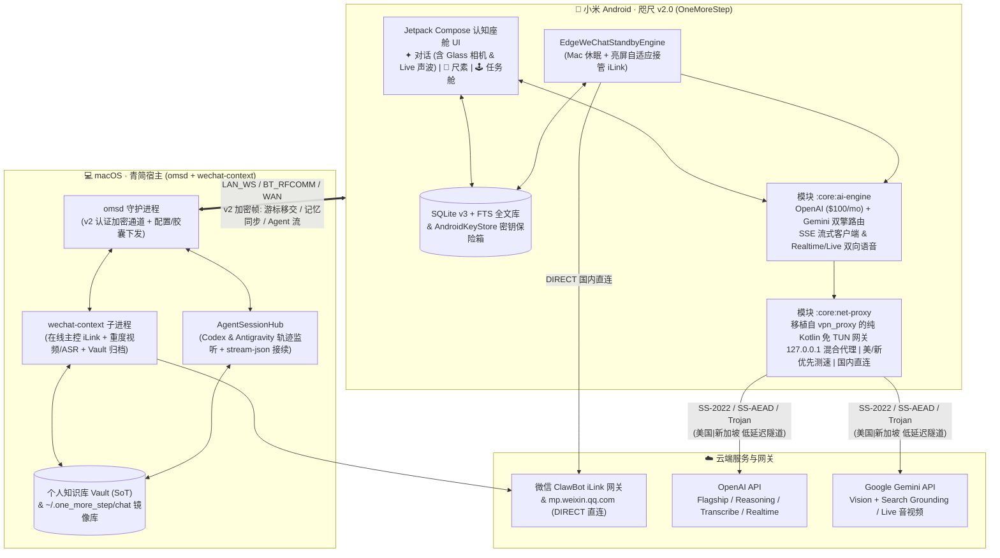

# 青简·咫尺 v2.0（随身认知座舱与双脑协同中枢）工程设计方案

日期：2026-11-20  
源码基线：`OneMoreStep v1.7.0`（`android-app` build 43/44 + `mac-host` + `wechat-context` + `shared-protocol`）  
参考工程：`/Users/dqrcsc/x_project/vpn`（`vpn_proxy` 纯用户态多订阅智能代理引擎）

---

## 1. 设计目标与体验红线

将手机端「咫尺（`com.oms.client`）」从单一的 **Mac 后台传输/遥控守护进程**，系统化升级为 **全天候独立的「随身第一现场认知座舱 & 前轻脑/后重脑协同中枢」**：

1. **早晚微信尺素零延迟不断档（保留现有微信转发习惯）**：当 Mac 合盖休眠且用户在手机亮屏刷微信转发公众号给「尺素」时，咫尺后台自动安全接管微信 iLink 轮询，国内直连抓取正文、经内置免 TUN 代理调用 **OpenAI 旗舰模型**（携带个人知识库上下文胶囊）完成初筛并直接回发微信聊天窗；Mac 唤醒重连后原子归档入库，零游标冲突、零重复分析。
2. **对标 ChatGPT / Gemini 官方 App 的丝滑日常主对话舱**：开屏 0 等待直达全能对话画布（亮屏预握手首字响应 `< 800ms`、120fps 块级增量流式 Markdown/代码/公式/思考折叠渲染、智能锚定滚动、HyperOS 线性马达微振、进电梯/锁屏不断流的后台乐观生成队列）。
3. **三级记忆漏斗反哺全局上下文（不污染知识库）**：移动端日常碎片对话 100% 落入本地与 Mac 镜像 SQLite 全文检索库（L0），后台空闲自动蒸馏高价值近期思考注入 `Context Capsule`（L1，反哺微信尺素与 Mac Agent），高光回复或博物卡片支持一键按个人知识库规范沉淀入 Vault（L2）。
4. **多模态行动与博物之眼（Google Glass 体验）**：对话输入栏左翼集成相机快拍与实时视觉流，调用 **Gemini Vision + Google Search Grounding** 生成结构化「🌿 博物图鉴卡」（植物/展品/元器件精准学名与易混特征辨析）或识别海报/截图一键写入小米原生日历（自动防冲突）与系统闹钟；右翼集成极速中英混排语音听写与 **OpenAI Realtime / Gemini Live** 散步免提音视频对谈。
5. **Mac 重脑任务舱（Codex & Antigravity 监控、派单与跨端接续）**：实时发现并流式监控 Mac 桌面或远程发起的 `codex` 与 `agy` 会话轨迹，支持从手机直接按 `session_id / conversation_id` 多轮接续（Resume）指令、将日常聊天一键升级为 Mac 重脑任务、以及高危操作内联审批。
6. **核心底座高内聚可复用**：将免系统 VPN 代理引擎（`:core:net-proxy`）与多模态流式/实时语音引擎（`:core:ai-engine`）拆分为零 UI 耦合的独立 Gradle 模块，未来新建独立「英语口语刻意练习 App」时可直接复用整套免梯网络与 OpenAI Realtime 双向语音底座。

---

## 2. 总体系统架构与多模块拓扑



### Android 工程 Gradle 模块划分（`android-app/settings.gradle.kts`）

| Gradle 模块 | 包命名空间 | 职责边界与复用性 |
| :--- | :--- | :--- |
| **`:core:net-proxy`** | `com.oms.core.proxy` | **纯 Kotlin 零 UI 依赖（可跨项目复用于独立英语 App）**：1:1 移植 `~/x_project/vpn/vpn_proxy`。内置纯 Kotlin `BLAKE3`、SS-2022（`SIP022` + `SIP023 EIH`）、SS-AEAD + `simple-obfs`、`Trojan` TLS、多源 `SUB_VPN_*` 聚合解析、穿透 `198.18.0.0/15` UDP 直连 DNS、`美国\|新加坡` 优先测速选路与熔断降级、`127.0.0.1:0` 进程内回环网关及亮屏 HTTP/2 TLS 连接预热池。 |
| **`:core:ai-engine`** | `com.oms.core.ai` | **纯 Kotlin 零业务 UI 依赖（可跨项目复用于独立英语 App）**：原生适配 OpenAI **Responses API (`/v1/responses`)**（`gpt-6.2-astra` / `gpt-6.2-sol` / `gpt-6.1-terra`）、流式听写（`gpt-live-transcribe` / `gpt-transcribe`）、实时语音（`gpt-realtime-2.1` / `gpt-live-1.1`），以及 Google Gemini 最新一代模型（`gemini-4-argon` / `gemini-3.8-flash` / `gemini-3.8-live` + `google_search` Grounding），内置 `Auto` 智能双擎路由器与动态模型发现（`GET /v1/models`）。 |
| **`:app`** | `com.oms.client` | 咫尺主应用：保留现有传输层、无障碍 GUI、短信 OTP、日历/闹钟/AirPods 能力，新增 `wechat/` 离线接管引擎、`memory/` 三级记忆同步器，并将原单文件 `MainActivity.kt` 重构为 `ui/shell`、`ui/chat`、`ui/reader`、`ui/agents`、`ui/markdown` 模块化 Compose 架构。 |

> [!TIP]
> **零 `.so` 体积膨胀优势**：由于 `android-app` 的 `minSdk = 30`（Android 11+），系统底层 Conscrypt 原生硬件加速支持 `AES/GCM/NoPadding` 与 `ChaCha20-Poly1305`，配合约 150 行纯 Kotlin 版 `BLAKE3` 密钥派生，即可实现满血 SS-2022 / SS-AEAD / Trojan 协议栈，不引入几十 MB 的 C++/Go 二进制库，也不占用系统唯一的 `VpnService` 槽位。

---

## 3. 核心子系统详细工程设计

### 3.1 `:core:net-proxy` 原生应用内代理与免墙引导机制

1. **防墙死双保险启动（Bootstrap Nodes Snapshot）**：
   - 痛点：国内蜂窝网络下，部分机场订阅链接本身（`SUB_VPN_*` URL）可能被墙或被 DNS 污染，导致手机端首次冷启动拉取不到节点。
   - 设计：Mac 端 `omsd` 在下发 `SUB_VPN_*` 原始订阅 URL 的同时，在 Mac 本地预解析出最新可用的节点列表快照（`bootstrapNodes[]`）一并经 v2 加密通道同步至手机 `AndroidKeyStore` 加密存储。手机端即使订阅源暂时不可达，也能 0ms 直接使用快照节点建连，随后通过已连通的代理隧道静默刷新订阅。
2. **分流规则（`RuleMatcher`）**：
   - 强制 `DIRECT`：`*.weixin.qq.com`、`*.qq.com`、`*.cn`、RFC1918 局域网段（保障微信 iLink 长轮询、公众号正文抓取及局域网 Mac 直连走最低延迟原生链路）；
   - 强制 `PROXY`（优先 `美国|新加坡` 梯队，延迟阈值 `4000ms`，超限自动降级香港/日本/全局最快健康节点）：`*.openai.com`、`*.googleapis.com`、`*.google.com`、`*.gstatic.com`、`*.openrouter.ai`。
3. **本机回环安全边界**：
   - `LoopbackMixedGateway` 严格绑定 `InetAddress.getByName("127.0.0.1")` 动态端口 `0`，并要求每次进程启动随机生成的 `Proxy-Authorization`（HTTP CONNECT）或 SOCKS5 用户名口令鉴权，严禁本机其他恶意第三方 App 蹭用咫尺本地代理端口。
4. **亮屏连接预热（`ScreenUnlockPrewarmer`）**：
   - 监听 `Intent.ACTION_USER_PRESENT`（用户解锁进入桌面），在 `3 分钟` 冷却期内最多触发一次后台异步探活：校验当前选中代理节点存活，并向 `https://api.openai.com` 与 `https://generativelanguage.googleapis.com` 预热 OkHttp HTTP/2 连接池，确保点开 App 发送首条消息时免除 TCP + Proxy + TLS 三重握手耗时，实现 `< 800ms` 首字响应（TTFT）。

---

### 3.2 微信尺素「零脑裂」主备接管与原子移交协议（保留现有微信习惯）

这是防止 Mac 与手机争抢微信 iLink 游标 `get_updates_buf` 和 `context_token` 的核心状态机设计：

#### A. 四态互斥租约状态机（防离家 5G 误判脑裂）

> [!IMPORTANT]
> **关键边界防护（5G 离家场景）**：当用户白天带着手机出门切到 5G 网络时，手机与家里 Mac 的局域网连接同样会变为 `DISCONNECTED`。如果家里 Mac 实际上**并未休眠**（仍在家里联网轮询 iLink），手机若贸然启动轮询就会造成双活脑裂！

因此，手机端 `EdgeWeChatStandbyEngine` 仅在确认 **Mac 确实未在轮询** 且 **用户可能正在操作微信** 时激活：

1. **`MAC_CONNECTED_IDLE`（Mac 在线主控态）**：
   - 只要 `OmsTransportClient` 处于已连接态（`LAN_WS` / `BT_RFCOMM` / `WAN`），手机立即取消任何在途 `getupdates` 请求；
   - Mac 每次推进 `clawbot_updates_buf` 或更新 `context_token` 时，通过 `wechat.cursor.checkpoint` 异步同步最新游标快照至手机。
2. **`MAC_SLEEP_CONFIRMED`（确认 Mac 休眠判定）** —— 满足以下任一条件即确认 Mac 未在轮询：
   - **条件 A（显式休眠通告）**：Mac 合盖/睡眠前，`omsd` 捕获 macOS `NSWorkspace.willSleepNotification`（或 `IOPMrootDomain` 睡眠事件），在暂停本地 `wechat-context` 轮询后向手机发出 `wechat.lease.grant_standby`（附最终 `updatesBuf`）；
   - **条件 B（同局域网不可达实证）**：手机当前连接的 Wi-Fi SSID 与上次成功连上 Mac 时的家庭/办公 Wi-Fi SSID 一致，且连续 `45 秒` 无法连通 Mac 局域网端口 `19527`（证明同网段内的 Mac 已休眠或关机）；
   - **条件 C（手动离家接管开关）**：用户在侧边栏显式开启「离家强制手机接管尺素」。
3. **`PHONE_ACTIVE_POLLING`（亮屏按需轮询态 · 零夜间待机耗电）**：
   - 在 `MAC_SLEEP_CONFIRMED` 前提下，**仅当 `screenInteractive == true`（手机亮屏使用中）或息屏后 `120 秒` 宽限窗口内**，启动 iLink `getupdates` 长轮询；深夜手机息屏静置时 **0 网络轮询、0 额外电量消耗**。
4. **`RECONNECT_HANDOFF`（重连原子移交态）**：
   - 一旦手机与 Mac 恢复连接：
     1. 手机立刻中止本地 iLink 轮询；
     2. Mac `omsd` 通知 `wechat-context` 挂起轮询锁（`POST /internal/standby/begin-handoff`）；
     3. 手机发送 `wechat.standby.handoff` 载荷（最新 `updatesBuf`、`contextToken`、手机已完成的 `processedArticles[]` 原文与伴读 Markdown、以及手机延迟处理的视频/重任务 `deferredMessages[]`）；
     4. `wechat-context` 在单一 SQLite 事务内更新游标、将已分析文章直接写入 Vault 并记为 `light_done`（绝不重复调模型、绝不重发微信回执），同时将 `deferredMessages[]` 投入本地收件箱立即补跑视频转写或 CLI 任务；
     5. Mac 返回 `handoff_ack`，恢复 Mac 主控轮询，手机将本地记录标为 `MERGED_TO_VAULT`。

#### B. 手机端分级分诊管线（L1 即时闭环 vs L2 晨间排队）

| 入站消息类型 | 手机端休眠接管动作 | 用户在微信「尺素」收到的即时反馈 |
| :--- | :--- | :--- |
| **微信公众号普通图文 / 常规网页**（占早晚阅读 85%+） | 国内直连 `mp.weixin.qq.com` 提取清洗 Markdown（必要时主线程外离屏 `WebView` 兜底动态渲染）➔ 注入本地缓存的 `ContextCapsule` ➔ 经 `:core:net-proxy` 调用 **OpenAI Responses API（默认主力 `gpt-6.2-sol` `effort="medium"`，复杂长文可升档 `gpt-6.2-astra`）** 按完整尺素统计契约生成 `wechat_reply` 与 `companion_note_markdown` | **10～18 秒内直接收到 450～650 字高质量初筛回复**（带 `📱 咫尺夜间直连初筛` 轻标识），同时进入咫尺 `📖 尺素` 随时精读/追问 |
| **“我有个想法：…” / 纯文字速记** | 幂等写入本地暂存队列，可选调用轻量整理 | 秒回「✅ 已由手机咫尺暂存，Mac 唤醒后自动归档入库」 |
| **抖音 / 小红书 / YouTube 视频 / 需调用本地 Codex/AGY 的重任务** | 原样保存原始 `ClawBotMessage` 进入 `deferredMessages` 队列（不丢消息、不瞎猜视频内容） | 秒回「🌙 Mac 当前休眠中，已为你锁定该视频/任务排入晨间队列，电脑唤醒后自动补齐转写并推送结果」 |

---

### 3.3 双擎智能模型路由（OpenAI GPT-6.2 系列 \$100/月额度 + Gemini 4 / 3.8 协同）

同步升级 Mac 端 `wechat-context/src/config.ts` 的旧版模型预设表，并在 `:core:ai-engine` 的 `DualLlmRouter` 中校准为最新一代模型矩阵（同时支持运行时 `GET /v1/models` 动态刷新，杜绝硬编码过时）：

| 引擎与具体模型 ID | 上下文与协议特性 | 承担的咫尺 v2.0 核心场景 |
| :--- | :--- | :--- |
| **`gpt-6.2-sol`**（OpenAI 日常主力） | ~1.05M 上下文 · `POST /v1/responses` · `reasoning.effort = "low" \| "medium"` | **早晚公众号尺素初筛主力**（`effort="medium"`）、日常通用对话默认高速高智商响应（`effort="low"`）、页内追问 |
| **`gpt-6.2-astra`**（OpenAI 顶级旗舰） | ~1.05M 上下文 · `POST /v1/responses` · `reasoning.effort = "high"` | 点亮输入框 **`💡 深度思考`** 时的复杂架构推演、代码疑难排查、跨文章深度思辨 |
| **`gpt-6.1-terra` / `gpt-6-luna`** | 高效视觉工具执行 / 极低成本批处理 | 工具辅助调用与后台 L1 记忆静默蒸馏 |
| **`gpt-realtime-2.1`**（及 `gpt-live-1.1`） | OpenAI Realtime API 端到端语音 + 可调推理强度 + 并行工具调用 | 输入框 **`🎧 Live` 散步纯语音深度对谈默认引擎**（含 `[🇬🇧 English Only]` 全英文流利度实战开关） |
| **`gpt-live-transcribe` / `gpt-transcribe`** | 超低延迟流式 ASR / 高精度录音转写 | 输入框 **`🎙️` 极速语音听写**（中英混排与技术专有名词精准上屏） |
| **`gemini-4-argon`**（Gemini 旗舰） | 1M 上下文 · Thinking (`low`/`medium`/`high`) · `Search grounding` · `Maps grounding` · `Structured outputs` | **博物之眼相机（`📷` 拍植物/昆虫/展品）**：多模态精析 + Google Search 交叉核验学名与辨识特征生成「🌿 博物图鉴卡」 |
| **`gemini-3.8-flash`**（Gemini 高速） | 极速多模态与 `google_search` Grounding | `Auto` 路由下的实时资讯、近期事实核查、快速识屏问答（渲染可点击网页来源胶囊） |
| **`gemini-3.8-live`**（Gemini Live GA） | 原生音视频流 `BidiGenerateContent` + **内置 `Search grounding` & `Thinking`** | **Live Glass 实时摄像头伴游**（1 fps `768px` 画面帧 + 双向语音流，边走边看边联网查证植物/展品） |

> [!WARNING]
> **GPT-6.2 Responses API 关键协议约束（编码强制遵守）**：
> 1. **禁止传 `reasoning.effort = "none"`**：`gpt-6.2-astra` 与 `gpt-6.2-sol` 均为原生推理模型，传 `"none"` 会被服务端直接拒绝，快速档统一传 `"low"`；
> 2. **`developer` 消息前置以命中 Prefix Cache**：GPT-6.2 的顶层 `instructions` 字段会被拼接在 `input` 之后；所有可复用的系统级规范必须作为 `input` 数组首元素 `{ role: "developer", content: ... }` 传入，且多轮对话严禁中途篡改历史前缀或降级切换模型，避免丢失推理状态（Reasoning Items）与缓存命中率；
> 3. **禁止对 GPT-6.2 传 `service_tier = "flex"`**（不支持 Flex，实时交互使用默认 Standard 或 Ultrafast）。

---

### 3.4 三级认知记忆漏斗与「按需上下文召回」

1. **SQLite v3 本地与镜像表结构（`android-app` & `~/.one_more_step/chat/mobile_chat.db`）**：
   - `chat_threads`: `thread_id TEXT PK`, `title TEXT`, `is_pinned INT`, `is_incognito INT`, `model_mode TEXT`, `created_at_ms INT`, `updated_at_ms INT`, `sync_seq INT`
   - `chat_messages`: `msg_id TEXT PK`, `thread_id TEXT`, `role TEXT`, `content_md TEXT`, `reasoning_md TEXT`, `model_used TEXT`, `grounding_json TEXT`, `attachments_json TEXT`, `action_cards_json TEXT`, `created_at_ms INT`, `sync_seq INT`
   - `field_guide_entries`: `entry_id TEXT PK`, `common_name TEXT`, `scientific_name TEXT`, `taxonomy TEXT`, `distinguishing_features_json TEXT`, `care_and_safety TEXT`, `cultural_notes TEXT`, `photo_local_uri TEXT`, `captured_at_ms INT`, `thread_id TEXT`, `vault_synced_path TEXT`
   - `working_memory_atoms`: `atom_id TEXT PK`, `category TEXT`, `summary TEXT`, `source_thread_id TEXT`, `updated_at_ms INT`
   - 全文索引：`chat_messages_fts`（优先 FTS5 `unicode61`，ROM 不支持时自动回退 FTS4），支持左滑抽屉 `< 15ms` 全局搜穿聊天记录、尺素伴读与博物图鉴。
2. **防干扰「按需召回」机制**：
   - 日常聊天默认 System Prompt 保持 `< 150 tokens` 纯净提示，不硬塞长篇知识库摘要；
   - 为模型注册本地函数工具 `search_my_context(query, scope: "all" | "vault_capsule" | "recent_chats" | "wechat_articles")`：仅当问题涉及“我们之前的观点 / 我的项目 / 我刚看的那篇文章”时，客户端本地毫秒级检索 `ContextCapsule`、近期对话与尺素库并回填结果给模型。
3. **L1 自动蒸馏与 L2 显式入库**：
   - **L1 静默蒸馏**：重连 Mac 或每日空闲时，对新增非无痕对话（`>= 4` 轮实质探讨）提取最多 3 条高价值认知增量更新至 `~/.one_more_step/chat/working_memory.json`，自动并入下一版 `ContextCapsule`；
   - **L2 一键入库**：消息长按菜单提供 `📚 提炼入个人知识库`，由 Mac 侧按 `personal-knowledge-base` 目录与 Frontmatter 规范写入 `01_inputs/`（严格遵守不覆盖已有笔记铁律）。

---

### 3.5 对标官方级丝滑度的 Compose 前端交互架构

将原 1858 行单文件 [MainActivity.kt](file:///Users/dqrcsc/x_project/one_more_step/android-app/app/src/main/java/com/oms/client/ui/MainActivity.kt) 拆解为清爽的 **三段式顶栏工作区 + 侧滑历史抽屉**：

```text
┌─────────────────────────────────────────────────────────────────┐
│ [☰]   [ ✦ 对话  |  📖 尺素  |  🕹️ 任务舱 ]        [🟢 双脑·138ms] │
├─────────────────────────────────────────────────────────────────┤
│                        （当前工作区主画布）                       │
│                                                                 │
│  • ✦ 对话：120fps 增量流式对话流 + 思考折叠胶囊 + 来源引用角标     │
│            内联卡片：🌿博物图鉴卡 / 📅防冲突日历卡 / ⏰闹钟卡      │
│            气泡快捷栏：[复制] [🔊朗读] [📚入库] [🚀转交Mac执行]   │
│                                                                 │
│  • 📖 尺素：分段精读视图（脱水干货/观点碰撞/验证契约/原文）        │
│            底部页内追问框 + 顶部/底部 AirPods 通勤未读联播条       │
│                                                                 │
│  • 🕹️ 任务舱：Mac Codex & AGY 活跃/历史会话流、实时工具调用步骤    │
│              文件变更摘要、内联高危审批卡、底部直接输入 Resume 接续│
├─────────────────────────────────────────────────────────────────┤
│  [📷 识物] [📎]  [ 问任何问题，或语音/拍照…  💡思考 ] [🎙️] [🎧Live] │
└─────────────────────────────────────────────────────────────────┘
```

**丝滑度关键工程保障**：
1. **块级增量 AST 渲染器（`IncrementalMarkdownView`）**：流式输出按空行/围栏切分为不可变历史块（`key = blockIndex`，零重复重组）与单一可变尾部块（`24ms` 帧对齐缓冲合并更新），代码块独立横向滚动 + 语法着色 + 一键复制。
2. **物理锚定滚动（`SmartChatScrollState`）**：用户新消息发出时平滑锚定至视口顶部；一旦检测到 `isScrollInProgress` 用户上滑手势，立即解除自动贴底并淡入悬浮 `↓` 按钮。
3. **后台保活生成（`BackgroundTurnExecutor`）**：对话请求托管于 `OmsCoreForegroundService` 的协程作用域而非 `ViewModel` 生命周期——用户点发送后立刻锁屏、切微信或进电梯断网 20 秒，后台自动完成重连或流式落库，绝不因切换界面丢失回复。
4. **细腻触感（`OmsHaptics`）**：在首 Token 到达、思考折叠完成、录音启停、卡片操作成功时触发轻量级 `CLOCK_TICK` / `CONFIRM` 线性马达反馈。

---

### 3.6 `🕹️ 任务舱`：Mac Codex & Antigravity 全局监控与会话接续

在 `mac-host/src/daemon/` 下新增 `agent-session-hub.ts`，与现有 `omsd` 加密通道集成：

1. **桌面与远程全量会话实时发现**：
   - **Codex 监听**：监听 `~/.codex/sessions/YYYY/MM/DD/rollout-*.jsonl` 文件变更，提取 `session_id`、工作目录 `cwd`、最新指令、正在执行的命令/文件编辑与状态（`running` / `idle` / `error`）；
   - **Antigravity (`agy`) 监听**：监听 `~/.gemini/antigravity/brain/*/.system_generated/logs/transcript.jsonl`，解析 `conversation_id`、`USER_INPUT`、`PLANNER_RESPONSE`、`tool_calls` 摘要及 `DONE` / `ERROR` 状态。
2. **新建派单与跨端无缝接续（Resume）**：
   - **新建任务（`agent.session.start`）**：手机端选择工作区（自动扫描 `~/x_project/*` 常用仓库与个人知识库目录）与后端（`codex` 或 `agy`）：
     - Codex：`codex exec --json -C <cwd> ... "<prompt>"`
     - Antigravity：`agy --print "<prompt>" --output-format stream-json --add-dir <cwd> ...`
   - **原会话多轮接续（`agent.session.resume`）**：无论该会话最初是在 Mac 桌面开启还是手机开启，手机端输入追问指令后直接调用原生续跑命令：
     - Codex：`codex exec resume <session_id> --json "<follow-up>"`
     - Antigravity：`agy --conversation <conversation_id> --print "<follow-up>" --output-format stream-json`
   - **流式进度推送**：`omsd` 将 NDJSON / `stream-json` 事件节流聚合（每 `300ms` 或阶段跃迁时）通过 `agent.session.event` 推至手机任务舱实时刷新，无需轮询。

---

## 4. 安全、隐私与可靠性红线

1. **凭据零明文落地**：`SUB_VPN_*` 订阅链接、节点密码、`OPENAI_API_KEY`、`GEMINI_API_KEY`、微信 `botToken` 在手机端一律经 `AndroidKeyStore`（`AES/GCM/NoPadding` 256-bit 硬件绑定密钥）加密存储；日志、诊断报告与异常堆栈对所有 URL Token、API Key、节点 IP 严格脱敏（延续 `vpn_proxy` `ProxyNode.__repr__` 脱敏准则）。
2. **文件与知识库铁律保留**：手机离线初筛移交 Mac 落盘时，严格复用 `wechat-context` 现有的文件保护契约——已有人工笔记、`deep/synthesis` 笔记绝不覆盖；采集质量标签（`extractionQuality`）与统计验证契约（`validation_contract`）100% 保持一致。
3. **本机安全回环**：手机端 `127.0.0.1` 代理端口携带进程级随机鉴权口令；Mac 端新增的 `/internal/standby/*` 与 Agent 接口继续严格受 `127.0.0.1` 回环与同源守卫保护。

---

## 5. 四阶段分步实施与验收计划（Milestones）

为保证你手头正在日常使用的 `OneMoreStep v1.7.0` 平滑演进、每一步交付即可真机实测收益，按以下 **4 个独立可验收里程碑** 推进：

### Milestone 1（M1）：原生免 VPN 隧道底座 + 双擎客户端 + 早晚尺素休眠自动接管
- **工程范围**：
  1. 搭建 `:core:net-proxy`（移植 `BLAKE3`、SS-2022、SS-AEAD + `simple-obfs`、Trojan、`SUB_VPN_*` 聚合解析、穿透 Fake-IP DNS、`美国|新加坡` 选路器、回环鉴权网关、亮屏预热池）与 `:core:ai-engine` 基础流式客户端；
  2. 在 `shared-protocol` 与 `mac-host` 实现 `edge.config.sync`（含 `bootstrapNodes` 快照）、`edge.context_capsule.sync`、Mac 睡眠监听与 `wechat.standby.handoff` 原子入库接口；
  3. 在 `:app` 实现 `EdgeWeChatStandbyEngine`（四态防脑裂租约 + 公众号抓取 + OpenAI 旗舰模型初筛 + 微信 iLink 回发）。
- **验收标准**：
  - 单元测试覆盖 SS-2022/SS-AEAD/Trojan 握手加解密、地区选路降级、iLink 游标主备切换与幂等移交（不污染真实配对与知识库）；
  - 真机关闭所有系统 VPN 软件，合上 Mac 休眠，点亮小米手机在微信转发公众号给「尺素」，15 秒内微信收到完整观点碰撞初筛；打开 Mac 后自动无感落盘至知识库且不重复发消息。

### Milestone 2（M2）：咫尺 v2.0 座舱主屏重构 + 丝滑通用对话 + 三级记忆漏斗
- **工程范围**：
  1. 重构 `MainActivity` 为 `✦ 对话 | 📖 尺素 | 🕹️ 任务舱` 三工作区 + 左滑全局搜索/历史抽屉，收拢运维诊断至状态胶囊抽屉；
  2. 实现 120fps `IncrementalMarkdownView`（代码块、表格、公式、思考折叠、来源引用胶囊）、智能锚定滚动、线性马达微振、`Auto` 智能双擎路由（`gpt-6.2-sol` / `gpt-6.2-astra` + `gemini-3.8-flash` / `gemini-4-argon`）、`gpt-live-transcribe` 极速听写、后台断网保活生成；
  3. 落地内联系统动作卡片（防冲突日历卡、原生闹钟卡）、L0/L1/L2 三级记忆同步与 `search_my_context` 按需召回，并升级 `📖 尺素` 分段伴读器、页内追问与 AirPods 通勤联播条。
- **验收标准**：开屏 `< 150ms` 进入对话页，亮屏首问 TTFT `< 800ms`，长文流式生成滑动零掉帧，锁屏/切后台生成不中断，跨端记忆检索准确。

### Milestone 3（M3）：`🕹️ 任务舱` —— Mac Codex & Antigravity 实时监控、派单与跨端接续
- **工程范围**：
  1. 在 `mac-host` 实现 `AgentSessionHub`（`~/.codex/sessions` 与 `~/.gemini/antigravity/brain` 实时监听、`codex exec --json` / `agy --output-format stream-json` 执行器、`resume` / `--conversation` 多轮续跑）；
  2. 完成手机端 `🕹️ 任务舱` 会话卡片流、实时工具步骤流、文件变更摘要、内联高危审批，以及从 `✦ 对话` 气泡一键 `[🚀 转交 Mac 执行]`。
- **验收标准**：在桌面开启的 Codex / AGY 会话可在手机实时看到步骤更新，并在手机端直接追加指令原会话续跑成功。

### Milestone 4（M4）：博物之眼 Google Glass 镜头 + OpenAI Realtime / Gemini Live 音视频舱
- **工程范围**：
  1. 集成 CameraX 快拍与 Gemini Vision + Google Search Grounding 结构化「🌿 博物图鉴卡」及本地/Vault 图鉴收藏册；
  2. 在 `:core:ai-engine` 完成 `RealtimeVoiceEngine`（OpenAI Realtime 双向低延迟语音 + `[🇬🇧 English Only]` 开关 + Gemini Live 1fps 实时视觉问答 + AirPods 自动路由），挂断自动沉淀对话纪要卡。
- **验收标准**：户外拍植物 3 秒出准确科属与辨识特征图鉴卡；戴 AirPods 散步开启 Live 对谈支持自然打断且模块可直接供未来独立英语口语 App 引用构建。
