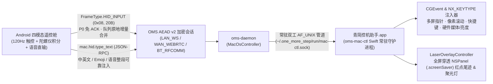

# 青简 (OneMoreStep) 全场景 Mac 多模态遥控舱与体感激光笔设计文档

- **日期**：2026-11-28
- **状态**：已评审定稿 (Approved)
- **适用范围**：`shared-protocol` · `mac-host` (`oms-daemon` + `oms-mac-ctl`) · `android-app` (`MacRemoteControlModal` 及触控/传感器控制器)

---

## 1. 背景与设计目标

现有 `MacRemoteControlModal` 与 `MacOsController` 完成了离散系统控制底座（唤醒亮屏、钥匙串远程解锁、立即锁屏、防休眠驻守、音量调节、应用搜索与启停），但尚未覆盖高频连续交互能力，用户仍无法脱离物理触摸板与键盘。

本次升级旨在将手机打造为**「眼看电脑大屏、手盲操手机」的 120Hz 全场景多模态触觉遥控器与体感激光笔**：

1. **媲美 Magic Trackpad 的高刷盲操触控板**：单指非线性加速精准控光标、双击按住拖拽/独立拖拽锁、双指轻点右键、双指像素级平滑惯性滚动、双指捏合缩放、三指调度中心（Mission Control）与全屏桌面空间（Spaces）左右切换。
2. **体感飞鼠与全屏穿透激光笔/聚光灯（Air Wand & Laser Spotlight）**：采用人体工学「按住拇指扳机键即指即动、松手即定格、随按自动归零防漂移（支持双击常驻锁）」的交互模型；在 Mac 屏幕原生渲染 **原生飞鼠光标 / 红点拖尾激光笔 / 聚光灯暗角高亮** 三种效果，穿透全屏 Keynote/PPT/浏览器演示空间。
3. **彻底脱离物理键盘的文字/语音直输与快捷键排**：支持手机输入法中英文/符号/Emoji 无损 Unicode 直注 Mac 光标处、**按住说话语音转文字直输 Mac（可选自动附带回车）**，以及高频盲操快捷键排与**手机侧边物理音量键场景化联动**（日常调 Mac 音量，激光演示页充当上下翻页键）。
4. **零新增 TCC 录屏权限、零新增防火墙端口**：完全复用现有 AEAD v2 双向认证加密链路（`LAN_WS` / `WAN_WEBRTC` / `BT_RFCOMM`）与已授权辅助功能权限的 `~/Applications/青简控机助手.app` (`oms-mac-ctl`)。

---

## 2. 方案比选与选型结论

| 维度 | **方案 A（选定）：加密通道紧凑二进制帧 `0x08` + 常驻 Swift 原生引擎** | 方案 B：局域网独立 UDP 快车道 + JSON-RPC 双轨 | 方案 C：纯 JSON-RPC 单向 Notification |
| :--- | :--- | :--- | :--- |
| **单帧开销** | **20 Bytes**（8B OMS 头 + 12B 定长二进制载荷），零 JSON 解析 GC | 约 28~40 Bytes（需独立防重放序号与 AEAD 头） | 约 100~140 Bytes UTF-8 JSON |
| **全链路连通性** | **LAN / WAN / BLE 全通**，自动按链路合批 | 跨网与蓝牙不通，需维护两套传输栈 | 全通，但 BLE 低 MTU 下易积压粘滞 |
| **系统权限与弹窗** | **零新端口、零 macOS 防火墙弹窗、零录屏权限** | 新监听 UDP 端口易触发系统防火墙拦截弹窗 | 零新端口 |
| **Mac 注入延迟** | 常驻 `AF_UNIX` 流 + 原生 `CGEvent`/`NX_KEYTYPE`，`<0.2ms` | `<0.2ms` | 若沿用短连或 `osascript` 则高达 `20~120ms` |

**选型结论**：采用 **方案 A**，兼顾微秒级原生响应、全链路安全加密与最小系统侵入性。

---

## 3. 系统架构与数据流

---

## 4. 协议规格设计

### 4.1 二进制高频输入帧 (`FrameType.HID_INPUT = 0x08`)

- **优先级调度**：在 `PriorityFrameQueue` 中归入 `FramePriority.P0_URGENT_CONTROL`，永不被大文件分片（`P2_BULK_DATA`）阻塞。
- **12 字节定长 Big-Endian 载荷结构**：

| 字节偏移 | 字段 | 类型 | 说明 |
| :--- | :--- | :--- | :--- |
| `0` | `opcode` | `uint8` | 动作码（见下表） |
| `1` | `modsOrBtn` | `uint8` | 鼠标按键标识或键盘修饰键位掩码（`bit0:⌘`, `bit1:⇧`, `bit2:⌥`, `bit3:⌃`） |
| `2..3` | `dx` | `int16` | X 轴增量（`0.25px` 定点数，即 `raw = round(px * 4)`，范围 `±8191.75px`）或虚拟键码 `keyCode` |
| `4..5` | `dy` | `int16` | Y 轴增量（`0.25px` 定点数）或辅助参数 |
| `6..7` | `aux` | `int16` | 聚光灯半径 `px` / 滚动阶段 `scrollPhase` / 缩放增量 |
| `8..9` | `seq` | `uint16` | 循环递增包序号（用于诊断与乱序保护） |
| `10..11` | `flags` | `uint16` | 标志位（`bit0: momentum/惯性帧`, `bit1: keepalive/激光保活`, `bit2: naturalScroll`） |

- **`HidOpcode` 枚举定义**：
  - `0x01 POINTER_MOVE_REL`：相对移动鼠标光标（若当前处于左键按下/拖拽锁态，自动发 `leftMouseDragged`）。
  - `0x02 MOUSE_BUTTON`：`modsOrBtn` 区分左(`1`)/右(`2`)/中(`3`)键，`dx` 区分 `CLICK(1)` / `DOUBLE_CLICK(2)` / `DOWN(3)` / `UP(4)` / `DRAG_LOCK_TOGGLE(5)`。
  - `0x03 SCROLL_PIXEL`：双轴像素级平滑滚动（`dx`, `dy` 为像素滚轮量，`aux` 标识 `began/changed/ended/momentum` 阶段）。
  - `0x04 KEY_TAP`：敲击单个 `CGKeyCode`（`dx = keyCode`, `modsOrBtn = 修饰键掩码`，覆盖方向键、`Esc`、`Tab`、`Return`、`Delete`、`Space`、`⌘C/V/X/Z/W/Q/Space/Tab`、桌面空间切换 `⌃←/⌃→`、调度中心 `⌃↑`、缩放 `⌘+/⌘-`）。
  - `0x05 SYSTEM_DEFINED_KEY`：触发 macOS `NX_KEYTYPE_*` 硬件媒体与亮度键（`SOUND_UP`, `SOUND_DOWN`, `MUTE`, `PLAY`, `NEXT`, `PREVIOUS`, `BRIGHTNESS_UP`, `BRIGHTNESS_DOWN`）。
  - `0x06 LASER_STATE_AND_DELTA`：激光笔/聚光灯控制（`modsOrBtn`: `0=OFF`, `1=RED_LASER`, `2=SPOTLIGHT`；`dx, dy` 为相对位移增量；`aux` 为聚光灯半径，默认 `140px`）。
  - `0x0F RESET_HID_STATE`：立即释放所有挂起按键、拖拽锁并淡出激光/聚光灯遮罩。

### 4.2 原地增量合批策略（In-Queue Delta Coalescing）

为确保在 `BT_RFCOMM`（BLE 低带宽）与 `WAN_WEBRTC` 抖动环境下零粘滞：
- 发送端维护专用轻量节流发送器 `MacHidDispatcher`：
  - `LAN_WS`：按最高 `120Hz`（`8ms` 帧对齐）刷出；
  - `WAN_WEBRTC`：按 `60Hz`（`16ms`）合并刷出；
  - `BT_RFCOMM`：按 `30Hz`（`33ms`）合并刷出，且当 BLE 写队列中存在尚未发出的同 `opcode` 连续位移帧（`POINTER_MOVE_REL`、`SCROLL_PIXEL`、`LASER_STATE_AND_DELTA` 且模式未变）时，直接在队尾原地将 `dx/dy` 饱和累加（钳制在 `int16` 范围内），**遇到任何点击或按键帧（Barrier）时严禁跨屏障合并**，保证“移到目标位置再点击”绝对精准。

### 4.3 可靠文本直输 JSON-RPC (`mac.hid.type_text`)

- 参数：`{ text: string, submitReturn?: boolean }`
- 行为：在已认证且 Mac 未锁屏状态下，将任意长度 UTF-8 字符串按每段最多 16 个 UTF-16 code units 注入 `CGEvent.keyboardSetUnicodeString`，若 `submitReturn == true` 则末尾追加一次 `Return (keyCode 36)`。

---

## 5. Mac 端原生引擎设计 (`oms-mac-ctl` & `MacOsController`)

### 5.1 常驻长连接 Unix Socket 管道

- `oms-mac-ctl --daemon <sockPath>` 在兼容原有短连接请求的同时，支持**同一连接多行持续流式 NDJSON 指令**（每行一条指令，高频 `hid` 指令可标记 `"noreply": true` 免回写以省去半双工等待）。
- `MacOsController` 新增 `PersistentHelperClient`：维护一条长驻 `net.Socket` 连接，首次发送或断开后自动拉起 `~/Applications/青简控机助手.app` 重建长连。

### 5.2 多显示器高精度光标与原生系统键

- **浮点虚拟坐标累加器**：`oms-mac-ctl` 读取当前鼠标真实位置初始化浮点坐标 `(cursorX, cursorY)`，每次叠加 `dx * 0.25, dy * 0.25`，有效避免整数截断导致慢速微移“动不了”的问题。
- **多屏桌面联合边界钳制**：查询 `NSScreen.screens`（转换为 CoreGraphics 左上角原点全局坐标），若目标点落在任一显示屏内则直接放行；若越出屏幕边缘，则钳制到最近显示屏边界内，支持多显示器无缝跨屏。
- **硬件系统键 (`postSystemDefinedKey`)**：使用 `NSEvent.otherEvent(with: .systemDefined, location: .zero, modifierFlags: ..., subtype: 8, data1: (keyType << 16) | (down ? 0x0a00 : 0x0b00), data2: -1)?.cgEvent?.post(tap: .cghidEventTap)`，原生唤起 macOS 音量/亮度圆角 HUD 并精准控制全系统当前活跃音视频源（包括浏览器 B 站/YouTube、Music、Spotify、IINA）。

### 5.3 全屏穿透激光笔与聚光灯渲染器 (`LaserOverlayController`)

- **窗口属性**：在主线程为每个 `NSScreen` 创建无边框透明 `NSPanel`（样式 `.borderless | .nonactivatingPanel`）：
  - `level = .screenSaver`（高于全屏应用与菜单栏）
  - `backgroundColor = .clear`、`isOpaque = false`、`hasShadow = false`
  - `ignoresMouseEvents = true`（点击 100% 穿透）
  - `collectionBehavior = [.canJoinAllSpaces, .fullScreenAuxiliary, .stationary, .ignoresCycle]`
- **渲染细节**：
  - **红点激光模式 (`RED_LASER`)**：保留最近 `180ms` 内的轨迹采样队列，绘制渐隐发光红色尾迹曲线 + 外圈柔和红色光晕 + 中心高亮白芯红点。
  - **聚光灯模式 (`SPOTLIGHT`)**：全屏绘制 `rgba(0,0,0,0.58)` 暗化层，以光标为中心按 `even-odd` 规则挖出半径 `R`（默认 `140pt`，可调 `80~280pt`）的高亮视窗，边缘配柔和发光描边。
  - **1.8s 看门狗防卡死**：每次收到激光更新或保活帧刷新截止时间；超过 `1.8s` 未收到更新，自动在 `180ms` 内动画淡出并隐藏覆盖窗口，停止渲染定时器以保持 **0% 空闲 CPU 占用**。

---

## 6. Android 端四模态交互与体感算法设计

### 6.1 模块拆分（保持高内聚、易测试）

避免单文件膨胀，将新增遥控能力拆分为独立清晰的组件：
1. `android-app/.../cockpit/MacHidProtocolAndCoalescer.kt`：`0x08` 二进制帧编码、定点数换算、多链路自适应节流与队列原地合批器（纯算法可单测）。
2. `android-app/.../cockpit/MacMotionAndTrackpadEngine.kt`：
   - **触控板指针加速曲线**：`gain(v) = clamp(base + k * v^1.35, minGain, maxGain)`，兼顾慢速像素级微操与快速甩动跨屏；
   - **物理惯性滚动器（Fling Scroller）**：双指抬起时根据末速度按指数衰减（摩擦系数 `0.92/frame`）投递 `momentum` 像素滚动帧，手指再次触碰触控板瞬间刹停；
   - **体感飞鼠陀螺仪积分器**：监听 `Sensor.TYPE_GAME_ROTATION_VECTOR`（`SENSOR_DELAY_GAME`），按下扳机瞬间记录基准四元数/姿态，提取手机偏航角速度（Yaw $\omega_z$ -> 水平 $dx$）与俯仰角速度（Pitch $\omega_x$ -> 垂直 $dy$），经过微抖动死区平滑滤波（Deadzone `0.018 rad/s` 防手部生理微颤）后映射为丝滑屏幕位移。
3. `android-app/.../ui/cockpit/MacRemoteControlModal.kt`（及子视图组件）：
   - 顶部状态栏（连接链路徽章、当前前台 Mac 应用名、锁屏态一键秒解横幅、钥匙串配置入口）；
   - 四段模式切换栏：**`触控板` · `激光飞鼠` · `键盘语音` · `系统应用`**；
   - 窗口级 `onPreviewKeyEvent` 拦截 `KEYCODE_VOLUME_UP / KEYCODE_VOLUME_DOWN`：激光飞鼠页触发上下翻页（`Right / Left Arrow`），其余页触发 Mac 原生硬件音量加减，配合清脆线性马达刻度震动。

---

## 7. 安全防呆、错误处理与验证计划

1. **安全边界**：
   - `HID_INPUT (0x08)` 与 `mac.hid.type_text` 仅处理通过 AEAD v2 双向鉴权的会话帧；未鉴权连接直接丢弃。
   - 当 `isScreenLocked() == true` 时，拒绝 `mac.hid.type_text` 与普通按键盲注，避免密码框误输入锁死账户，UI 自动引导用户点击受保护的「远程解锁」。
2. **状态自清理（`RESET_HID_STATE`）**：
   - Android 端 `DisposableEffect(onDispose)`、模式切换、以及 Mac 端 `oms-daemon` 检测到对端连接断开时，均立即触发 `RESET_HID_STATE`，释放所有拖拽按键、修饰键并关闭激光/聚光灯窗口。
3. **自动化测试矩阵**：
   - `shared-protocol/tests/hid-protocol.test.ts`：验证 `0x08` 帧编解码、定点数精度与边界裁剪、`P0` 优先级队列行为。
   - `android-app/app/src/test/.../MacHidAndMotionTest.kt`：验证队列原地合批（含点击屏障保序）、指针加速曲线、陀螺仪生理微颤死区滤波与惯性滚动刹停逻辑。
   - `mac-host/tests/mac-hid-control.test.ts`：验证鉴权边界、锁屏拦截、断连自动 `reset_hid_state` 及 `mac.hid.type_text` 路由。
   - 原生构建校验：`swiftc` 编译 `mac-host/bin/oms-mac-ctl` 零错误、`./gradlew testDebugUnitTest assembleDebug` 与 `bun test` 全绿通过。
